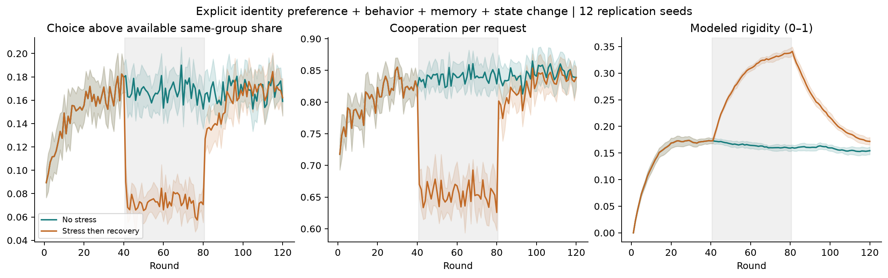

# Nous Volition · Streams and Rocks

**[Source-chain audit and repairs](studies/community-chain-audit/README.md).** Rechecked the full corrected corpus, all 37 PDF pages, eight Miro boards and the study dependency chain. Reproduced 443 existing unit tests, reran saved-result checks and the latest workbook analysis, and ran 18 new full-field numerical fixtures. Corrections expose initial-history resets, uncalibrated observation maps, form-definition drift and errors in Miro forgetting proposals. The exact corpus equations are retained; a full empirical two-in-one validation remains open. Coverage limits and all failed audit attempts are recorded.

**Large numerical data:** [verified release downloads and restore instructions](DATA-RELEASES.md). Reports and figures remain available here.

This repository, **Streams and Rocks**, preserves the original stream-function report, physical-fluid experiments and separate social-organization studies.

## Real data for the community connections

**[New measured inner-experience data](studies/community-measured-inner-experience/README.md).** Recomputed within-person contrasts from 31 people and audited 3,108 valid idea responses linked to 350 people. The corrected corpus and Miro links are preserved. These records do not yet identify Smoke, Clay, idea forms and personal history sufficiently for a full empirical field test; no substitute predictor was fitted.

**[Real observations connected to the two-in-one field](studies/community-observation-bridge/README.md).** Five real inward-experience episodes are explicitly connected to Smoke, Clay, the moving idea and their person's history, using the corrected corpus and live Miro frames. The unchanged full coupled field solver completed 75 main runs and three exploratory refinements. Different assumed histories satisfy the same report-derived constraints yet yield opposite later support contrasts; finer grids and a stricter directional interpretation preserve the ambiguity. Includes the observation graph, every added measurement assumption, source hashes, all numerical states, eight unit tests and 42 saved/source checks. This is a conditional compatibility test, not a forecast of measured human outcomes or full empirical validation.

**[Original inner-experience records for the full two-in-one](studies/community-two-in-one-application/primary_records/README.md).** New source audit: 39 indexed samples from one person (37 after training), five fully reviewed transcript episodes, and a separate workbook of 66 questionnaire records from 23 people. The records describe inward speaking/hearing, reconsideration, changing imagery and personal-history references. Exact corpus equations and Miro connections are retained. These are component observations, not a full-model predictive validation; no simpler predictor or invented score is substituted.

**[History and form tests for the two-in-one](studies/community-two-in-one-application/README.md).** Adds separate person-state/history records around the unchanged corpus solver, 48 coupled synthetic trials, and an audit of 840 real thought probes from 24 people. The [corrected corpus and live Miro review](studies/community-two-in-one-application/MIRO_CONNECTIONS.md) adds 12 mirrored-field runs: opposite signed states can yield identical movement. Input order still matters, while role labels alone do not change the equations. The author's D₂O meaning asks whether a small compositional change can have a large consequence. Fourteen unit tests, 89 original saved checks and 69 Miro-derived checks pass locally. The full empirical two-in-one application remains unfinished; no simpler predictor or movement-only fit is substituted.

**[Exact corpus equations and the two-in-one data audit](studies/community-two-in-one-field/README.md).** The complete coupled field equations were checked in 18 numerical trials, with 12 unit tests and 272 saved-result checks. A new public source contains 6,434 annotated thoughts from 118 people. No simpler predictor was substituted. A full empirical fit remains unresolved because the corpus-to-observation links for the inward roles, utility and idea forms have not yet been specified; the report records the precise missing connections and a structural parameter ambiguity.

**[One person and a moving idea](studies/community-two-in-one/README.md).** Smoke and Clay are inward speaking and listening within one person’s two-in-one, shaped by their own history. Wind, Fog, Water and Mist describe the moving idea itself; Water represents perceived balance, and the other water form is heavy water D₂O. Includes an editable SciSpace-assisted testing document, public inner-dialogue and autobiographical-memory probes, recording forms and exact-corpus fidelity requirements. Personal-history prediction error is 0.2134 versus 0.2567 for a population estimate; older memories have more counted content in 31.25% of within-person pairs on average. These limited findings do not validate the full inner field.

**[New reference, expression and interaction measurements](studies/community-reference-field/README.md).** OneCommon provides wording, human reference interpretations, spatial object positions and actual message times. The exact coupled corpus equations are tested under an explicit reference-field mapping, using 64 training and 64 reserved scenario episodes. Spatial MSE is 11.771 versus 12.913 for the last observed field, with uncertainty that includes no advantage; removing the added force gives 11.775. The force and accumulated source have not demonstrated a predictive benefit. Includes 1,160 episode integrations, 12 unit tests, 2,851 saved-result checks and all numerical predictions. Reference is a measured component of meaning, not a measurement of all intent or social utility.

**[Full coupled corpus field: real-record conditional test](studies/community-full-field/README.md).** Runs the supplied momentum, incompressibility, field-transport and accumulated-source equations together. Under an explicit proposed correctness mapping, evaluation MSE is 0.1403 versus 0.1043 for the last-answer control across 455 submissions in 127 groups. The failed mapping and lack of spatial identifiability are retained. Includes 25 spatial runs, all three activation laws, 17 unit tests, 3,122 saved-result checks and every prediction. This is a retrospective internal split of previously used records, not full empirical validation of human field dynamics.

**[Your corrected corpus equations and real uptake records](studies/community-mimesis/README.md).** Audits which earlier equations were added, implements the supplied accumulation and distinct threshold laws, and verifies them with 37 unit tests and 87 saved-result checks. In 162 observed candidate answer-uptake changes, 62 become correct, 8 become incorrect and 92 stay incorrect. Among 2,259 matched forum pairs, the primary phrase-reuse difference before later attack removal is +2.30 percentage points [−0.49, +5.16]; mirrored rivalry and causal copying remain unestablished. Includes frozen functional reviews, complete assumptions and the [equation-by-equation corpus audit](studies/community-mimesis/CORPUS_AUDIT.md). No social coordinates, utility values or penalty-memory law were silently substituted for the corpus.

**[Meaning-preserving wording and repeat-penalty controls: completed public-record tests](studies/community-record-tests/README.md).** Forty German comment pairs were reviewed with recorded statuses hidden: eight provisionally preserve meaning, 21 change it and 11 remain uncertain. Three of the eight have different actual moderation statuses, including two of five lexical changes; 193 of 353 identical-text controls also differ, so a wording-caused effect is not identified. In Wikipedia records, 517 of 591 finite second blocks are longer with the same recorded reason and moderator; the median paired ratio is 3.5. Includes every audit judgment, source hashes, timing sensitivities, 23 unit tests, 189 reproduced-result checks and the [updated community connections](studies/community-power/CONNECTIONS.md). These are historical records and observed associations, not estimates of a causal memory rule.

**[Actual moderation decisions and successive penalties](studies/community-moderation/README.md).** In 8,687 paired finite Wikipedia blocks, the second assignment was longer in 81.8%; median assignments rose from 24 to 72 hours. This is observed escalation among accounts blocked again, not a causal memory effect for the same conduct. A Reddit audit finds substantive meaning changes in all 12 closest topic pairs reviewed, leaving the wording-only effect open. Includes reproducible public-data analyses, 19 unit tests, 27 saved-data checks and explicit missing-outcome accounting. The [community connections](studies/community-power/CONNECTIONS.md) show what the findings support and what still needs testing.

**[Wording, meaning and later recognition: completed real-data checks](studies/community-real-data/README.md).** Of 30,072 changed wording pairs, 4,544 failed the source’s content-match check; a documented assistant audit flags additional semantic changes. A selected 941-pair comparison shows changes in human offensiveness judgments, with limited coverage and no moderation-outcome claim. A separate randomized Wikipedia study shows later awards for 12/100 initially awarded contributors versus 2/100 controls (+10 percentage points; 95% interval +2.9 to +17.9). Includes reproducible analysis, source hashes, figures, 13 unit tests and 19 saved-data checks. The [community model](studies/community-power/CONNECTIONS.md) distinguishes these results from open questions about intent, actual penalties and memory mechanisms.

## Measured pile-driving predictions

**[Local soil and depth history: training-only model selection](studies/isfog-local-history/README.md).** Compares 33 candidates using only the 87 training piles, with nested whole-pile validation, then freezes the selected model before checking all seven previously inspected excluded piles. The combined model reduces pooled MAE from 13.91 to 12.42 blows/m and RMSE from 18.10 to 17.05, but local soil alone is slightly better on these seven. EL worsens and remains a clear failure. Includes every pile, uncertainty, 19 scientific unit tests, 76 saved-result/rerun checks and an exact independent numerical rerun. These retrospective results do not establish physical soil memory or validate the separate community model.

**[Seven excluded piles: actual ISFOG2020 data](studies/isfog-pile-tests/README.md).** Reproduces the supplied linear-model notebook on 87 fitting piles and evaluates all seven excluded piles (353 measured depth records). Pooled RMSE is 18.10 blows/m and MAE is 13.91. The notebook model beats a depth-only control on four of seven piles; EL and EF have negative R². Includes code, figures, row accounting, whole-pile uncertainty estimates, 14 passing unit tests and 26 saved-data checks. These piles were excluded from coefficient fitting but were visible during historical feature development, so this is a retrospective test, not untouched model-selection validation. Physical pile measurements do not validate the separate community model.

## Substance interactions and equation tests

**[Open the earlier substance-interaction and equation studies](studies/substance-interactions/README.md).** The collection includes the 114-row interaction matrix, gas/water partitioning, charged-droplet controls, five-equation transport tests, stability and energy examples, and the water-figure audit. Source, saved numerical data, figures, references and reproduction instructions are included. All 74 unit tests and 8 saved-data checks passed again before publication; matrix entries distinguish simulated cases from analytic or literature assessments.

**[New substance follow-up: evaporation, polarization and measured capture](studies/substance-interactions/followup_tests/README.md).** Adds 29 tests and independent published-data comparisons. The earlier diffusion-only capture model underpredicts the tested measurements by factors 40–447. A [family/community guide](studies/substance-interactions/followup_tests/COMMUNITY.md) develops the proposed Water, Fog, Mist, Gas, Smoke, Clay and Ice roles alongside the existing SIMS work.

**[Substance extensions: falling droplets, internal diffusion, carbonate kinetics and surface data](studies/substance-interactions/advanced_tests/README.md).** Adds 34 passing unit tests and 44 saved-result audits. The new falling-droplet candidate is 9–32% below 18 measured central values, substantially improving on the failed closure; smoke validation remains open. Includes specified-alkalinity CO₂ transients, recovered VOC partition data, ice-aging endpoints, and an unresolved peroxide table-to-graph reconstruction mismatch. [Peroxide interpretation recheck](studies/substance-interactions/advanced_tests/results/peroxide_recheck.json) explains why this does not establish an error in the source. [New collection measurements and frozen-model tests](studies/substance-interactions/collection_external_check/README.md) compares eight previously unused experimental outcomes with the unchanged falling-droplet model, including source checks, repeated seeds, numerical refinement and sensitivity. These large-raindrop comparisons expose limitations; missing temperature, size-distribution and flow-regime mismatches keep matched validation open.

**[Large-raindrop revision and new measurement test](studies/substance-interactions/large_raindrop_tests/README.txt).** Adds published finite-Re collection, inertia, bounded wake capture, ventilated phoresis and distribution averaging. The physical model was frozen before extracting four new Hong2025 mean efficiencies. They remain 5–15 times above the predictions; glycerol–water, coated silica, unknown distribution and unresolved high-Re wake make this a conditional transfer test, not smoke validation. Includes all outcomes, 72 controls/sensitivities, 12 passing unit tests, 52 saved-result checks and an [illustrated report](studies/substance-interactions/large_raindrop_tests/report.html).

**[Particle-capture mechanisms and water-interface topology](studies/substance-interactions/large_raindrop_tests/ADDED_METHODS.txt).** Adds Beard’s 1974 resolved-flow route and distinguishes diffusion, interception, inertia, diffusiophoresis and electrophoresis. Includes a runnable fourth-topological-neighbor water classifier with 14 passing tests and 175 independent shortest-path comparisons. Synthetic checks establish algorithm behavior; that methods addition did not run interface MD or resolved high-Re flow. The following pilot adds those numerical calculations.

**[Water-interface simulations and resolved large-drop flow](studies/substance-interactions/interface_flow_tests/README.txt).** Adds actual TIP4P/2005 liquid–vapor molecular simulations, fourth-shell topology, three-dimensional external-flow fields, refinement controls and new published-measurement comparisons. The fixed-body flow model remains unvalidated for falling liquid drops; all failures and mismatches are retained. [Illustrated numerical report](studies/substance-interactions/interface_flow_tests/report.html).

**[Deformable raindrops: interim results](studies/substance-interactions/deformable_raindrop_tests/README.txt).** Publishes 24 completed three-dimensional airflow runs, complete 20- and 28-cell prediction tables, a 36-cell reference check, and four measured drop-shape comparisons. The largest drop remains too flat in the model. Four numerical checks are unfinished and simulations remain paused; this is a reduced shape model, not validated two-fluid flow or smoke capture. [Figures and shape animation](studies/substance-interactions/deformable_raindrop_tests/report.html).

## Mechanisms, switching and memory

**[Open the completed spring and chemical-feedback study](studies/mechanisms-switching-memory/README.md).** Eighteen verification tests and 168 seeded simulations test spring hysteresis, pulse thresholds, maintained activity, finite fuel and controls. Source, figures, saved trajectories and numerical results are included. The biochemical rates are explicitly hypothetical; this does not establish new reactions or forces for the original substances.

## Fluid Organization Under Stress

**[Open the completed physical-fluid pilot](studies/fluid-organization/README.md).** It includes 93 paired fluid configurations, 7 inertial-particle configurations, 22 passing tests and the added dynamical-system controls. Marker history improves overall deformation prediction in the held-out pilot, but does not clearly improve the disturbance-specific response. Numerical failures and remaining questions are retained explicitly.

The [report and plots](studies/fluid-organization/report.html) are here in Streams and Rocks. **[Runnable code and complete data live in My-Sources-Project-ALL](https://github.com/NousVolition/My-Sources-Project-ALL/tree/main/reports/fluid-organization-pilot).** This is separate from the symbolic social SIMS models below.

## Community: coordination, boundaries and power

**[Test wording and prior treatment in community encounters](studies/community-encounters/README.md).** Completed 432 wording cases, 6,000 paired history paths, 2,400 sensitivity pairs and 19 unit tests. A chosen wording penalty yields a 25.4-point probability difference; reversing the rule reverses it. One prior restriction changes later restriction rates by +1.28 points with reinforcing feedback and −0.62 with correction. Wording-blind and history-blind controls give zero differences. These are synthetic rule audits; published aggregate checks are separate and do not validate human meaning equivalence or the model parameters. [Methods](studies/community-encounters/METHODS.md).

**[Meaning, expression, context, treatment and memory](studies/community-power/CONNECTIONS.md).** Connects what someone means, how it is expressed and received, how they are treated and what persists into later encounters. Distinguishes source-described relationships, mechanisms tested in fictional communities, logical definitions and claims needing observations. Includes the actual expectation update, matched-comparison tests, the scope of the reported 83 term occurrences, and the difference between consistency and fairness.

**[Water here, fog there: situational roles and evidence](studies/community-power/SITUATIONAL_ROLES.md).** The same person can be Water, Fog, Smoke or Clay as circumstances change, combine orientations or reject a label. Keep strong language about force, resistance, adaptation and power while showing the observation, the attributed interpretation and the missing test. Includes open tests for boundary visibility, linguistic capital, semantic change and feedback; no new human-data or simulation claims.

**[Use the Foucault passage with the seven-member community](studies/community-power/README.md).** Water, Fog, Mist, Gas, Smoke, Clay and Ice name fictional participants in 768 main allocation cases and 576 sensitivity cases. The comparison tracks needs met, unequal decision priority and work beyond requested limits, with 19 passing unit tests and 29 saved-result checks. In the higher-demand replication setting, connected allocation raises mean fulfillment from 46.6% to 77.2%, while the least-served member can lose out. These are explicit synthetic assumptions, not human observations or chemical behavior. [Passage-to-model interpretation](studies/community-power/interpretation.md).

**[Everyone can be the adaptable one—and everyone can stop](studies/adaptable-roles/README.md).** Rotates the role through all seven members in 2,688 main paths and 1,008 sensitivity paths, with 19 unit tests and 43 saved-result checks. Compare accepting, refusing, handing off and sharing coordination work, while tracking original plans and where extra work goes. These are explicit fictional rules, separate from physical fluid behavior.

## SIMS: names, memory, and group boundaries

**[Read the completed six-group SIMS study →](studies/social-organization/README.md)**

Ice, Water, Fog, Mist, Gas (water vapor), and Smoke are symbolic group labels in a
social analogy. **SIMS** are the simulated participants. The study includes 6,444 main/control simulations, 72 additional
diagnostic trajectories, numerical results, six charts, runnable Python scripts,
tests, and a proposed optional group-decision game.

- [Results and reproduction guide](studies/social-organization/README.md)
- [Accessible report](studies/social-organization/report.html) — download and open locally
- [Model and measurement specification](studies/social-organization/methods.html)
- [Optional group-decision game — proposed](studies/social-organization/human_protocol.html)
- [Recorded numerical outcomes](studies/social-organization/analysis/run_phase_metrics.csv)

Names alone changed nothing when semantic perception was disabled. In the full
model, combined stress reduced cooperation by 18.43 percentage points; memory
delayed rigidity recovery. These results describe the specified model's responses to stress and memory.

Current Navier–Stokes math, code, papers, and project status remain organized in
the separate project linked below.

## Review across both repositories

[Read the review and connections](https://github.com/NousVolition/My-Sources-Project-ALL/blob/main/REPOSITORY-CURRENT-REVIEW.md) for current completion status, duplicate-file findings, material feedback, clay memory, and related identity/position and prediction tests. It distinguishes shared testing methods from demonstrated physical coupling.

Repository CI now runs 374 dynamics/fractal/topology/heteroclinic/reversibility/SIMS-response/Hug/clay/orbit, 12 social-organization and 13 recovery/entrainment unit tests, plus source syntax, JSON, local Markdown links and the published study manifests. These checks do not rerun the full ensembles or certify the scientific interpretations.

## Start here

**[Open the organized project →](https://github.com/NousVolition/My-Sources-Project-ALL/tree/main)**

The project guide on the main branch leads to the corrected smooth field, finished results, and next steps. The organization changes were merged in [pull request #1](https://github.com/NousVolition/My-Sources-Project-ALL/pull/1).

## Original report

[Read the Stokes stream-function report](stokes_stream_report.pdf).

The stream function constructs an initial velocity field. The original radial Gaussian has an axis cusp when the ring radius is positive. The [corrected smooth-field derivation](https://github.com/NousVolition/My-Sources-Project-ALL/blob/main/math/notes/smooth-initial-field.md) supplies the smooth replacement and exact energy formula.

The maintained implementation lives in the shared workspace. The original PDF is preserved here as a record of the earlier construction.

## SIMS follow-up: recovery, shared rhythms, and the arrangement

[Open the follow-up and worked model atlas](studies/sims-recovery-entrainment/README.md).
This adds 1,152 longer recovery runs, 576 oscillator-SIMS runs, and worked
calculations from the supplied mathematical pages: entrainment, Josephson dynamics,
pendulum energy and damping, topology, population models, and weakly nonlinear
oscillations. A later six-mode addendum adds 528 scheduled trajectories separating
initial-state forgetting, stored input history, and connection-dependent switching.
It also explains the supplied nine-state heteroclinic-network and entrainment figures.
A [Josephson solver and current-order comparison](studies/sims-recovery-entrainment/junction_methods.html)
adds damping-aware leapfrog, alternating and random current paths, and reset controls:
2,496 paths comprising 32,448 current-setting segments, plus fixed-start checks.
The package includes numerical results, tests, 22 original figures, and three offline
reports. The cropped textbook heteroclinic exercise awaits its missing equations.

## One position always fights back

[Open the resisting-position experiment](studies/one-resisting-position/README.md) for runnable simulations, saved results, assumptions, and volunteer-testing considerations. It compares a position that holds its initial color with one that actively opposes its neighbors, including ring and star networks and the difference between first and lasting agreement.

The study explores human coordination through nine **SIMS**, its simulated participants, using a Streams and Rocks analogy. The experiment runs independently using Python 3.12 and no third-party dependencies.

## Dynamics, fractals, and SIMS

[Open the dynamics and fractals test suite](studies/dynamics-fractals-sims/README.md) for sixteen batches, including 12,800 binary-choice SIMS runs, 1,632 earlier continuous-response trajectories, 384 historical threshold-Hug trajectories, 384 current clay-SIMS trajectories, and 672 orbit-driven clay trajectories. These use different response rules, reported separately. The package covers continuous dynamics, finite fractals, tipping points, oscillations, topology, and heteroclinic switching.

The topology batch adds 39,056 bounded algebraic checks and 2,560 new SIMS runs comparing contact density, resisting positions, and filled faces. An exact counterexample shows why group totals can conceal different future coordination.

The heteroclinic batch tests saddle connections, 48 isolated nine-state trajectories, 64 starting states for a 16-unit pacemaker ring, local memory and interaction inference, and 12 sudden parameter changes. It includes independent controls, smaller-step comparisons, and explicit limits on what each experiment establishes.

The sixth batch checks a reversible system with an attractor, seven linear stability cases, transient growth, and 36 saved water-channel results using independent formulas and a separate discrete-mode calculation. It adds 22 tests and records the source data and limitations.

The seventh batch applies the supplied dynamics inside a continuous-state SIMS experiment: 20 participants follow linear, reversible, or driven-relaxation rules on three matched networks. It measures alignment separately from bounded attraction and choice agreement, tests a reversal intervention, and separates response speed from the final target. Its 1,632 trajectories and 24 additional mathematical/participant tests are documented in [the SIMS response methods](studies/dynamics-fractals-sims/SIMS_RESPONSE_METHODS.md).

The historical eighth batch locates and pins the earlier threshold-Hug equations, reproduces nine original checks, and applies lean, damping and pressure memory to 384 matched SIMS runs. It adds 72 separate numerical/reflection controls and reproduces the missed short-pressure-pulse failure. See [the Hug/SIMS methods and outcomes](studies/dynamics-fractals-sims/HUG_SIMS_METHODS.md).

The current ninth batch replaces the active Hug/SIMS response with the updated Burgers clay formula. It reruns 384 matched SIMS trajectories, adds 128 uncoupled comparisons and 24 independent solver controls, and verifies immediate deformation, delayed recovery and retained strain. The current model has no opening-at-1 trigger. See [the clay SIMS methods and results](studies/dynamics-fractals-sims/CLAY_SIMS_METHODS.md).

The tenth batch adds paired circular/reference-eccentric orbits for Pasiphae, Elara, Himalia, Europa, Callisto and Thebe. It applies six equal-mean eccentric loading signals and a shared circular control inside the current clay formula: 672 main SIMS runs, twelve orbital integration controls and twelve full-network solver checks. See [the orbital methods and outcomes](studies/dynamics-fractals-sims/ORBIT_METHODS.md).

The eleventh batch applies those orbital inputs directly to the current clay Hug: 28 material trajectories across four frozen coefficient sets and 28 independent solver controls. It tests deformation, recovery, retained strain, closed joins, enclosed area and work/energy balance; these add no participant runs. See [the direct Hug orbital-load test](studies/dynamics-fractals-sims/HUG_ORBIT_METHODS.md).

The twelfth batch adds a proposed active Hug with the unchanged clay internal law plus inertia, restoring stiffness and powered feedback. Twelve autonomous starts establish attracting cycles before 28 circular/eccentric forced runs. Full-state periodic shooting, Floquet multipliers, kicked-cycle recovery, passive controls, energy accounting and 32 independent Radau segment controls test the new behavior. See [the active Hug methods and plots](studies/dynamics-fractals-sims/ACTIVE_HUG_METHODS.md). These direct Hug tests add no SIMS participant runs.

The thirteenth batch adds [a local Hug measurement notebook and calibration procedure](studies/dynamics-fractals-sims/HUG_CALIBRATION_METHODS.md). It fits clay, passive mechanics and actuator feedback using separate fitting recordings, then tests held-out autonomous and orbital motion. Fourteen synthetic recordings recover known parameters; physical measurements are still pending. The entry form and analysis never upload entered measurements. These checks add no SIMS participant runs.

The fourteenth batch tests [the Hug’s rhythm in simulated measurements](studies/dynamics-fractals-sims/HUG_RHYTHM_METHODS.md). With fixed synthetic calibration parameters, its unforced period is about 2.839324 simulation seconds. Three starts, a disturbance and a feedback-off control test attraction and decay; circular and six eccentric cases repeat with the chosen 5.7-second orbit, while two 4-second controls show no repeat over one to four orbits. Noise checks, energy accounting and independent integration support the numerical results. Longer clay-memory settlement controls retain their initial failed checks. The [clay starter guide](studies/dynamics-fractals-sims/CLAY_STARTER_TEST.md) keeps preliminary compression observations separate from shear calibration.

The fifteenth batch tests [Hug rhythm robustness](studies/dynamics-fractals-sims/HUG_ROBUSTNESS_METHODS.md) across 35 synthetic parameter settings. Two starts, no orbit, circular and six eccentric inputs, and baseline timing controls give 568 trajectories, each repeated at half the time step, plus 46 independent physical-unit solver controls. The three new plots distinguish a self-sustained rhythm from orbital repetition and retain unsettled or start-dependent outcomes. The clay and active-feedback equations remain unchanged; no physical measurements or SIMS participant runs are added.

The sixteenth batch tests [live loss and recovery of Hug synchronization](studies/dynamics-fractals-sims/HUG_SYNC_METHODS.md). Forty-two continuous trajectories raise and restore stiffness, keep it unchanged, or leave it high, with circular and all six eccentric inputs. All restored cases regain confirmed synchronization; the controls separate recovery from mere passage of time. Full-state refinement, switching-work energy accounting and 21 physical-unit solver checks support the results. An [offline animation](studies/dynamics-fractals-sims/hug_sync_player.html) shows the actual continuous intervention with labelled time skips. These are synthetic results, with no physical clay measurements.

The package includes 374 automated tests, thirty-eight original scientific figures, saved numerical results, and an [illustrated report](studies/dynamics-fractals-sims/report.html) to download and open locally. Equations, selected parameters, and links to primary sources are documented alongside the code.

## Hug: larger movement and a SciSpace-assisted testing structure

**[Open the larger-movement study](studies/hug-movement-sweep/README.md).** The [specification register](studies/hug-movement-sweep/SPECIFICATION_STATUS.md) distinguishes corpus laws, the user's graded upper-region mimetic intent, and the assistant-added capped source, relaxation, pair exchange and Burgers mechanics. The completed runs test that reduced surrogate; full-field domain, boundary, S/input/kernel and material/interface specifications remain open. Tests six actual movement settings without an orbit and with circular and eccentric forcing, plus fixed-orbital-force controls. Across 96 main trajectories and 204 refinements, movement increasingly restructures the expressed field but no matched case crosses the predeclared rhythm-change bands. When external force stays fixed, orbital repetition is lost in both paired models; this is not attributed to memory feedback. Includes the [testing structure](studies/hug-movement-sweep/TESTING_STRUCTURE.md), source-law fidelity checks, 20 unit tests, saved-data verification, [plots](studies/hug-movement-sweep/report.html), and [animations](studies/hug-movement-sweep/player.html). Large synthetic shears are stress tests of the reduced equations, not calibrated finite-strain clay behavior.

## Hug: clay movement restructures expressed history

**[Open the movement-feedback study](studies/hug-memory-feedback/README.md).** Uses the supplied transport law in material coordinates and updates diffusion and source-force gradients with the clay's actual deformation. Accumulated input and event provenance remain intact. In 30 main paths and 72 refinement paths, no-orbit, circular and eccentric cases show a small, resolved spatial redistribution; measured rhythm-recovery times remain unchanged. Includes explicit angular-field/shear-mode assumptions, fixed-geometry and partial-feedback controls, 25 equation tests, saved-data checks, [plain-language plots](studies/hug-memory-feedback/report.html), and an [offline animation](studies/hug-memory-feedback/player.html). Color differences are enlarged for visibility; this is synthetic model behavior, not empirical clay or human-memory validation.

## Hug: persistent history with bounded expression

**[Open the retained-history study](studies/hug-memory-continuity/README.md).** Uses the corrected accumulated-input and smooth exact-off source laws in a declared clay shear-mode reduction, with explicit additions that bound expressed influence without deleting recorded history. Across 54 main synthetic paths, braking quiets the rhythm; the main retained-history cases regain amplitude without an orbit and with circular and eccentric forcing. Includes communicated-origin, caregiving, neighbor, generation and feedback sensitivities, reset and no-pause controls, spatial/time refinement, 13 equation tests, saved-data verification, [plots](studies/hug-memory-continuity/report.html), and an [offline animation](studies/hug-memory-continuity/player.html). Adoption statistics are worldwide reference material for distinguishing ancestry from lived family history, never a calibration of trauma or inherited personal memories. Physical clay and human measurements remain absent; this is not the full coupled field solver above.

## Hug with the updated evolving guards

**[Compare the old and updated Hug](studies/hug-active-guard/README.md).** The declared reduced model retains the clay oscillator and adds internal participant states, evolving directional guards and passive resistance. Across 128 trajectories at two accuracy settings, the autonomous rhythm and circular/all six eccentric orbital repeats persist; the no-orbit swing is 27.6% smaller. Frozen, shared, direction-swapped and energy-off controls explain what changed. Includes 19 unit tests, independent solver and cycle-stability checks, [three plots](studies/hug-active-guard/report.html) and an [offline comparison player](studies/hug-active-guard/player.html). These are synthetic results; prior stiffness-switch recovery delays are not recalculated.

**[Updated Hug: direct loss-and-recovery comparison](studies/hug-guard-sync/README.md).** Repeats the earlier stiffness switches with old and updated equations across 84 live trajectories, including unchanged and leave-high controls. All seven restored cases lose and regain confirmed orbital repetition. Circular recovery falls from 319.2 to 279.3 simulation seconds; Elara from 364.8 to 313.5 seconds. Includes whole-path refinement, 42 independent solver checks, full-state and mechanical-only diagnostics, [plots](studies/hug-guard-sync/report.html), and an [offline old/new animation](studies/hug-guard-sync/player.html). Delays include a confirmation window, have 5.7-second resolution and are checked through the finite horizon; these remain synthetic models.

## Hug breakdown: clay hug and fluid shelter

**[Open the hug-breakdown study](studies/hug-breakdown/README.md).** Two small 2D Navier–Stokes models test how a hugged fluid holds, breaks and recovers under an outside push. The first has a yielding clay wall that can heal. The second has a water and fog shelter using real density and viscosity ratios and surface tension. Once broken, the water shelter never re-closed. A third model puts the two together: a water layer with a clay lining. Up to a push of P = 20 it held better than either wall alone; at P = 40 the result depended on the case. A materials sweep swaps in hard water, hydrogen peroxide, smoke, CO2 and helium, and a separate smoke vs hard water test shows a smoke ring, which has no surface tension, breaks at every push while a hard-water ring behaves like plain water. Source, sweep scripts, 40 passing tests, figures and saved results are included. These are 2D models with walls and forcing. They are not the Clay Millennium problem setup and make no claim about real people.

## SIMS animations: what changes within, and what changes with place

[Open the animation guide](studies/sims-recovery-entrainment/animations/index.html). Seven interactive examples trace position, internal changes, carried memory, destination–memory feedback, and institutional records recreated from behaviour. These are explanatory models with explicit assumptions; download the repository to play the HTML animations locally.

## SIMS evidence lab: claims, actions, and repeated promises

**[Open the live SIMS model](https://sims-evidence-lab.itswaffles88.chatgpt.site)** — public and shareable, with the latest saved run, all four interactive models, and links to methods and source.

[Open the complete interactive collection](studies/sims-evidence-lab/README.md). Four browser models trace network choices, claim predictions, evidence exchanges, and repeated rounds with remembered promises. The package preserves editable sources, standalone browser documents, methods, existing checks, and reproducible saved outputs. [The latest saved run](studies/sims-evidence-lab/site/latest-run.html) retains the eight-round, seed-20261011 settings. Response policies and evidence thresholds are explicit synthetic assumptions; claim revisions, behavior-rule changes, and promises without change are recorded separately.

