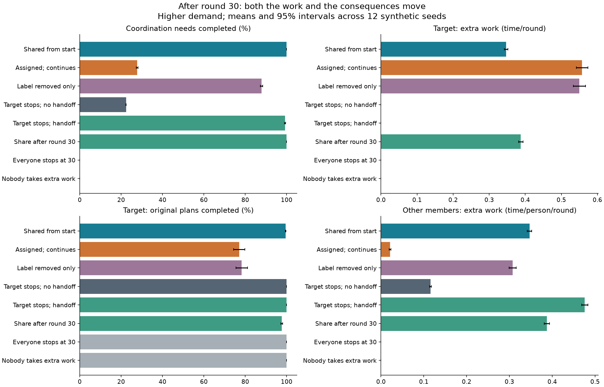
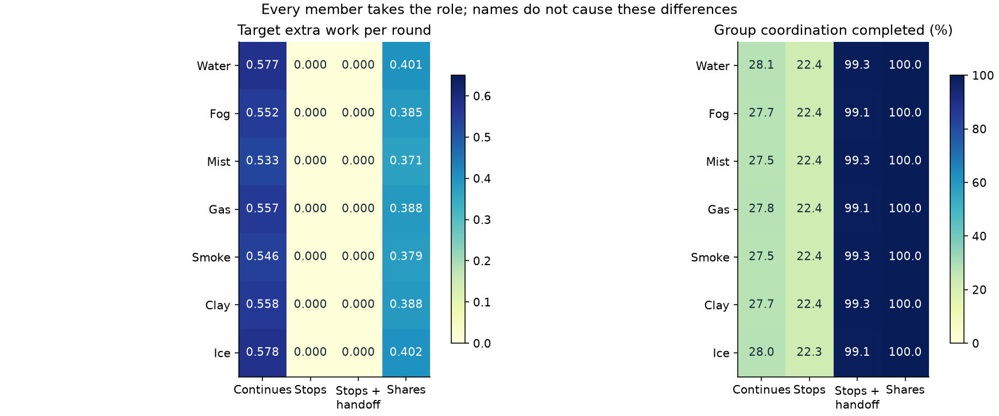
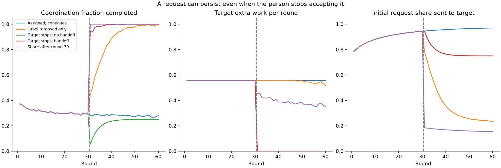

# Everyone can be “the adaptable one” — and everyone can stop

Streams and Rocks • completed synthetic community experiment • 15 October 2026

**Water, Fog, Mist, Gas, Smoke, Clay and Ice each took the adaptable role in turn.** We compared accepting it, removing the label, refusing it, handing work to others and sharing it. We also tested everyone adapting from the start and nobody doing extra coordination. Adaptation here means responding to unexpected coordination needs; it is an explicit social metaphor, not a measured property of people or a fluid simulation.

The central result is conditional but useful: **when someone stops accommodating, what happens depends strongly on whether the group redistributes the work.** Their original plans can recover, and the additional work can move to others. Counting both outcomes avoids treating all accommodation as good or every refusal as harmful.

Completed: **2,688 main paths**, 1,008 sensitivity paths, 18 arithmetic-refinement pairs and **19 passing unit tests**. Each path contains 60 decision rounds. The designated role changes after round 30. [Methods, assumptions and Foucault connection](METHODS.md) · [All seven members](analysis/all_seven_roles.csv) · [Verification](verification.json).

## The same person can be water, fog, smoke or clay

The wider community model treats these as **overlapping, changeable orientations in a situation**. A person can connect as water, be partly understood as fog, carry an earlier event as smoke, and hold or reshape an impression as clay. They can reject the description or fit none of the labels. The fixed names in this completed experiment are identifiers; its role rotations do not measure material personalities.

**Keep the strong language and make its evidence clear:** describe the action, attribute the interpretation and state the missing test. The [situational-role guide and test plan](https://github.com/NousVolition/Nous-Volition/blob/main/studies/community-power/SITUATIONAL_ROLES.md) gives examples and proposed tests of boundary visibility, linguistic capital, semantic change and feedback. These are open questions, not new results from this experiment.

## What happened after the role could change

This table uses the higher demand (3.6 service units per round on average), 12 replication seeds and all seven target rotations averaged within each seed. Time is normalized: every person has one available time unit per round. “Target” means whoever was assigned the adaptable role in that run.

| Rule | Coordination completed | Target extra time | Target original plans completed | Other members extra time each |
| --- | --- | --- | --- | --- |
| Shared from start | 100.0% | 0.347 | 99.5% | 0.347 |
| Assigned; continues | 27.8% | 0.557 | 77.1% | 0.021 |
| Label removed only | 87.9% | 0.550 | 78.3% | 0.308 |
| Target stops; no handoff | 22.4% | 0.000 | 100.0% | 0.116 |
| Target stops; handoff | 99.2% | 0.000 | 100.0% | 0.476 |
| Share after round 30 | 100.0% | 0.388 | 97.6% | 0.388 |
| Everyone stops at 30 | 0.0% | 0.000 | 100.0% | 0.000 |
| Nobody takes extra work | 0.0% | 0.000 | 100.0% | 0.000 |



Group needs and individual plans are different outcomes. Error bars quantify synthetic seed variation, not empirical uncertainty about families.

When the target stops without a handoff, coordination completion is 22.4%. Adding a handoff gives 99.2%, with the target’s original plans fully completed in both cases. The other six average 0.116 versus 0.476 extra time units each. The work is redistributed; it is not made costless.

Sharing after round 30 completes 100.0% of coordination and reduces the target’s extra time from 0.557 to 0.388. Target plan completion rises from 77.1% to 97.6%. These values depend on the available capacity, learning law and ability to share.

## Try the role with every member



Each name gets the same role experiment. Small differences arise from random abilities and budgets assigned independently of names; renaming has exactly no effect.

The family can use every name without making Water permanently responsible for smoothing things over. In this experiment a person can keep the name and change the role. Everyone stopping protects original plans, but leaves all imposed extra coordination unmet by construction. That does not tell us whether a real request should have been imposed in the first place.

## Removing a label and changing a working arrangement are different actions



The first 30 rounds match across these five policies. The vertical line marks the rule change. Initial requests can still target a person who refuses; handoff changes who actually performs the work.

Removing the assignment bias alone improves group completion to 87.9%, but the former target still supplies 0.550 extra time units, near its earlier 0.557. Its remembered role and accumulated skill remain. The model therefore distinguishes changing what someone is called from changing which requests they receive and which work they accept.

The no-memory control raises completion after label removal to about 99.9%; the no-bias control reaches 100%. These controls show that the poor assigned-role outcomes come from the chosen request-routing rules. They do not establish a general law that specialization, memory or adaptation is harmful. The stronger handoff-cost and no-learning cases are retained in [sensitivity results](analysis/sensitivity_summary.csv).

## What this does and does not show

The model assumes a strong 75% assignment bias, allows unused capacity to sit elsewhere when handoff is forbidden, and gives sharing an ideal coordinator. Those mechanisms favor redistribution. Its numerical advantage is a conditional result, not independent evidence that these assumptions describe a family. No fatigue, fear, trust, emotional benefit, retaliation, negotiation cost beyond the specified handoff time, or subjective wellbeing is modeled.

Foucault provides the question: how can a category and repeated expectations shape a person’s opportunities, and can that arrangement be contested? Our equations are an exploratory way to make those choices inspectable. The physical substance models remain separate; fluid behavior does not validate social roles.

## Reproduce and inspect

```sh
python -m pip install -r requirements.txt
python test_model.py
python verify.py
python run_study.py --out reproduced
python analyze.py --data reproduced --out reproduced-analysis
# Rebuild the delivered reading formats from delivered results:
python build_report.py
```

The runner refuses to overwrite an existing protocol. [Protocol](data/protocol.json), [execution and accounting](data/execution.json), [all cases](data/cases.csv), [individual contributions](data/members.csv), [paired contrasts](analysis/paired_contrasts.csv) and [source code](model.py) are included. Maximum recorded accounting residual is below 2×10⁻¹⁵. Eighteen tighter-arithmetic comparisons make no change in the stored work/output values. This is a discrete process, so there is no physical time-step convergence claim.

The [earlier community allocation benchmark](https://github.com/NousVolition/Nous-Volition/tree/main/studies/community-power) and [substance study](https://github.com/NousVolition/Nous-Volition/tree/main/studies/substance-interactions) remain available.
