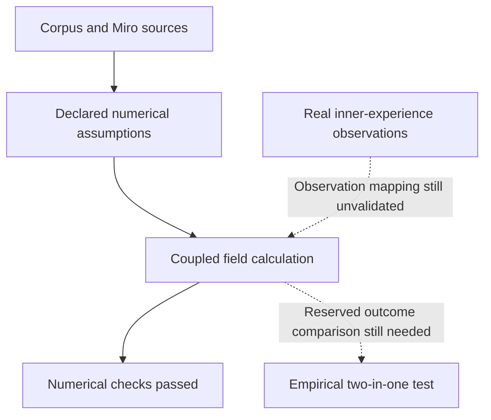

# Checks using the requested research and language tools

23 October 2026. This supplements the source-chain audit; it is not a new full-model fit.

## SciSpace and independent source checks

SciSpace returned ten records for a question about longitudinal inner speech, thought content and autobiographical context. These include different records for the same study. [Discovery identifiers](research_discovery.json) preserve the returned titles and DOIs, not a count of ten independent datasets.

The Zhang et al. think-aloud dataset describes 118 participants, timed transcripts, content ratings and participant questionnaires. The publisher's indexed abstract was checked; direct publisher access redirected and PMC required a browser check, so the detailed data-availability section was not newly read. Critically, the [existing source register](../community-two-in-one-field/SOURCES.md) already identifies this publication and its underlying cohort. Finding it again is not discovering a new holdout or an independent replication. Its relevance to timing and verbal content remains; the inward-role/meaning/history observation connection is unvalidated. [Publisher](https://www.nature.com/articles/s41597-026-08414-6).

The Lux et al. repository describes ordered free-association measurements and valence, self and time ratings, and lists a codebook and base-data files. These are candidate observations for aspects of changing thought. The archive was not downloaded or reanalysed in this supplementary check; its density-map predictor has not been substituted for the corpus equations. Suitability of individual fields, licensing and observation operators still require file-level review. [Zenodo record](https://zenodo.org/records/10445890).

## Hugging Face

Both connector searches (`inner speech`, `experience sampling`) returned `UNAVAILABLE`: the server did not expose its advertised dataset-search tool. This is a connector failure, not a finding that no datasets exist. A public web search returned the EEGDash `ds003626` card: a pointer to OpenNeuro EEG data, reporting 10 subjects and 30 recordings. The indexed card was read; a subsequent direct open failed. No raw EEG was downloaded or decoded, and no inner-role/meaning/history inference was made. [Dataset card](https://huggingface.co/datasets/EEGDash/ds003626/blob/main/README.md).

## Miro, GitHub and terminology

The eight-board Miro coverage and the exact source-to-implementation trace are recorded in this package. Miro sources remain unchanged; published errata name their item IDs. GitHub publication is checked separately against the resulting commit and automated checks.

Lexical Lens's Nuance Navigator was applied to these distinctions. They are contextual wording guidance, not dictionary-based scientific proof:

| Term | Intended use here | Not interchangeable with |
|---|---|---|
| Reproduced | The same input and method regenerate a specified output. | Independently replicated on a different sample. |
| Numerically verified | Code satisfies the stated analytic or refinement checks. | Empirically validated as an account of inner experience. |
| Compatible | An observation can occur under an explicit mapping/assumption. | Identified, uniquely explained, or causally demonstrated. |
| Complete subsystem | All specified terms of that subsystem were retained. | Complete empirical two-in-one, or every relation in the corpus dynamically connected. |
| Not confirmed | The available evidence has not established the claim. | False, irrelevant, or impossible. |

The Visualize guidance favors a small static diagram for this distinction. Solid links below are the checked source-to-computation route; dashed links are still-needed empirical connections.

No number of tools, literature hits or passing numerical checks closes the dashed connections by itself.
