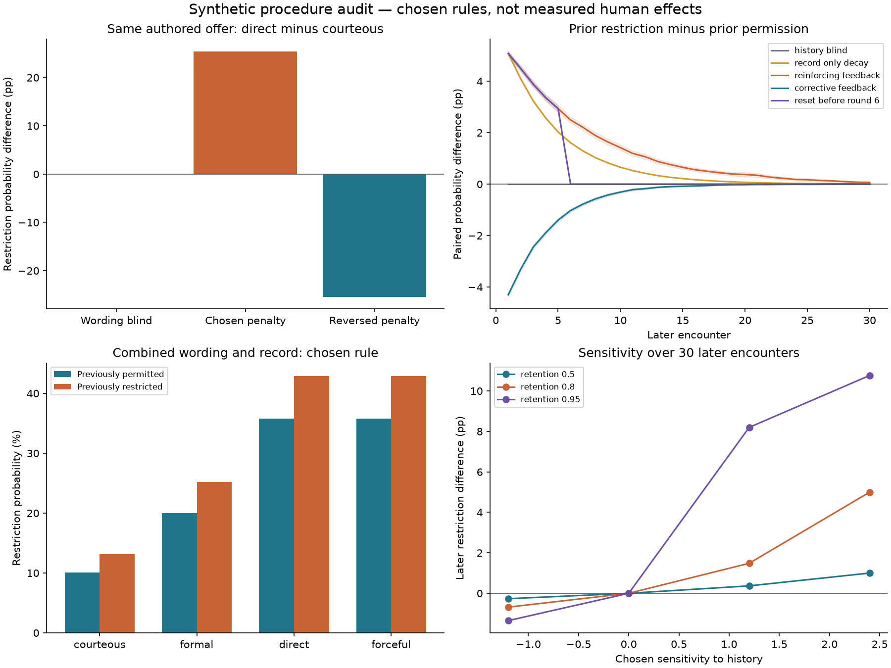
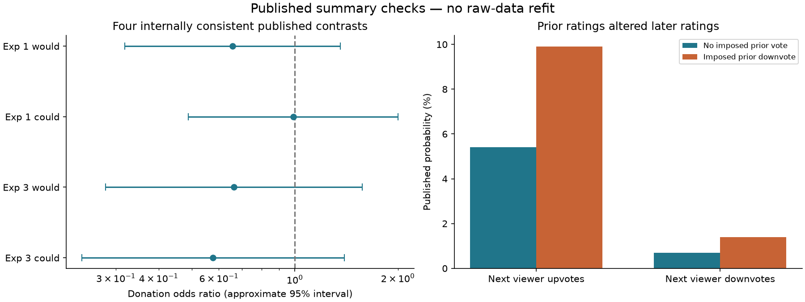

# Wording and prior treatment in community encounters

Streams and Rocks • completed computational tests and published evidence checks • 21 October 2026

**The decision rule matters.** The new tests find identical treatment when wording is ignored, different treatment when a chosen wording penalty is active, and lingering effects when earlier restrictions enter later decisions. Reversing the rules reverses the effects. These are results for an explicit synthetic procedure; they do not establish how a family or platform treats people.

The study ran 432 wording cases, 144 joint wording/history probability pairs, 6,000 paired history paths and 2,400 sensitivity pairs. Each history pair has 30 later encounters. Nineteen unit tests passed. Published numerical checks are reported separately below. [Methods](METHODS.md) · [Frozen protocol](data/protocol.json) · [Saved-result verification](verification.json).

**Real-data follow-up now completed:** [content, judgment and later recognition](https://github.com/NousVolition/Nous-Volition/blob/main/studies/community-real-data/README.md) analyses human annotation records and exact randomized-study counts. It finds semantic failures, differing judgments among selected labeled matches, and a recognition effect in one Wikipedia experiment. These observations do not fit or validate the synthetic parameters below.

## The same offer expressed four ways

Each expression keeps the same authored task, offered duration and maximum duration. For example, one person offers twenty minutes and declines any larger commitment. Direct, courteous, formal and forceful versions retain that content. **Complete meaning is not proven identical:** wording can also communicate different relationship signals, urgency or tone. Independent speaker and recipient checks remain necessary.

| Procedure | Direct minus courteous restriction probability | What the comparison establishes |
| --- | --- | --- |
| Wording blind | 0.0 percentage points | The same structured offer receives the same probability |
| Chosen literal-marker penalty | +25.4 points on average | Consequence of the specified wording rule |
| Reversed marker penalty | -25.4 points on average | The direction is supplied by the rule, not discovered in human data |

The marker counts “will not” and “refuse” positively and “please” negatively. It is an intentionally limited stress test, not a politeness or harm detector. Direct and forceful versions receive identical probabilities because their marker values match. The positive-rule difference ranges from 15.2 to 35.3 points across the three chosen contexts. No interval is assigned to repeated templates as if they were independent observations. [Exact wording and probabilities](data/wording_cases.csv).

## What one prior restriction changes

Two copies begin with identical content and circumstances, but one receives permission and the other restriction at encounter zero. Thereafter their wording, context sequence and random numbers match. The table excludes that imposed first decision and measures only the next 30 encounters. Memory here is a stored decision record; this module contains no skill learning or measured emotion.

| Procedure | Difference in later restriction rate | 95% Monte Carlo interval |
| --- | --- | --- |
| History blind | +0.000 pp | [+0.000, +0.000] |
| Initial record fades | +0.857 pp | [+0.757, +0.956] |
| Later restrictions reinforce the record | +1.283 pp | [+1.108, +1.459] |
| Prior restriction prompts correction | -0.623 pp | [-0.704, -0.543] |
| Reset both records before encounter 6 | +0.640 pp | [+0.546, +0.734] |
| No decisions stored | +0.000 pp | [+0.000, +0.000] |

Under reinforcing feedback, the first later restriction probability increases by 5.08 points on average. Across all 30 later encounters, the realized rate difference is 1.28 points. A corrective rule produces a −0.62-point rate difference. With no history effect or no stored input, paired outcomes are exactly identical. Clearing both records before encounter 6 makes every subsequent paired outcome identical; the table retains differences from encounters 1–5. The intervals quantify simulation variability under chosen rules, not uncertainty about people.



## What the published evidence checks show

[Juanchich, Sirota and Bonnefon](https://jfbonnefon.github.io/publication/jbdm19/jbdm19.pdf) varied donation-request wording while retaining the requested donation. We checked all six main-experiment contrasts against the paper’s appendix. Four pass the coefficient-to-odds-ratio rounding check; all four reconstructed 95% intervals include 1. Two Experiment 2 entries disagree: 0.67 versus 0.45, and 0.87 versus 0.44. Those estimates are excluded from the retained plot. Experiment 3 contrasts apply to donation-first order. The raw-data link returned 404. This check does not establish equivalence or refit participant data.

[Muchnik, Aral and Taylor](https://snap.stanford.edu/class/cs224w-readings/muchnik13bias.pdf) randomly altered prior comment ratings. Their reported later upvote probabilities after an imposed downvote were 9.9% versus 5.4% in the control; our arithmetic gives +4.5 percentage points. Later downvotes were 1.4% versus 0.7%, a +0.7-point difference. This includes correction as well as reinforcement. These are rounded published outcomes for later viewers of the same comment, not a new test of someone’s future treatment across different encounters. No counts or confidence intervals are reconstructed from the percentages.



These sources were read during design and are not untouched holdouts. They do not calibrate the synthetic rule. [Transcribed sources and scope](source_estimates.json) · [Wording consistency audit](data/published_wording_audit.csv) · [History arithmetic](data/published_history_arithmetic.csv).

## What this adds to the community model

Meaning, expression, context, treatment and memory now have an executable comparison in addition to the conceptual guide. A person can adapt an expression as Water, be partly understood as Fog, carry an earlier account as Smoke, or retain an impression as Clay. These descriptions can overlap or be rejected; they do not enter the decision score. Strong language remains attributable to its speaker, and a refusal is not automatically coded as wrongdoing.

The missing social test is a comparison of actual treatment after independently checked equivalent expressions, followed by new time-ordered encounters with relevant context recorded. That requires observations and a causal design, not another large batch of fictional seeds. [Connections and evidence guide](https://github.com/NousVolition/Nous-Volition/blob/main/studies/community-power/CONNECTIONS.md).

## Reproduce and inspect

```sh
python -m pip install -r requirements.txt
python test_model.py
python verify.py
python run_study.py --out reproduced
# Rebuild this report from delivered data:
python build_report.py
```

The runner refuses to overwrite an output directory. [Seed summaries](data/memory_seed_results.csv), [example encounters](data/example_encounters.csv), [joint comparisons](data/joint_wording_history.csv), [sensitivity results](data/sensitivity.csv) and [model](model.py) are included. Parameters are assumptions, recorded before execution; this local freeze is not public preregistration. The previous community and physical studies remain unchanged.
