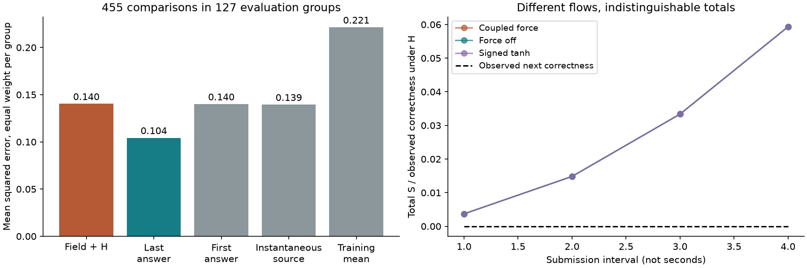
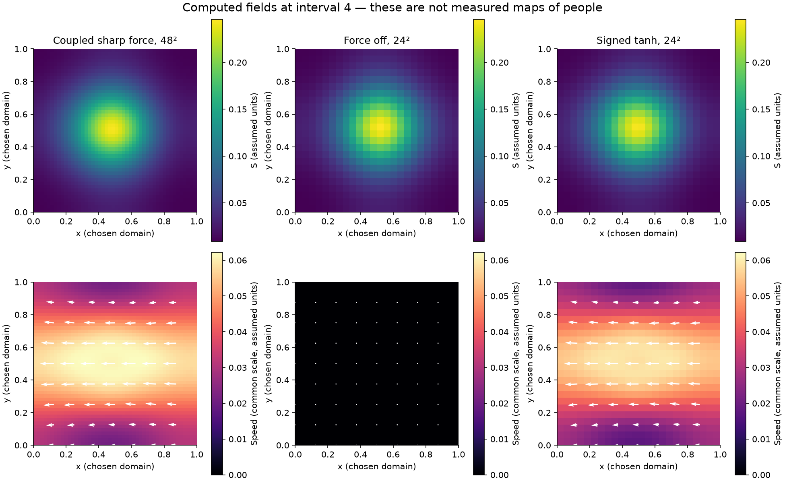
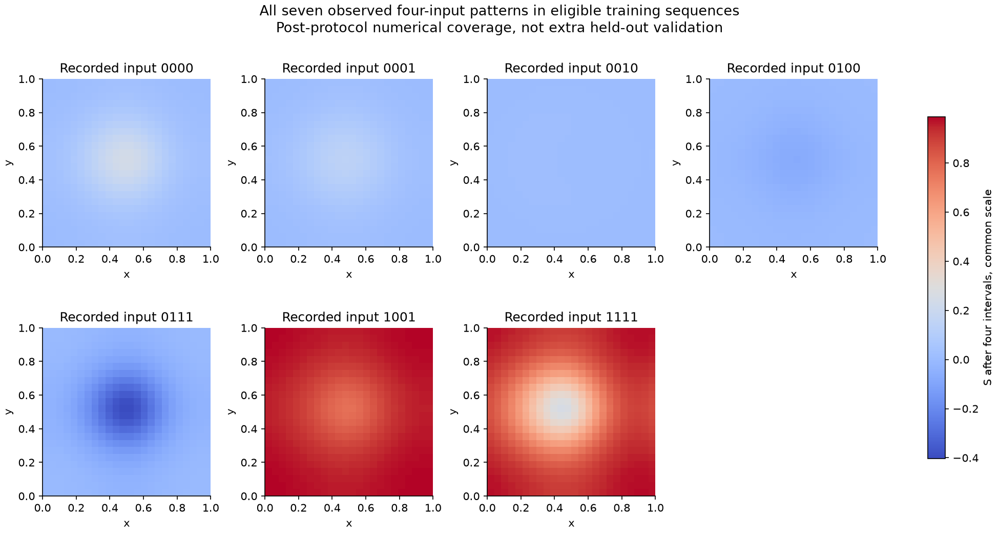

# Full coupled corpus field with real submission records

Completed 22 October 2026 for Streams and Rocks. **The coupled equations have now been run. The proposed link from those fields to task correctness did not outperform a simple last-answer control. Full empirical validation remains open because the records do not measure the spatial fields.**

[Illustrated report](report.html) · [Frozen protocol](PROTOCOL.md) · [Equations, sources and units](SOURCES.md) · [All comparison results](results/data_results.json) · [Spatial diagnostics](results/spatial_results.json)

## What used your exact equations

The solver couples your momentum balance and incompressibility to your signed S transport and accumulated source:

```text
u_t + (u·grad)u = -grad(p) + nu Lap(u) - (sigma/rho) a(q) e
div(u) = 0; q = |grad(S)| - Gamma
S_t + u·grad(S) = D Lap(S) + K_h kappa A
A_t = gamma (U - Ubaseline), A(0) = 0
T = mu0 (grad(u) + grad(u)^T)
```

Source: P229–230, P517–519 and P545–550 of your [pinned corrected corpus](../community-mimesis/corpus_extract.json). Sharp, original signed tanh and smooth exact-off responses are tested separately. The tanh response retains its negative tail. There is no added forgetting, logistic moderation score or replacement of the fixed-direction force with drag. Pressure enforces incompressibility; mean velocity is allowed to change. These are numerical approximations to your equations, not exact arithmetic or a proof of global regularity.

We supply a **specified 2D periodic computational domain** and explicit initial/boundary conditions; we do not claim to reconstruct an unspecified 3D social field or the full Cartesian initial-field construction absent from this attachment. All parameter values and kernel normalization are in the protocol. The corpus's separate consistency W and boundary-utility rules have no supplied coupling to this field system and are not silently turned into decision equations.

## The added observation hypothesis is visible

**H:** use the most recent recorded task correctness (0 or 1) as U for the next interval, and compare the integral of S with the next recorded correctness. This is a proposed measurement link, **not your definition of Sens, Sin or personal utility**. A time unit is one submission interval, not a measured second. Initial total S equals the first recorded correctness; A starts at zero at that observation. Missing earlier history is unknown. The field remains signed; it is never clipped into a probability.

This choice permits a real-data check without inventing unmeasured beliefs, velocities or pressures. It also makes the test conditional: a failure concerns H and its timing, boundary and initialization choices. It does not refute every interpretation of your field equations. **Preserves Sens while adjusting Sin** remains distinct from succeeding at a card task. Water, Fog, Smoke and Clay remain situational descriptions, not measured permanent kinds of person.

## Real measurements and training separation

We used actual explicit card submissions in [DeliData](https://convokit.cornell.edu/documentation/deli.html), from the same pinned public archive used in the earlier study. This is a retrospective internal split, **not a new untouched external dataset**. All 17,111 records lack timestamps. Seven of 3,107 submissions are unparsed; 677 sequences have only one valid observation. The remaining **916 participant-within-group sequences yield 1,507 successive comparisons**. Unchanged submissions are retained. We do not use approximate state-of-mind trackers.

All 500 groups were assigned by a fixed hash rule: 350 training, 150 evaluation. After eligibility filtering, **280 training groups provide 1,052 comparisons**, and **127 evaluation groups provide 455 comparisons**. No group crosses the split. Animal aliases are scoped to their group. The earlier use of this archive means the evaluation set cannot be described as pristine model-selection data.

Only the observable accumulated-source coefficient is fitted. Training-only Ubaseline=0.236593, gamma=1 and **kappa=-0.031338**. The negative coefficient is reported because the corpus does not specify its sign. If nonnegative kappa is imposed as an extra assumption, the training optimum is zero: the total stays at its initial value. No spatial coefficient was fitted to correctness, since these observations cannot identify them.

The recorded previous responses drive the model causally in observation order. The next response is not used in its own prediction. This is a retrospective, observation-driven one-step comparison; it is not an autonomous prediction of all future submissions from the first response alone.

| Method | Evaluation group-macro MSE | Evaluation group-macro MAE |
|---|---:|---:|
| Corpus accumulated source + H | 0.140318 | 0.151936 |
| Last observed answer | 0.104279 | 0.104279 |
| Initial observed answer / nonnegative-kappa fit | 0.140045 | 0.140045 |
| Separately assumed instantaneous-source control | 0.139425 | 0.145544 |
| Training-target-mean control | 0.221381 | 0.444338 |

Each group receives equal weight, then errors are averaged within group. Accumulated-source MSE minus last-answer MSE is **0.03604**, with a 2,000-resample whole-group 95% bootstrap interval **[0.01446, 0.05778]**. Smaller errors are better. The interval is conditional on this mapping and independent-group resampling; stable cross-group worker identities are unavailable. It is not a causal estimate or a test of Girardian rivalry.

**16 of 455 field predictions fall outside [0,1]**, reaching -0.196. This is allowed for signed S, but is a failure of treating its raw integral as bounded correctness. We do not fix it by secretly inserting a sigmoid. The instantaneous control is a different equation and is labelled as such.



## All records use an exact consequence of the full model

For periodic incompressible flow with normalized K, integrating your scalar equation yields **M'=kappa A**. Advection and diffusion integrate to zero. We therefore evaluate all 1,507 comparisons using this exact integral identity; we do not claim to have simulated 1,507 observed spatial fields. It is a consequence of the coupled system, not a substitute differential equation invented for fitting.

This same identity exposes a structural limit: changing viscosity, diffusion, force strength, activation, threshold, kernel width or zero-mean spatial texture cannot change M. Gamma and kappa also appear only as a product in M. More correctness records alone cannot identify these quantities. A good aggregate fit would not validate the full field model either.

## Coupled spatial calculations actually completed

Eighteen primary runs cover two fixed-rule evaluation pilots, three spatial grids (24², 48², 72²), all three response laws, force-off, source-off, uniform initial S and a halved-step control. Both independently selected sequences happen to begin with the same four zeros, so these are **one unique forcing history**, not two independent spatial validations. The choices and that duplication remain in the results.

The declared post-protocol supplement adds **7 runs**, covering every distinct four-input pattern found in eligible training sequences. It changes no coefficients or evaluation outcomes and is numerical coverage, not additional held-out validation.

Maximum mass-identity error is **1.26e-15**; maximum discrete divergence is **2.21e-18**; maximum instantaneous energy work/dissipation residual is **4.34e-19** in the primary runs. These check conserved material, incompressibility and the kinetic-energy identity. They do not claim energy is conserved in this forced viscous system. The force can supply energy, and viscous loss is accounted for.

Taylor–Green analytic velocity and pressure RMS errors are 2.17e-13 and 4.48e-15. Halving time steps in that analytic check reduces errors about sixteenfold before roundoff. In the coupled sharp-force pilot, final combined field/velocity Fourier L2 differences are **6.513e-06** (24² versus 48²) and **6.912e-07** (48² versus 72²); halving the 24² time step gives **1.006e-10**. Adjacent-grid differences are estimates, not error against an exact coupled solution, and unequal refinement ratios do not establish an order of accuracy. Non-polynomial activation can retain aliasing; see the method clarification.



Turning off the force changes final spatial S by RMS **0.009867** and velocity components by RMS **0.032782**, while the total-field difference is 0.0e+00. This is an explicit example of different internal dynamics fitting the same measured total. The displayed coordinates and velocities are computational assumptions, not maps of social actors.



## What is supported, and what remains untested

* **Supported numerically:** the coupled implementation preserves your accumulated source, fixed-direction force, distinct responses, incompressibility and stress relation under the declared domain and numerical approximation. The integrated equation agrees with the spatial solver.
* **Supported by these observations:** under H, the accumulated field is less accurate than last-answer persistence. Negative fitted kappa, out-of-range totals and unidentifiable spatial parameters are reported, not repaired through unacknowledged changes.
* **Still untested:** whether a defensible measurement of S and U corresponds to human meaning, reciprocal copying, personal utility, treatment or penalties; whether a spatial metric and measured transitions support this continuum representation; and whether independently collected observations validate it. There is no supplied field-to-W or penalty-to-U equation. The prior public-record moderation findings remain separate.

The next empirical requirement is an observation specification and data that can distinguish spatial predictions: repeated observations at declared positions, a defined field quantity, measured inputs and time, initial/boundary information, and any proposed observation-to-decision link. The units and comparison must be fixed before fitting. A smoother plot alone cannot supply this evidence.

## Reproduce and inspect

**17 unit tests and 3,122 independent saved-result checks passed.** [Verification receipt](results/verification.json). All individual predictions are in [forecasts.csv](results/forecasts.csv); [group scores](results/group_scores.csv) and [derived observation sequences](results/sequences.json) support independent arithmetic. No source conversation text or aliases are published.

```bash
python -m pip install -r requirements.txt
python -m unittest -q
python verify_saved.py
python data_test.py
python run_spatial.py
python run_input_patterns.py
python verify_saved.py
python build_report.py
# To repeat extraction from the pinned raw archive:
python data_test.py --raw /your/local/deli-corpus.zip
```

Run from this study directory inside the repository; the existing community-mimesis study supplies the unchanged card parser. The local NumPy version is pinned; CI also checks compatibility with the repository's installed NumPy. Figures use Matplotlib. Inspect [field.py](field.py), [data_test.py](data_test.py), [the full sources and limitations](SOURCES.md), and the [protocol](PROTOCOL.md). Numerical domain parameters are reproducible choices, not fitted human constants.
