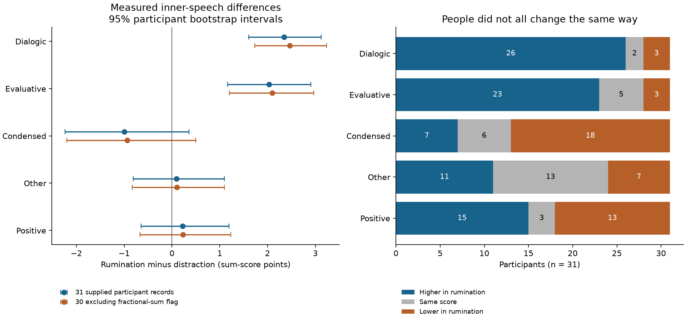

# Real inner-experience measurements for the two-in-one

<!-- chain-audit:start -->
Audit update, 23 October 2026. The workbook analysis was rerun independently of all earlier predicted fields and reproduced its saved quantitative outputs. It still does not identify the full inward observation model. The audit now covers the whole corrected DOCX, all 37 PDF pages and all eight board inventories, including prototype contents and explicit remaining coverage limits. No full empirical two-in-one fit is claimed. [Corrections, source coverage and remaining tests](https://github.com/NousVolition/Nous-Volition/tree/main/studies/community-chain-audit). Mist’s narrower agreement interpretation is provisional, not an author-established definition. Earlier frozen protocols and editable documents retain that historical proposal; current definition tables supersede it.
<!-- chain-audit:end -->

**New public data were analyzed. The full empirical corpus-equation test remains unperformed.** These files do not identify inward Smoke, Clay, the moving idea and personal history well enough to initialize and score the coupled field model. No simpler predictive model was fitted and no missing history was set to zero. This is new measurement evidence and a specific account of what prevents the requested full test, not a claim of completion.

## What was actually measured and calculated

In [Moffatt et al. (2020)](https://doi.org/10.1371/journal.pone.0238920), the public workbook links the same 31 people across rumination and distraction. We recomputed all five supplied inner-speech subscale contrasts. Values are two-item sum-score points (possible 2–14), not field values or measurements of the author's roles. These are retrospective self-reports with measurement error.

| Subscale | Mean difference | 95% bootstrap interval | Higher / same / lower | Holm p (five contrasts) |
|---|---:|---|---:|---:|
| Dialogic | +2.345 | [1.603, 3.119] | 26 / 2 / 3 | 7.445e-06 |
| Evaluative | +2.032 | [1.161, 2.903] | 23 / 5 / 3 | 0.0003719 |
| Condensed | -0.994 | [-2.239, 0.355] | 7 / 6 / 18 | 0.4453 |
| Other | +0.097 | [-0.806, 1.097] | 11 / 13 / 7 | 1 |
| Positive | +0.226 | [-0.645, 1.194] | 15 / 3 / 13 | 1 |



Dialogic and evaluative differences survive excluding the one record flagged by fractional distraction sums: +2.467 and +2.100 points (n=30). The source reports two mean-imputed items. Raw item flags are unavailable, so this exclusion is a sensitivity check, not an authenticated reconstruction of the original missing data. This analysis adds no imputation. Condition-order results are saved separately; order is limited experimental context, not each person's life history. The other three overall intervals include zero; that does not prove equality.

Bootstrap resamples whole people within each comparison (20,000; seed 20261023). Paired t intervals and Holm-corrected tests are also saved. Sum-score arithmetic is descriptive, and the sample is small. The articles' findings were read before analysis: this is exploratory reproduction, not a new holdout validation of the corpus model.

## Ordered ideas: a second real dataset

[Labrie and de Chantal (2026)](https://doi.org/10.1177/02762366261446941) provides 350 identified participants, retrospective inner-dialogue ratings and 3,349 response records. Our join audit finds:

- 3,108 author-coded valid responses, all linked to those 350 participants. Three invalid responses belong to one unmatched ID and remain excluded from person-linked results.
- 201 additional subject-sheet rows contain only a fluency value and no participant ID. They are isolated numeric values, not extra participants or formula cells. Their origin is unresolved. Fluency is not analyzed here.
- 694 observed person/prompt sequences; 344 people have records for both prompt orders. Four sequences have internal order gaps. No missing ideas are interpolated.
- 2,375 consecutive valid response pairs; 169 share a supplied content category. Category equality is not verified same intended meaning, an inward encounter, or copying.
- No per-idea timestamps. Total survey duration cannot supply the spacing between ideas or felt time.
- All 350 saved four-item state means reproduce exactly from the supplied item values. However, survey display labels and explicit recodes run in opposite directions; the export-to-analysis transformation is unresolved. We do not reverse scores or infer the direction of a dialogue/originality association.
- Four survey questions concern links between ideas, but their response columns are absent from these workbooks. A question being asked in an instrument is not evidence that its answers are available.

## Connection to the author's model

The [measurement ledger](measurement_map.json) preserves Smoke as inward putting-forward, Clay as inward receiving/holding/questioning/reshaping/refusing, and the moving idea within the same person. Water is perceived balance; Fog concerns clarity; Wind concerns experienced time; Mist is an author-named form whose narrower interpretation as internalized agreement remains provisional; D₂O denotes the consequential small change. These forms are not inferred from unrelated questionnaire names. H₂O₂ remains separately unspecified.

The [corpus and Miro reconciliation](CORPUS_AND_MIRO.md) records the exact equations, source hashes and inspected frames/pages. In particular, S means the signed status/context field, not Sens. The Miro arrows require an operational connection between measurements and the field. The model's accumulated A cannot be reconstructed from age, a trait score or the number of prior answers.

An empirical test can estimate latent states; it need not observe every mathematical variable directly. What is missing here is an identifiable observation model with a shared domain/metric, time scale, personal prehistory/initial state, utility input/baseline, boundary/source specification and independently evaluable outcomes. Making those numbers up would recreate the shortcut the user rejected. The exact equations are retained; no new synthetic run is presented as evidence for them.

**Status:** measurement comparisons completed; full two-in-one empirical test not completed. The data neither validate nor falsify the full model. The next necessary evidence is a linked within-person record of idea content/expression, inward proposal and reception, relevant individual history and the defined forms, followed by identification of how those observations read out the unchanged field. That observation layer must be declared and tested rather than silently built into a fit.

## Reproduce and inspect

Python 3.12; versions in [requirements.txt](requirements.txt) and [run status](results/run_status.json).

```sh
python -m pip install -r requirements.txt
python fetch_data.py --data-dir raw-data
python analyze.py --data-dir raw-data
python build_report.py
python -m unittest test_measurements.py -v
python verify.py
```

Raw files remain at their public sources; the repository contains hashes and a downloader, aggregates and code. No participant narratives are republished. [Source manifest](sources.json), [analysis plan](ANALYSIS_PLAN.md), [all contrasts](results/paired_visq.csv), [order sensitivity](results/order_sensitivity.csv), [measurement audit](results/measurement_audit.json).

The earlier [observation-bridge study](https://github.com/NousVolition/Nous-Volition/tree/main/studies/community-observation-bridge) remains a conditional numerical study with assumed inputs. These new data do not retroactively turn its trajectories into empirical forecasts.
