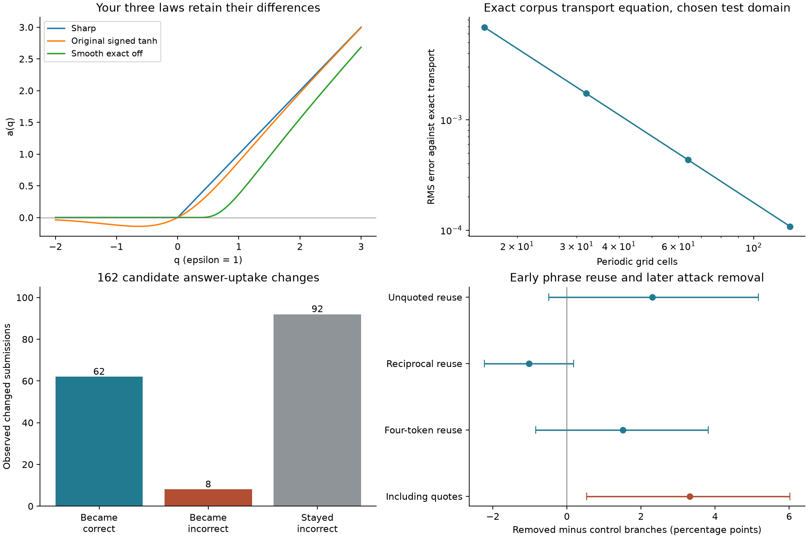

# Corpus equations and real records of uptake and conflict

<!-- chain-audit:start -->
Audit update, 23 October 2026. This study implemented corpus components and observable uptake/copying comparisons. Its scalar transport checks are not a full coupled inward field fit. Later numerical checks retain the complete coupled momentum/pressure/transport/accumulator system; real observation functions remain to be identified. [Corrections, source coverage and remaining tests](https://github.com/NousVolition/Nous-Volition/tree/main/studies/community-chain-audit).
<!-- chain-audit:end -->

Completed 22 October 2026 for Streams and Rocks. **The earlier community simulations included added equations. This study implements the supplied corpus equations explicitly, audits those differences, and separately tests real conversation records.** It does not call a phrase similarity score meaning, a correct answer utility, or a past penalty your field-memory variable.

[Illustrated report](report.html) · [Equation-by-equation audit](CORPUS_AUDIT.md) · [Frozen protocol](PROTOCOL.md) · [All numerical results](results/observed_results.json) · [Every functional review](results/functional_audit.json).

## Exact mathematical checks

The source is the user-supplied **Plain Language Corpus with Mathematical and Logical Clarifications**, combined corrected edition, pinned by SHA256. Selected formulas and their original paragraph text are in [corpus_extract.json](corpus_extract.json). [corpus_equations.py](corpus_equations.py) implements coordinate alignment, reciprocal scaling, binary consistency, exact-edge eligibility, all three activation laws, both gradient regularizations, fixed-direction force, symmetric stress, normalized momentum balance and accumulated-source transport. Domain and parameter choices for verification are stated in the audit.

* For ε=1, the original tanh response at q=−1 is **−0.119202922**. Sharp and smooth exact-off responses are both zero there. These laws have different behavior and remain separate.
* Your accumulated-input choice is **A(t)=∫₀ᵗγ[U(s)−Ubaseline]ds; J(t)=κA(t)**. With unit constant excess input, γ=κ=1 and closed boundaries, A(1)=1 and the total field increases by 0.5. Maximum numerical integral error across four grids is 2.89×10⁻¹⁵.
* With the source off, transport error drops from **0.006878 at 16 cells to 0.00010825 at 128 cells**, approximately fourfold per grid doubling. Halving the time step reduces the error against the semidiscrete analytic solution approximately sixteenfold.

These are implementation checks and a scalar transport calculation. They do not establish that human interactions obey continuum momentum equations. No full coupled Navier–Stokes solution, empirical social metric, utility calibration or copying-to-rivalry law is supplied by these records.



## What people take up from one another

We analyzed **500 DeliData groups**, with 14,003 conversational messages and 3,107 submission events in the Cornell conversion. Participants discussed a card-selection reasoning task. The published task has an objective answer: select the vowel and odd-number cards. [Dataset documentation](https://convokit.cornell.edu/documentation/deli.html), [Karadzhov, Stafford and Vlachos, 2023](https://doi.org/10.1145/3610056).

The conversion contains only **one INITIAL event**. We therefore compare successive observed submissions, not reconstructed solo-to-final improvement. We do not use its approximate solution tracker to infer unobserved beliefs. There are 1,593 first observed group/alias submission records, 969 repeated unchanged submissions, seven unparsed submissions and **538 changed selections in 249 groups**. These sum to all 3,107 submission events. Reused animal aliases are not globally unique people.

Of the 538 changes, **162 in 122 groups** matched a partner's intervening message annotated as a complete proposed solution. These are candidates for uptake; sharing an answer after seeing it is not by itself proof of copying.

| Observed changed submissions | n | Incorrect → correct | Correct → incorrect | Incorrect → another incorrect answer |
|---|---:|---:|---:|---:|
| All changed selections | 538 | 154 | 40 | 344 |
| With detected prior partner proposal | 162 | **62** | **8** | **92** |
| No detected prior proposal | 376 | 92 | 32 | 252 |
| Proposal candidates with all four card categories recoverable | 75 | 19 | 2 | 54 |
| Proposal candidates within ten archive events | 60 | 23 | 0 | 37 |

In the 162 candidates, mean binary correctness increased by **33.3 percentage points**; a whole-group bootstrap gives **23.8 to 43.0 points**. This describes the selected changes. It is not the causal benefit of copying or a comparison against independent reasoning. Unchanged correct responses do not enter this changed-answer cohort, and unrecognized proposals are possible. Missing card vocabulary and strict case-sensitive matching affect retrieval; the complete-vocabulary sensitivity is materially smaller (+22.7 points).

Sixteen candidates from sixteen groups were reviewed in fixed hash order before correctness summaries were joined. **Seven contain explicit acceptance, two are joint construction, four show sequence alone, one returns to a previously held idea, one shows deference, and one follows a request for the answer.** All sixteen have at least one genuine preceding proposal in the inspected window. The review is by one assistant; the answer text itself can reveal correctness, so this is not fully blinded semantic validation. [Locked review](results/audit_lock.json), [review with outcomes](results/audited_outcomes.json).

Concrete observations illustrate distinct processes. In one discussion a participant accepts a partner's explanation and changes to a three-card answer that remains wrong. In another, a participant abandons a correct vowel-and-odd answer for a partner-supported vowel-and-even answer. Two reviewed discussions involve the eventual recipient contributing the crucial reasoning before the matched proposal: calling this one-way copying would erase their contribution. One participant requests a final answer, submits it, then changes again immediately. These are paraphrased observations, not diagnoses or fixed kinds of people.

**A helpful double can be an operational description of a useful contribution taken up by another person.** The 62 improvements are candidates for that limited description. Agreement can also preserve or spread a mistake. Neither wrong agreement nor disagreement alone establishes a rival. Girard's rival-double concept concerns a more specific mirrored relationship; this study does not measure shared desire or validate his broader theory.

## Does repeated wording accompany later attack removal

We used the same pinned historical **CGA-CMV** archive as the earlier community studies, not a newly unseen population. Both branches in **2,259 source-matched pairs** have at least four readable comments. Features use only their first three comments, excluding the final labelled comment. The endpoint records a Rule-2 personal-attack removal; controls have no such recorded endpoint removal. [Source schema](https://convokit.cornell.edu/documentation/awry_cmv.html), [Chang and Danescu-Niculescu-Mizil, 2019](https://aclanthology.org/D19-1481/).

The added measurement procedure detects three-token phrases newly used by one participant after another used them, stripping URLs, marked blockquotes and inline double-quoted text. It excludes the participant's own earlier phrase use. It does **not** measure preserved Sens. The primary analysis keeps full propositions and stance open for review.

| Early feature | Later removed branch | Control branch | Paired difference, percentage points [95% cluster bootstrap] |
|---|---:|---:|---:|
| Any detected unquoted reuse | 1,017/2,259 (45.0%) | 965/2,259 (42.7%) | **+2.30 [−0.49, +5.16]** |
| Reciprocal reuse in A–B–A exchange | 100/2,259 (4.4%) | 123/2,259 (5.4%) | **−1.02 [−2.23, +0.18]** |
| Four-token sensitivity | 453/2,259 | 419/2,259 | +1.51 [−0.84, +3.81] |
| Including quoted text | 1,506/2,259 | 1,431/2,259 | +3.32 [+0.53, +6.02] |

The primary and reciprocal comparisons do not give clear evidence of a difference in these records. That is not proof of no effect. The quote-including result changes, showing that the definition matters; it is an exploratory sensitivity, not a selected replacement for the primary result. All six contrasts and descriptive sign tests are published without multiple-testing claims. The primary discordant-pair test gives p=0.126.

For a same-window topic check, a third comment shares a new phrase with its own earlier branch in 584 removed and 547 control cases; with its matched branch instead, the counts are 234 and 269. Cross-branch overlap persists, so a shared topic or familiar phrase can explain some resemblance. Branches may share audiences or comments; this is a diagnostic comparison, not an unexposed randomized control.

Twelve phrase-reuse conversations were reviewed with endpoint labels hidden: four rebuttals, three common-phrase matches, one shared-topic extension, one partial agreement followed by rebuttal, one reciprocal rebuttal, one mirrored personal challenge and one quotation-continuation error. **Repetition can oppose a claim rather than endorse it.** The personal-challenge example contains mutual attacks on understanding and presentation; it is a candidate instance of mirrored conflict, not proof of Girardian rivalry or its cause.

Uncertainty uses 2,109 clusters: source post when recoverable from permalinks, otherwise the matched pair. Only 2,008 of the 4,518 eligible conversations have a recoverable source post; residual dependence can remain. The archive also includes edited text whose final wording may postdate early replies. Excluding the final comment does not reconstruct historical text versions. The simple quote filter misses Markdown continuation lines in one reviewed case. These limitations preclude a prospective forecasting or causal claim. Source balancing prevents estimating the platform-wide frequency of attacks.

## Using the corpus without changing it

The [traceability audit](CORPUS_AUDIT.md) follows each clause to its code, measured field, assumption and missing test. The corrected corpus supplies a field memory equation. It does not identify actual penalties with its utility input, define a social geometry, or provide a law that turns reuse into a rival. Those connections must remain explicit questions rather than silent substitutions.

The findings support observing what is repeated, whether the recipient accepts or contests it, what changes, and what later treatment is recorded. They do not establish a wording-only consistency failure under W(i,α;c)=W(j,α;c), because the same action and full relevant context have not been held fixed. They also do not identify a feedback law for penalties. The earlier [public-record penalty study](../community-record-tests/README.md) remains a separate association study.

The same person can be Water, Fog, Smoke or Clay in different situations. **Preserves Sens while adjusting Sin** remains your distinction. A partner's argument can be adopted, resisted, corrected or repurposed without assigning a permanent character type. Strong language is retained with its observed action or attribution.

## Reproduce

Python 3.12; dependencies pinned in [requirements.txt](requirements.txt). Run from this study folder:

```bash
python -m pip install -r requirements.txt
python -m unittest -q
python verify_saved.py
python build_report.py

# Full real-data reproduction with archives kept outside the published study:
python download_data.py --raw /your/local/raw-directory
python observations.py --deli /your/local/raw-directory/deli-corpus.zip --cga /your/local/raw-directory/cga_cmv.zip --private /your/local/private-analysis
python analyze.py --private /your/local/private-analysis
```

Reproduction uses the frozen review rather than creating new human labels. A changed source archive fails its hash check; do not substitute another version and call it the same sample. Read [sources and distribution limits](SOURCES.md). Source texts, animal aliases, usernames, full DOCX and raw archives are not redistributed. Hashed keys and derived numerical records allow arithmetic checks; hashing is not a guarantee of anonymity.

**Completed checks: 37 unit tests and 87 independent saved-result checks.** Grid and time-step refinement, source hashes, audit locking, quote controls, missing-data accounting and all unsuccessful or ambiguous cases are retained. The protocol was fixed after schema inspection, not externally preregistered; two extraction bugs were fixed before the outcome analysis (partner IDs are reciprocal IDs, and removed quotations must not create artificial adjacent phrases). No classifier or social parameters were fitted.
