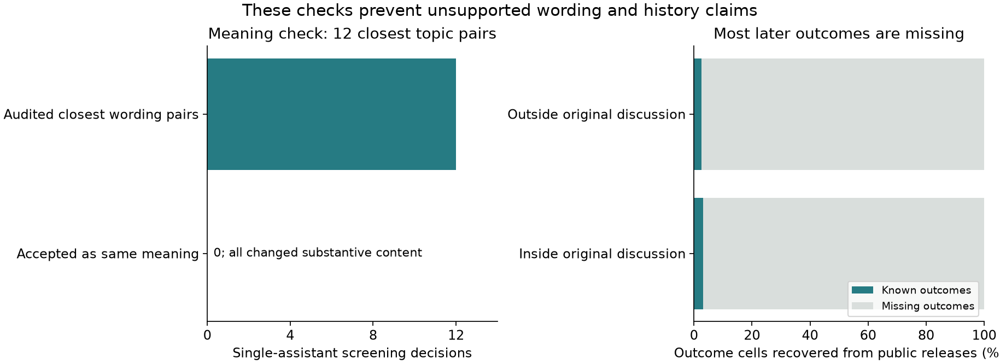

# Actual moderation decisions and later penalties

Streams and Rocks • completed public-data analyses • 21 October 2026

**Second finite Wikipedia blocks were longer in 7,109 of 8,687 paired accounts (81.8%).** This documents escalating assigned penalties among accounts blocked again. The records do not establish that the earlier penalty caused harsher treatment for identical later conduct. The Reddit wording check found no acceptable same-meaning pair among the 12 closest topic pairs reviewed, so a wording effect remains unmeasured.

| Question | Completed check | Conclusion |
| --- | --- | --- |
| Same meaning, different wording, different moderation? | 3,183 topic pairs with both texts; the 12 closest were reviewed. All 12 changed substantive content. | Not established by this retrieval and audit; topic matches cannot stand in for paraphrases. |
| Are later penalties different? | 7,109 longer, 881 equal, 697 shorter second finite assignments. | Observed escalation in this selected Wikipedia cohort. |
| Does an earlier penalty itself change later treatment? | No controlled same-conduct history comparison. Reddit matching release has no complete four-outcome comparison after joins. | Causal memory effect remains open. |

These are actual recorded Rule-2 removals and account blocks. The earlier [ParaDetox judgment study](https://github.com/NousVolition/Nous-Volition/blob/main/studies/community-real-data/README.md) measured offensiveness labels, and the [synthetic encounter study](https://github.com/NousVolition/Nous-Volition/blob/main/studies/community-encounters/README.md) used chosen decision rules. Their findings retain those narrower meanings.

## What changed in the second penalty

The full log contains 5,227,809 actions. After reconstructing episodes and applying the declared criteria, 57,600 named accounts had a first observed finite block and 180 days of follow-up after that episode ended. 18,784 received another distinct block in that window. 10,097 second assignments were indefinite; 8,687 were finite and enter the paired duration comparison. The cohort is broader than established editors; it is not a replication of the published paper’s selected population.

For the finite pairs, the median first assignment was 24 hours and the median second was 72 hours. The median account-level ratio was 3.0 times, with a paired bootstrap interval of 2.8–3.0 times. The sign test strongly favours more longer than shorter assignments (p < 0.001); this tests asymmetry, not a causal explanation.


A block extension is counted within the existing episode, not as a new encounter. Durations describe initial assignments; early unblocking and later changes can alter time actually served. Right-hand intervals are 95% paired bootstrap intervals and can collapse at discrete standard durations. These are calculations from the public log, not findings copied from the source paper.

| Follow-up | Eligible accounts | Another block | Finite pairs | Second finite assignment longer |
| --- | --- | --- | --- | --- |
| 30 days | 58,949 | 14,918 | 6,711 | 84.0% |
| 90 days | 58,396 | 17,562 | 8,028 | 82.7% |
| 180 days | 57,600 | 18,784 | 8,687 | 81.8% |

The same-moderator and disruption-keyword checks also show escalation. Neither holds conduct severity, policy or exposure constant. The keyword subset is not a judgment that the two offences were equivalent. An account with no recorded second block may have stopped participating. Different window lengths also change which accounts have complete follow-up.

## Why the wording question is still open

The [CGA-CMV dataset](https://convokit.cornell.edu/documentation/awry_cmv.html) provides 3,421 pairs from the same original discussion topic. One endpoint is recorded as removed and one as a comparison by the dataset’s construction. Of these, 3,183 have available text on both sides; 270 endpoints contain missing or replacement text. Treating the paired outcome difference as a wording effect would simply reproduce the sampling rule.

The 12 closest pairs share words but change arguments, referents or interpersonal claims. One shares a paragraph about old video games while adding several new claims in its longer version. Another changes an argument about imperfect parenting into an accusation that the other person wants humanity to disappear. Neither is a controlled wording substitution. The review also rejects a deleted-message template as evidence about the original meaning.

Across all available endpoints, there were no exact duplicate texts and no changed-text pairs meeting the declared high-overlap search threshold. That search can miss valid paraphrases. **The result is an unsuccessful search for a usable comparison, not proof that wording has no effect or that moderation is fair.** The [12 audit reasons](data/meaning_audit.json) are one assistant’s visible-outcome review, with a local text inspection tool for independent checking.

## What the Reddit penalty-history release can reproduce

The authors’ [public matching records](https://github.com/BoulderDS/effect_of_comment_deletion_cmv_dataset) identify before/after comparisons for people whose comments were removed earlier versus later. The release does not include all subsequent removal outcomes. Joining it with the recorded endpoint labels and first/second removal lists recovers only a small fraction of the required outcome cells.

| Matched setting | Comparisons | Known outcome cells | Complete four-outcome comparisons |
| --- | --- | --- | --- |
| Outside original discussion | 775 | 83 / 3,100 | 0 |
| Inside original discussion | 1,139 | 147 / 4,556 | 0 |

Absence from a first/second removal list cannot mean “allowed”: a third removal is absent too. Leaving those cells unknown produces bounds spanning both positive and negative differences, so these joins cannot recover the direction of the effect. The published [delayed-feedback study](https://doi.org/10.1145/3359265) reports reduced immediate later removals under its design assumptions; this analysis has not independently replicated that estimate.



Meaning was screened directly instead of assumed from shared vocabulary. Missing Reddit outcomes remain missing; they are not counted as favourable decisions.

## Connections to the community model

| Connection | Status now | What would test the stronger claim |
| --- | --- | --- |
| Meaning → expression | The audit detects substantive differences in candidate wording pairs. | Independent checks of proposition, referent, stance and force, plus the speaker’s account of intent where possible. |
| Expression in context → treatment | Actual removals are recorded; a causal wording contrast is not identified. | Meaning-preserving variants under the same policy and conversational context, independently reviewed, with comparable moderator exposure. |
| Past penalty → later assigned restriction | Observed escalation among repeated finite Wikipedia blocks. | Comparable current conduct with history visibility controlled or credibly varied. |
| Treatment → memory → later encounter | No psychological or institutional memory mechanism isolated. | Record what prior history was visible to whom; distinguish changed behaviour, changed attention and changed decision rules. |

**Keep strong language and test its treatment.** Refusal, accusation and resistance are not interchangeable with polite agreement. Removing an accusation to make a message sound calmer changes the test if that accusation is part of the meaning. A word count, a sanction or an algorithmic score does not settle whether a criticism is justified.

Water can describe adaptation, fog an unclear boundary, smoke a trace of earlier treatment, and clay an impression that persists or changes. These remain situational descriptions chosen or contested by people. The new observations constrain claims about records and penalties; they do not turn those descriptions into fixed human types. Foucault’s questions about who records, classifies and applies sanctions guide the inquiry; this evidence does not validate the whole theory.

## Reproduce and inspect

The [methods](METHODS.md), [source hashes](sources.json), [analysis plan](data/protocol.json), [amendments](data/protocol_amendments.json), [verification](verification.json) and aggregate tables accompany the results. No participant intervention or live moderation submission was performed. Raw messages and account identities are not republished.

```sh
python -m pip install -r requirements.txt
python -m unittest discover -p test_analysis.py -v
python reproduce_aggregates.py
python verify.py

# Fetch and rerun the Reddit checks (~52 MB):
python download_data.py --raw-dir raw
python analyze_wording.py --raw-dir raw --out-dir reproduced

# Full block reconstruction additionally downloads 1.67 GB:
python download_data.py --raw-dir raw --include-blocks
python prepare_blocks.py --raw-dir raw
python analyze_blocks.py --raw-dir raw --out-dir reproduced

# Rebuild the report from saved results:
python build_report.py
```

The full reconstruction needs additional space for its SQLite cache and refuses to replace an existing cache. Quick aggregate reproduction verifies all nine finite-duration summaries without that download. The supplied tests verify implementation and data accounting; they cannot supply missing meanings, behaviour measures or causal controls. This is exploratory reanalysis, not a fresh model-selection holdout.

[Community connections](https://github.com/NousVolition/Nous-Volition/blob/main/studies/community-power/CONNECTIONS.md) · [Earlier real-data results](https://github.com/NousVolition/Nous-Volition/blob/main/studies/community-real-data/README.md) · [Cornell block-log catalog and study](https://convokit.cornell.edu/datasets.html) · [Associated block-trajectory paper](https://arxiv.org/abs/1902.08628)
