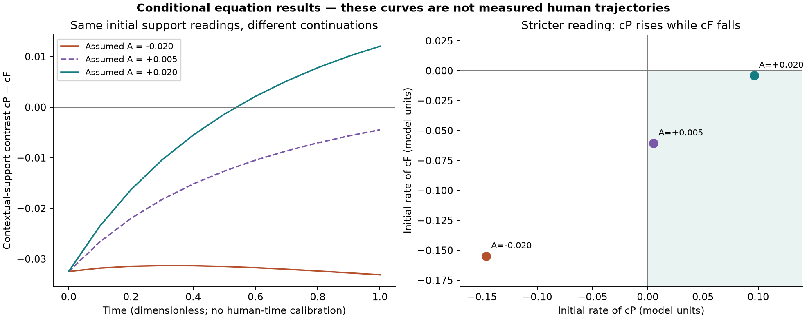
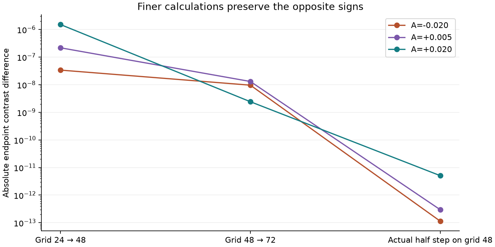

# Real observations connected to the two-in-one field

<!-- chain-audit:start -->
Audit update, 23 October 2026. This conditional compatibility test uses analyst-chosen node locations, Gaussian readout widths, initial fields and support zero. It is not an empirical calibration or prediction of later measured inward experience. Positive-support constraints need a calibrated zero. The earlier duplicate-step amendment is retained and rechecked; 75 main runs contain 73 unique configurations. [Corrections, source coverage and remaining tests](https://github.com/NousVolition/Nous-Volition/tree/main/studies/community-chain-audit). Mist’s narrower agreement interpretation is provisional, not an author-established definition. Earlier frozen protocols and editable documents retain that historical proposal; current definition tables supersede it.
<!-- chain-audit:end -->

Streams and Rocks · 23 October 2026

**Completed:** an explicit connection from five real inward-experience episodes to Smoke, Clay, the moving idea and personal-history references; 75 full coupled field runs plus three exploratory refinements; source, conservation and numerical checks. The solver is byte-identical to the audited corpus implementation. No simpler predictor was fitted or substituted.

**Finding:** under the declared observation mapping, different assumed histories satisfy the same report-derived constraints but give opposite later contextual-support contrasts. Finer grids and a stricter directional reading preserve this ambiguity. **This is a conditional equation test informed by real observations, not an empirical forecast or validation of the entire two-in-one model.** The chart, support readout and numerical histories remain assumptions.

[Readable report](report.html) · [Detailed connection](CONNECTIONS.md) · [Observation graph](observations.json) · [All run records](results/runs.csv) · [Quantitative summary](results/summary.json)

## The corpus and Miro connection

The available corrected corpus has SHA256 `01f9ab0942f9c88982863e2ffc1e3c495786b5e6b67a26ae77d18235e7058acf`. The live review used selected frames 10, 13, 16, 18 and the Theory map on the [Math + Logic board](https://miro.com/app/board/uXjVEXBJz3k=/). [Provenance](provenance.json) records frame IDs, source hashes and skipped board coverage. No different newer corpus or exhaustive board review is claimed.

The connection follows the board's distinction between a stated relationship and an operational link needing a measurement rule. It retains Sens/content separately from Sin/expression, attaches history to its person, and tests whether current observations distinguish different admitted states. Source and force are not renamed Smoke and Clay.

| Author's concept | Recorded connection | Evidence status |
|---|---|---|
| Smoke | Inward presentation of an appraisal, recalled content or imagined alternative | Analyst mapping of reported operations |
| Clay | Receiving, search, evaluation or reconsideration of the content | Analyst mapping; hearing alone is insufficient |
| Moving idea | Content, expression and reported transitions in one person | Reports support particular operations; no complete semantic trajectory |
| Each person's history | Earlier event/reference, present retrieval and interpretation remain separate | Three source-attributed references; numerical influence unknown |
| Water / Fog / Wind / Mist / D₂O | Separate descriptor fields, never fixed classes of people | Fog and Wind have partial feature connections; remaining form measurements absent |

All five episodes belong to **one** publicly described participant. This tests neither population frequency nor differences between people's full biographies. The ledger can preserve separate people and rejects cross-person history links, but the actual source cannot demonstrate across-person generalization.

## The real records

The [original DES series](https://hurlburt.faculty.unlv.edu/ieo/lena/lena_sampling.html) includes sampled experience, interview clarification and methodological commentary. The five selected episodes were already inspected development evidence, not untouched holdouts. They report reconsideration, incomplete visual recall, inward speaking/hearing, coexisting frustration and patience, and evaluation of imagined arrangements. Their locations and qualifications are retained in [observations.json](observations.json). Original PDFs remain with the publisher; concise descriptions and hashes are supplied here.

Only sample **10.1** constrains the numerical experiment. The participant describes choosing understanding while frustration remains, and cannot rank the two intensities at the sampled moment. The source examines awareness and timing but provides no continuous numerical trajectory or later matching outcome. See [interview 12, PDF pages 1–5, especially 6:45, 10:03 and 11:19](https://hurlburt.faculty.unlv.edu/ieo/lena/lena_interview_12_sampling_day_10_transcript_with_commentary.pdf).

## What was actually computed

The unchanged coupled system includes momentum, nonlinear advection, pressure, incompressibility, the S transport/diffusion/source equation, accumulated input, all three response-law alternatives and stress diagnostics. All parameter values and numerical choices were saved before the first trial in [PROTOCOL.md](PROTOCOL.md). The corpus integral has no inserted forgetting term.

We add an **observation hypothesis**: `c_j = integral(w_j S)`, where a normalized localized kernel reads contextual support near content alternative j. P denotes understanding/patience; F denotes frustration. Chart positions represent these alternatives, not inward roles or people. S remains a status/context field and does not become Sens itself. The model does not decode semantics.

The main constraints are `cP>0`, `cF>0`, and `d(cP−cF)/dt>0` at observation start. These inequalities are proposed translations of coexistence and reconsideration, not measured derivatives. The chosen support zero is arbitrary: a constant shift in S changes positivity without changing dynamics or the contrast, as an explicit unit test demonstrates.

The 63-run search covers three response laws, three alternative separations and seven initial accumulators. Initial fields are otherwise fixed; future excess input is zero. Parameters and fields use dimensionless numerical scales. The assumed history is not reconstructed from the biography, and model time 1 is not one human second or one interview interval. No gaps between sampled moments are filled.

**The utility optimum was not estimated.** The source supplies no feasible set, objective or exact margin for the corpus optimization. Future input is prescribed. This is the complete coupled field calculation under declared conditions, not a completed empirical implementation of every statement in the corpus.

## Numerical findings



All three rows below start with the same `cP=0.338312` and `cF=0.370799` and the same velocity field. Readouts are uncalibrated model quantities.

| Assumed accumulator at observation start | Initial cP rate | Initial cF rate | cP−cF at model time 1 |
|---|---|---|---|
| −0.020 | −0.146105 | −0.154760 | −0.033124 |
| +0.005 | +0.005428 | −0.060532 | −0.004469 |
| +0.020 | +0.096348 | −0.003996 | +0.012043 |

The primary witness pairs −0.020 with +0.020. Both satisfy the weak constraints, including increasing relative support for P. Their eventual contrasts have opposite signs.

That primary witness allows both absolute supports to fall. A labelled [post-result sensitivity test](CONSTRAINT_AMENDMENT.md) therefore requires P's support to rise and F's support to fall. The already computed +0.005 and +0.020 candidates satisfy this stronger rule, yet still have opposite final contrasts. Three additional refinement runs check the +0.005 member; the +0.020 refinement was already available. This follow-up is exploratory and does not become a holdout test.

Across the original search, **48 of 63 candidates** meet the weak constraints and **60 pairs** witness ambiguity. Pairs overlap and are not independent samples or confidence intervals. The primary execution has 75 runs, including two documented duplicate configurations; the follow-up adds three runs. [runs.csv](results/runs.csv) retains all **78 records, 76 distinct configurations**.

This result establishes conditional nonuniqueness within this mapping and tested uncertainty range. It does not establish that either input history actually occurred, that every possible mapping fails, that emotions have these numerical magnitudes, or that one continuation is helpful and the other harmful.

## Checks and controls



| Initial A | Grid 24→48 contrast difference | Grid 48→72 difference | Actual half-step difference on grid 48 |
|---|---|---|---|
| −0.020 | 3.38e−8 | 9.61e−9 | 1.14e−13 |
| +0.005 | 2.17e−7 | 1.31e−8 | 2.96e−13 |
| +0.020 | 1.51e−6 | 2.42e−9 | 5.07e−12 |

The signs and constraints survive refinement. The first nominal time-step halving was ineffective because the solver's stability cap chose the same actual step. That duplicate is retained and explained in [NUMERICAL_AMENDMENT.md](NUMERICAL_AMENDMENT.md); the corrected run halves the actual step from `0.1/79` to `0.1/158`.

- Eight unit tests passed, including pressure/momentum consistency, the analytic accumulator/total-field integral, constant-shift ambiguity and rejection of cross-person history links.
- Forty-two saved/source checks passed before publication, including five original PDF hashes and reconstruction of endpoint readouts from saved full fields. Publication manifests add artifact-integrity checks.
- Maximum field-total error: **3.58e−14**; divergence RMS: **2.47e−17**; instantaneous semidiscrete energy-identity residual: **2.60e−18**. These diagnostics do not mean that forced/dissipative kinetic energy is conserved in time.
- With κ=0, the two history choices give identical fields in this control. With σ=0, the source still changes S and history sensitivity remains. These parameter ablations preserve the other equations; they are not replacement predictors.

The code uses 2D periodic Fourier Galerkin projection and RK4. Grid refinement checks the reported observable within this chosen model. It does not establish a psychological geometry, a new Navier–Stokes law or a theorem about general solutions.

## What still needs testing

The observation mapping now exists explicitly and has been exercised. It has **not** been independently calibrated. The data do not determine the starting field, accumulator, utility input, contextual-support units, semantic chart or human time scale. Reported histories remain attached to inward operations, but the equations do not yet distinguish separate Smoke and Clay history evolution. The idea-form descriptors are retained without fabricated numeric labels.

A full empirical test needs independently coded, repeated episodes and later outcomes that jointly constrain those quantities. Water's perceived balance must be distinguished from calm; Mist needs an established experiential distinction; an internalized assumption would test only the narrower, provisional agreement interpretation; D₂O requires a specified small change and an observed consequence. Fog's partial retrieval needs an original-event comparison to test accuracy; Wind needs experience-time and clock-time measurements. A physical substance dataset cannot supply these inward observations.

Freeze the chart, input and readout mappings on development data before scoring later episodes or held-out people. The current five episodes have already informed the mapping and cannot serve as that independent test. No empirical prediction error is reported; its JSON value remains null.

## Reproduce

Python 3.12; exact local package versions are in [requirements.txt](requirements.txt) and [environment.json](results/environment.json). The main numerical run took about 56 seconds on the available local runtime; other machines will differ.

```sh
python -m pip install -r requirements.txt
# Check the published artifacts before rerunning:
python -m unittest discover -p 'test_*.py' -v
python verify_saved.py --published
# Recompute all field calculations and reports:
python run_tests.py
python check_stronger_reading.py
python verify_saved.py
python build_report.py
```

Rerunning changes elapsed-time metadata and thus output hashes. Use `--published` only for the original artifacts; ordinary verification checks a recomputed run's sources and numerical conditions. Optional `--raw-sources PATH` verifies the five downloaded original PDFs against [provenance.json](provenance.json). Source URLs and exact page/time locators are provided; full interviews and board exports are not republished.

The source/solver locks, complete output arrays, all trial records, explicit amendments and unknown fields are provided so the difference between the author's equations, new observation assumptions and reported experiences stays inspectable.
