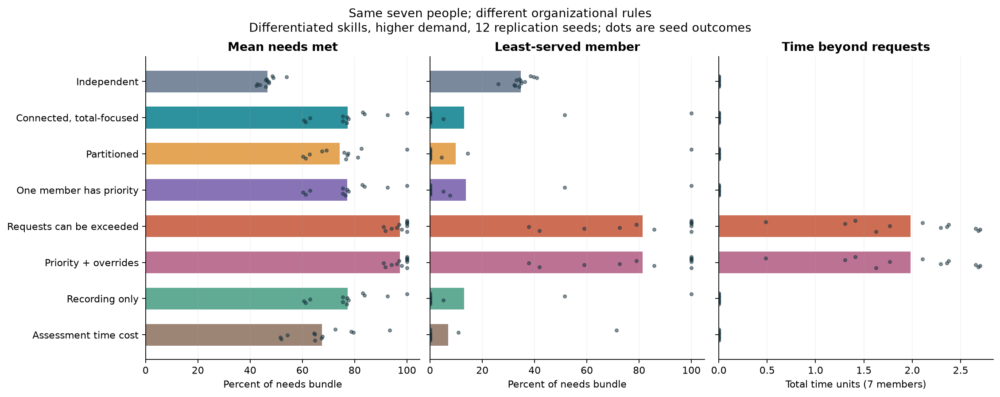
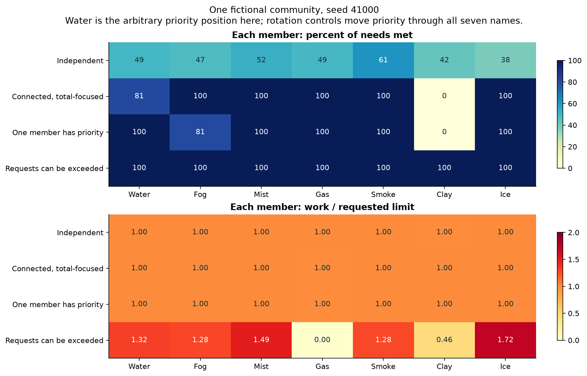
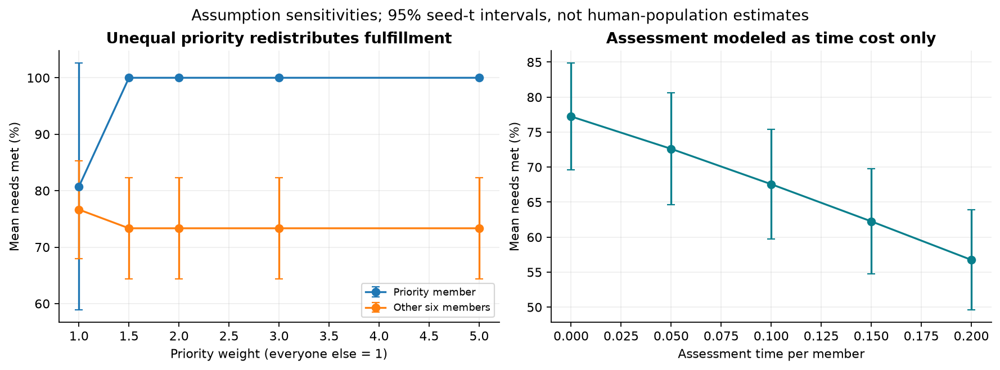

# A community: coordination, boundaries and power

Streams and Rocks • seven fictional participants • an executed allocation benchmark inspired by the uploaded Foucault passage

**Water, Fog, Mist, Gas, Smoke, Clay and Ice can belong to the same community.** This study asks how organizing the same people changes their ability to meet needs, the distribution of help and the work required of each member. Different skills and contact opportunities can make a group more capable; a higher group total does not guarantee that every member benefits.

The supplied page matches Foucault’s *Discipline and Punish*, in the panopticism chapter. Its discussion of organization and power provides the questions. The numerical rules are our explicit synthetic assumptions. [How the passage is used](interpretation.md) · [Methods and units](methods.md) · [Source provenance](source_provenance.json) · [Verification](verification.json).

## People can be water, fog, smoke or clay in different situations

**A person can be water here, fog there, smoke after an earlier event, and clay while holding or reshaping an impression.** These orientations can overlap and change. They describe a person in a situation, not a permanent type. The names in the existing numerical tables remain arbitrary identifiers; this broader interpretation does not assign new measured traits to those participants.

| Orientation | Possible meaning | What needs describing |
| --- | --- | --- |
| Water | Adaptation and connection | What changed, what was preserved, and who carried the cost |
| Fog | Presence with partly visible meaning or boundaries | Which signals were available, to whom, and what remained uncertain |
| Smoke | A trace or warning travelling from an earlier event | The event or account, its route, and its later effects |
| Clay | Holding or reshaping an impression | What persisted, what changed, and under which pressures or choices |

**Being water creates no obligation to absorb everyone else’s work.** People may combine, change or reject these descriptions. Record who chose the language, including any disagreement, and leave room for an episode that fits none of the labels.

**Keep the strong language; show the evidence and the missing test.** Describe what happened, attribute the interpretation and identify the comparison still needed. Force, resistance, pressure and boundaries can retain their meaning without being mistaken for measured physical forces. The proposed tests concern boundary visibility, linguistic capital, semantic change and feedback from labels; none is established by the existing synthetic runs. [Read the situational roles and concrete test plan](SITUATIONAL_ROLES.md).

## Meaning, expression, context, treatment and memory

**Follow the encounter:** stated meaning → expression in context → treatment → remembered consequences → a later encounter. Context also shapes which expressions are available. This is a proposed way to examine a community, with evidence attached to each connection. Water, fog, smoke and clay can describe overlapping experiences along the sequence; they do not determine permission, worth or a fixed personality.

| Part | What to preserve |
| --- | --- |
| Meaning · Sens | The person’s account of what they mean; keep the receiver’s interpretation separate |
| Expression · Sin | Exact words, actions or silence, with timing and register |
| Context · c | Audience, rules, policy version, resources and relevant history, declared before comparing outcomes |
| Treatment | What happens to the person: decision, reasons, severity, duration, work and help |
| Memory | Whose experience, expectation or institutional record persists, and how it affects a later encounter |

| Connection | Support now | Missing test |
| --- | --- | --- |
| Meaning and expression within context | Described in the supplied diagrams | Check the speaker’s meaning and receiver’s interpretation in comparable episodes |
| Rules and priorities → allocation | Tested under the fictional allocation rules below | Check whether those rules describe an observed community |
| Past contributions → later requests | Tested in the linked adaptable-role model | Test the expectation update against new time-ordered observations |
| Wording or prior treatment → later treatment in people | Proposed social hypotheses; new synthetic audit linked below | Matched wording/actor comparisons and held-out sequences |

**A source-described relationship is not automatically an observed causal effect.** Solid arrows in the supplied diagram identify source descriptions; dashed arrows identify operational connections still to specify or test. In the existing adaptable-role model, the no-memory control freezes expectation weights but still allows learning through practice. It does not remove every consequence of history.

**Keep the strong language and identify its evidence.** Record the action, attribute the account and state the missing comparison. The screenshot’s 83 reported term occurrences are a count to reproduce from its manuscript, not a finding of bias. Equal permit/restrict decisions also do not establish equal reasons, severity or fairness.

The [full connections and evidence guide](CONNECTIONS.md) includes a worked fictional boundary example, the actual memory update, the Sens/Sin and Socio-Didact links, definitions of U, Ω and W, the distinction between score clearance and distance, and the tests still needed for field-to-decision mappings. Its initial conceptual addition was followed by the synthetic encounter tests below; no newly collected human observations are claimed.

## Completed wording and prior-treatment tests

The [new encounter study](https://github.com/NousVolition/Nous-Volition/blob/main/studies/community-encounters/README.md) adds 432 wording cases, 6,000 paired history paths and explicit controls. In its synthetic rule, a chosen wording penalty produces a 25.4-percentage-point average restriction-probability difference for the same authored offer; reversing the penalty reverses that difference. Wording-blind rules give zero difference. The texts preserve task and time limits, but complete meaning equivalence has not been independently assessed.

One prior restriction changes the next 30 encounters’ restriction rate by +1.28 points under reinforcing feedback and −0.62 under a corrective rule. History-blind controls give zero difference; resetting both records removes later differences. These are consequences of specified rules, not measured family effects. Published wording and comment-rating summaries are checked separately, with two inconsistent wording estimates excluded. [Methods and evidence limits](https://github.com/NousVolition/Nous-Volition/blob/main/studies/community-encounters/METHODS.md).

## What was actually tested in the allocation benchmark

768 main allocation cases cross 24 seeds, two skill patterns, two demand levels and eight organizational rules. Another 576 cases vary who receives priority, how strong it is and how much time assessment consumes. There are 36 tighter-tolerance pairs and 19 passing unit tests. These are optimization cases, not observed families or simulated conversations. Every arrangement uses the same ideal solver with complete information; distributed negotiation is not modeled.

| Choice | What changes |
| --- | --- |
| Independent | Each person must supply their own two services |
| Connected, total-focused | Help can cross nine bidirectional ties; requested time limits remain |
| Partitioned | The same number of ties forms disconnected groups of three and four |
| One member has priority | That member receives triple weight in the allocation objective |
| Requests can be exceeded | The optimizer may use more time than members requested, within finite capacity |
| Priority + overrides | Unequal priority and relaxed requested limits together |
| Recording only | Metadata are recorded but do not alter allocation rules |
| Assessment time cost | An assumed 0.1 time unit per member is consumed; no information benefit is modeled |

Names are independent of abilities. Changing the seven labels leaves results exactly unchanged. Both graph types have nine undirected edges, but their degree sequences differ. A family-specific memory role for Clay or a contact style for Mist would require additional stated rules; those dynamics are not implied by the names.

## Results: the group total and the least-served member can move in opposite directions

The table below uses the differentiated-skill, higher-demand setting and the 12 independent replication seeds. Each person has one total available-time unit and requests a work limit between 0.5 and 0.8. A needs score is the fraction of both abstract services received, not a wellbeing score. Full discovery and replication results for every setting are in [summary.csv](data/summary.csv) and [paired_contrasts.csv](data/paired_contrasts.csv).

| Arrangement | Mean needs met | Mean of least-served score | Time beyond requests, total |
| --- | --- | --- | --- |
| Independent | 46.6% | 34.7% | 0.000 |
| Connected, total-focused | 77.2% | 13.1% | 0.000 |
| Partitioned | 74.3% | 9.9% | 0.000 |
| One member has priority | 77.2% | 13.7% | 0.000 |
| Requests can be exceeded | 97.3% | 81.3% | 1.980 |
| Priority + overrides | 97.3% | 81.3% | 1.980 |
| Recording only | 77.2% | 13.1% | 0.000 |
| Assessment time cost | 67.6% | 6.9% | 0.000 |



Bars show means; dots show the 12 seed outcomes. The lowest member score is retained separately from the group average.

Connected allocation raises mean needs met from **46.6% to 77.2%**, a gain of 30.6 percentage points (paired 95% seed-t interval 24.5–36.8 points). Yet the mean lowest-member score falls from **34.7% to 13.1%**. The objective maximizes total fulfillment and has no individual minimum guarantee. More available help does not force the optimizer to share its gains equally.

The direction of the optimized total gain is guaranteed when the connected arrangement includes every independent option. The amount of the gain and its distribution are the numerical findings. Holding each person’s arithmetic mean skill fixed, the corresponding higher-demand coordination gain is only 2.2 percentage points when their two skills are equal. This supports a complementarity mechanism within this model, not a general law about personality types.

Partitioning changes mean fulfillment by −2.9 percentage points relative to the connected graph; the paired seed interval is −8.3 to +2.4 points. This finite sample does not establish a consistent direction. Keeping the tie count equal prevents explaining the comparison solely by “more relationships,” but does not control every graph property.

## Who receives the benefit?



One illustrative community, the first replication seed. The priority position is arbitrary. A work/request ratio above 1 means the chosen allocation exceeds that member’s requested time; zero fulfillment displayed here is not a property of the Clay label.

With member 0 given triple priority, that member’s mean fulfillment rises from 80.7% to 100.0%, while the other six fall from 76.7% to 73.3%. The group average barely changes. Moving priority through all seven positions gives an average recipient gain of **21.3 percentage points** and a **-3.9-point** change among the others, averaging within seed before calculating intervals.

Allowing work beyond requested limits raises average fulfillment to 97.3%, but uses **1.98 extra time units across seven people** beyond their requests. Relaxing a constraint can only improve this optimized objective. That is not evidence that overrides improve consent, wellbeing or family relationships; these are not modeled.



Priority and assessment-cost sensitivities. The intervals describe synthetic seed variation; untransformed interval bounds can extend beyond the metric range.

Recording alone changes nothing exactly, because the model gives it no causal effect. Assessment that only consumes time reduces available work by construction. Measuring a real benefit of information would require imperfect knowledge, an explicit observation process and a rule for how information changes decisions. No claim that all assessment is harmful follows from these scenarios.

## What the passage adds to your project

It adds a question about power inside the arrangement: who sets the objective, who has access to whom, whose needs receive priority and whose time counts as available? Your community can contain different members without treating one material name as superior. The model makes it possible to inspect both collective capacity and individual outcomes instead of using output alone as success.

The earlier [family/community guide](https://github.com/NousVolition/Nous-Volition/blob/main/studies/substance-interactions/followup_tests/COMMUNITY.md), [SIMS model](https://github.com/NousVolition/Nous-Volition/tree/main/studies/social-organization) and [shared-rhythm study](https://github.com/NousVolition/Nous-Volition/tree/main/studies/sims-recovery-entrainment) remain separate, linked components. The substance study supplies physically tested transport mechanisms; this passage supplies a conceptual basis for organizational comparisons. No chemical kinetics or droplet forces were changed.

A minimum-service guarantee, negotiation, fatigue, memory, changing relationships and a benefit from better information remain possible extensions. They were not silently added. No human participants, real family data or empirical validation of Foucault’s wider argument are involved.

## Reproduce and inspect

The completed ensemble ran in 11.6 seconds on the recorded environment. Maximum allocation-constraint residual was 8.9e-16; tightening the objective tolerance changed a member’s fulfillment by at most 9e-10. Numerical units are defined in [methods.md](methods.md). [Per-person results](data/members.csv) preserve who contributes and who receives help.

```sh
python -m pip install -r requirements.txt
python test_model.py
python verify.py

# Preserve the delivered data while rerunning:
python run_study.py --out reproduced
python analyze.py --data reproduced --out reproduced-analysis

# Rebuild the delivered report from delivered data:
python build_report.py
```

`data/protocol.json` records the design and source hashes. `data/allocations.npz` contains every main effort, service flow and needs fraction, with order in `data/case_order.json`. `verification.json` records saved-result checks and selected reruns; `manifest.json` records packaged hashes. The runner refuses to overwrite a previous protocol. Counts of repeated controls and refinement solves are explicit in [execution.json](data/execution.json).
