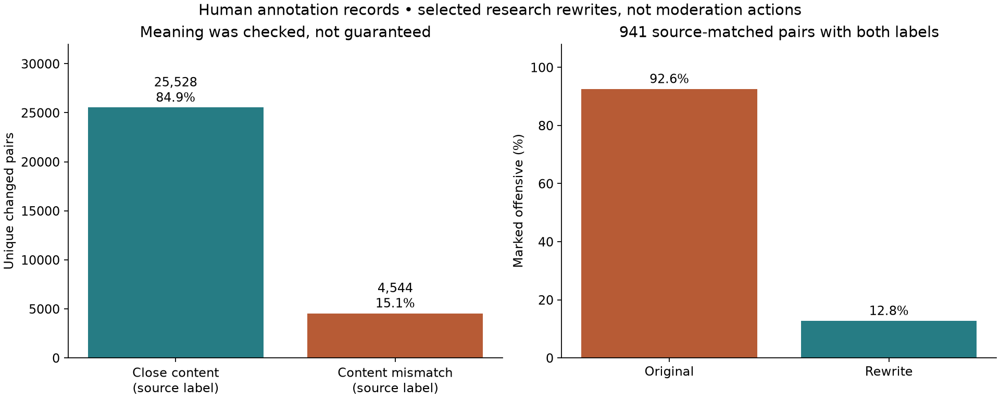
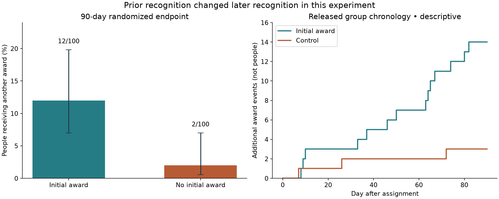

# Real data: wording, meaning and later encounters

Streams and Rocks • completed reanalysis • 21 October 2026

**Wording can change how a statement is judged, but preserving its meaning is a separate test. Prior recognition can also change later recognition.** These findings come from human annotation records and a randomized Wikipedia experiment. They do not establish the complete community model or a universal rule for how people remember treatment.

| Question | Completed finding | Evidence boundary |
| --- | --- | --- |
| Does changed wording preserve content? | 25,528 of 30,072 changed pairs were labeled close in content; 4,544 (15.1%) were not. | Publisher labels are fallible; close content is narrower than identical meaning or force. |
| Do judgments change within labeled matches? | Among 941 pairs with both labels, 754 changed from offensive to nonoffensive and 3 changed in the opposite direction. | A selected annotation contrast, not observed punishment or exclusion. |
| Does earlier treatment affect later recognition? | 12/100 initially awarded contributors received a further award, versus 2/100 controls: +10.0 percentage points. | Randomized evidence in one selected Wikipedia population; mechanism and negative treatment remain open. |

[Methods and limits](METHODS.md) · [Exact results](data/results.json) · [Data provenance](sources.json) · [Verification](verification.json) · [Community connections](../community-power/CONNECTIONS.md)

## Check the meaning before interpreting a wording effect

The [ParaDetox project](https://github.com/s-nlp/paradetox) releases human-written alternatives and separate content/offensiveness judgments. We read 32,317 content rows and 26,507 toxicity rows, removed duplicate records, and excluded 8 pair keys and 41 text keys with conflicting labels. These counts are records and texts, not numbers of independent raters.

There are 30,072 unique changed pairs with an unambiguous content label. The 4,544 rejected matches remain visible. Another 1,556 pairs have identical strings; eight of those nevertheless carry a mismatch label. That discrepancy is recorded as a label-quality concern, not silently repaired.

**A closer review found substantive changes even among accepted matches.** In a predetermined 24-pair sample, my single-assistant audit found 9 content changes, 3 uncertain cases and 12 with no clear core-content loss. For example, one rewrite drops an accusation that a number was fabricated; another changes criticism of a person into criticism of an action. These are reasons for independent human review, not a validated error rate for the whole dataset. The sample comes from the broader matched pool, not only the fully joined subset.

[All 24 audit decisions and reasons](data/meaning_audit.csv) are traceable to the pinned text files using pair hashes. The review preserves disagreements with the original labels. No new human raters were recruited.



## What the paired judgment comparison shows

| Original label | Rewrite label | Pairs |
| --- | --- | --- |
| Nonoffensive | Nonoffensive | 67 |
| Nonoffensive | Offensive | 3 |
| Offensive | Nonoffensive | 754 |
| Offensive | Offensive | 117 |

The fraction marked offensive falls from 92.6% to 12.8%: a 79.8-percentage-point reduction. Resampling the 717 original-text clusters gives a conditional 95% interval of 76.9–82.8 points. Giving each original equal weight yields 78.1 points. These intervals describe this selected corpus and fixed labels; they do not correct semantic errors or selection bias.

**Coverage is only 3.69% of accepted changed pairs.** We did not assume an original was offensive because its column was named “toxic.” Both labels had to exist in the released pool and agree across duplicate keys. Selection for the detoxification task also makes this an unsuitable estimate of ordinary language reception. The evidence supports different judgments under the dataset’s content criterion; it cannot establish a wording-only causal effect with complete meaning held constant.

**Preserve semantic force.** Criticism, anger, refusal and accusations need not be softened automatically. An offensiveness label does not establish that a claim is false, unwarranted or deserving of punishment. A rewrite that removes the point should be recorded as a changed statement, even if readers prefer it.

## Earlier recognition and later encounters

The [original randomized study](https://doi.org/10.1371/journal.pone.0034358) compared 100 Wikipedia contributors given an initial award with 100 controls over 90 days. It selected highly productive contributors who had not previously received such an award. The endpoint here is receiving any further award from other community members.

**The later-award rate was 12% versus 2%.** The difference is +10.0 percentage points, with a Newcombe–Wilson 95% interval of +2.9 to +17.9 points. Our two-sided Fisher exact test gives p = 0.0101. The risk ratio is 6.0, with a wide approximate interval of 1.38–26.12. Small endpoint counts make the magnitude uncertain.



This is evidence that initial recognition affected later recognition in that experiment. It does not distinguish public reputation, motivation, changed contribution or remembered experience. It does not establish that prior punishment has the same effect, or that every subsequent encounter changed.

**The data levels are explicit.** The statistical test uses the exact published 2×2 table, not newly recovered individual trajectories. The downloadable researcher-attributed file contains 242 group-day summaries. Its 14 versus 3 additional award events match the paper, while the endpoint concerns 12 versus 2 people. Its first control award is dated day 7 and its first treated award day 8. The article’s day-8 discussion concerns experimental recipients; these dates can coexist. Individual event-time trajectories remain unavailable. [Provenance of the aggregate file](https://learningds.org/data_sources.html).

## How this changes the community model

| Connection | Support now | Still needs testing |
| --- | --- | --- |
| Meaning → expression | Real content labels and a transparent audit show both preserved content and substantive alterations. | Independent speakers and reviewers must assess intended meaning, target, commitment and pragmatic force. |
| Expression → judgment | Selected content-matched pairs receive different offensiveness labels. | Actual comparable institutional or interpersonal treatment; context, policy and semantic equivalence. |
| Past treatment → later encounter | Randomized recognition increased the chance of later recognition in the Wikipedia study. | Negative treatment, other populations, mediation and complete longitudinal encounters. |
| Memory → decision | A plausible interpretation, still separated from the observed endpoint. | Whose memory or record changed; causal mechanism, retention and reset effects. |
| Water, fog, smoke, clay | Situational metaphors for adapting expression, partial understanding, circulating accounts and lasting impressions. | No dataset here measures these as fixed human types or validates material names as predictors. |

The same person can occupy several of these situations and can reject the description. The two datasets support parts of the argument separately; they do not connect all five parts in one observed chain. The [earlier synthetic encounter model](../community-encounters/README.md) remains a demonstration of chosen rules. Its wording penalty and memory parameters have not been fitted or validated by these results.

## Reproduce and inspect

All 13 unit tests passed. Saved-data checks verify joins, counts, source hashes, audit selection and the exact history test. No downloaded raw comments or participant identities are republished. The report includes the source downloader, analysis, audit reasons, derived counts and figures. The audit can be expanded locally for independent review.

```text
python -m pip install -r requirements.txt
python download_data.py
python -m unittest discover -p test_analysis.py -v
python run_analysis.py
python verify.py
python build_report.py
python inspect_audit.py
```

The protocol was recorded before these full-data summaries, after source findings and previews had been read. This is an exploratory reanalysis of existing evidence, not an untouched holdout or a newly conducted human experiment. [Analysis plan](data/protocol.json) · [Documented changes](data/protocol_amendments.json).
