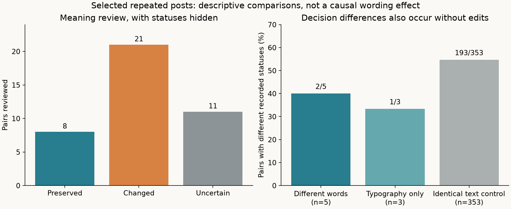
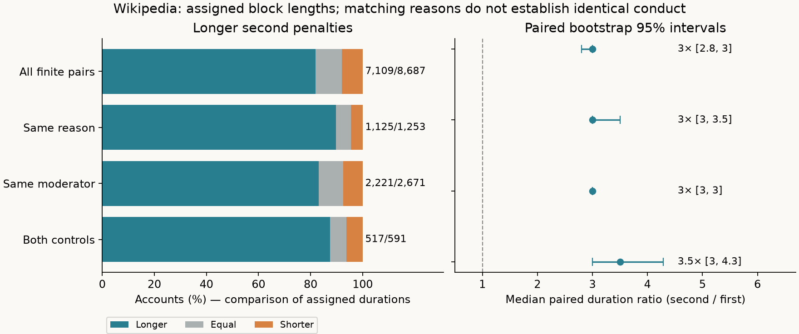

# Meaning, moderation and repeated penalties

Streams and Rocks · completed public-record analysis · 22 October 2026

**Three of eight pairs judged to preserve meaning had different recorded moderation outcomes. Second penalties were longer in 517 of 591 Wikipedia pairs sharing the same recorded reason and moderator.** These are observations from public records. Neither comparison isolates a causal wording or prior-penalty effect.

[Open the illustrated report](report.html) (download and open locally). [Frozen protocol](PROTOCOL.md) · [Complete meaning audit](results/semantic_audit.json) · [Wording results](results/wording_results.json) · [Penalty results](results/history_results.json).

## Wording: what was actually checked

The OFAI One Million Posts v1.0.0 corpus contains 1,011,773 German-language DER STANDARD forum posts. The analysis uses recorded `online`/`deleted` statuses, **not** researcher offensiveness labels. Data and schema: [official dataset](https://ofai.github.io/million-post-corpus/), [database schema](https://github.com/OFAI/million-post-corpus/blob/master/database_schema.md).

Retrieval pairs posts from the same author, article and parent, created at most 24 hours apart, excluding newspaper staff. After HTML decoding and whitespace normalization, full headline-plus-body text must contain at least five words and 30 characters. Changed candidates require character similarity >=0.85, token-set Jaccard >=0.75 and length ratio >=0.70. Similarity retrieves candidates; it does not establish meaning equivalence.

The outcome-free scan screened 156,965 context/time pairs. Greedy non-overlap selection yielded 520 changed-text candidates and 353 exact normalized-text controls. Forty changed candidates were chosen by fixed SHA256 order, independent of outcomes. The [selection receipt](results/wording_selection.json) pins the source, protocol and sample hashes. All selected changed pairs came from different authors; they span 38 articles.

A single assistant reviewed German headline/body text, article title and the available parent, assessing proposition, target, stance, negation, quantities, accusations and pragmatic force. The verdicts were saved and [hash-locked](results/semantic_audit_lock.json) before [joining the statuses](results/status_join_receipt.json). Eight passed, 21 changed meaning, and 11 were uncertain. Some texts themselves mention censorship or reposting, so blinding only hid the stored outcome fields. No independent German-speaking human reviewers or verified author intentions were available.

Removing an insult, demand or allegation was not treated as a harmless stylistic improvement. Strong wording is part of what was assessed. Ambiguous differences in accusation, emphasis or referent remained uncertain.

| Reviewed group | Pairs | Online / online | Online / deleted | Deleted / online | Deleted / deleted | Different statuses |
|---|---:|---:|---:|---:|---:|---:|
| Meaning preserved, provisional | 8 | 5 | 2 | 1 | 0 | 3/8 |
| Of these: different words/syntax | 5 | 3 | 1 | 1 | 0 | 2/5 |
| Of these: typography only | 3 | 2 | 1 | 0 | 0 | 1/3 |
| Meaning changed | 21 | 9 | 1 | 7 | 4 | 8/21 |
| Meaning uncertain | 11 | 4 | 3 | 2 | 2 | 5/11 |
| All identical-text controls | 353 | 52 | 179 | 14 | 108 | 193/353 |
| Hash-selected exact-control subset | 40 | 4 | 20 | 5 | 11 | 25/40 |

Columns refer to **earlier-created post / later-created post**, not the same post before and after moderation. The corpus has no decision timestamps or deletion reasons. Earlier creation does not establish that a penalty was already known when the later post was submitted.



The eight accepted pairs are from eight authors and eight articles. The two lexical disagreements were: adding an indefinite article before an unpaid role (online/deleted), and exchanging two expressions of complete agreement while retaining the argument (deleted/online). The other disagreement involved spacing after ellipses. See each frozen reason and outcome in the report; inspect original text locally using the command below.

The identical-text control is decisive for interpretation: **different treatment also occurs with no wording change**. Its 179 online/deleted versus 14 deleted/online pairs are compatible with duplicate-post moderation, among other explanations; the reason cannot be determined here. The control population is selected differently from the eight semantic passes and is not a randomized comparator. We do not interpret the difference in rates as a wording effect or population prevalence.

Tighter creation-time gaps retain 3/7 meaning-preserving differences within one hour and 2/4 within ten minutes; the exact controls are 146/253 and 91/152. The five lexical passes alone give 2/4 within an hour and 1/2 within ten minutes. Both non-top-level accepted pairs have their parent available; all eight article records are available. Full intervening conversation, moderator, reports, visibility and applicable duplication rules are not held fixed. A top-level post has no parent to inspect.

All 353 exact controls were mechanically checked for normalized text identity and matching context keys. They did not receive an independent semantic referent review. This is a narrower implementation of the planned exact-control audit, recorded rather than silently treated as human validation. Even identical words can acquire a different referent or pragmatic role over time.

## Repeat penalties: what the new controls show

The public [Cornell ConvoKit](https://convokit.cornell.edu/datasets.html) Wikipedia block-log release is associated with [Chang and Danescu-Niculescu-Mizil's 2019 study](https://arxiv.org/abs/1902.08628). We reuse the previously reconstructed source and episode rules, rehash the original 1.67 GB log, and newly compare exact nonempty initial-decision reason strings. The source log spans 23 December 2004 to 4 June 2018; it is a historical snapshot. This is an extension of earlier findings, not a new independent sample or unseen holdout.

Eligible named accounts have a finite first observed block from 2006 onward, a known episode end, no reconstruction problems and complete 180-day follow-up. A later block must begin after the first episode ended. Reblocks within an active episode modify it rather than create an encounter. Initial assigned duration is retained even if the block is later shortened, extended or lifted. IP-target records are excluded.

Of 57,600 eligible accounts, 18,784 had a distinct second block within 180 days: 10,097 initially indefinite and 8,687 finite. Duration ratios cover the finite pairs only. They do not estimate all subsequent encounters or the probability of receiving a penalty.

Reason normalization HTML-decodes, collapses whitespace and case-folds only; dates, evidence, links and target references remain. Same-moderator comparisons require nonmissing identities. **Matching reason text is not proof of matching conduct or severity.**

| 180-day finite-pair group | n | Longer second | Equal | Shorter | Median initial hours, first → second | Median paired ratio [95% bootstrap interval] |
|---|---:|---:|---:|---:|---:|---:|
| All pairs | 8,687 | 7,109 (81.8%) | 881 | 697 | 24 → 72 | 3.0 [2.8, 3.0] |
| Same recorded reason | 1,253 | 1,125 (89.8%) | 71 | 57 | 31 → 168 | 3.0 [3.0, 3.5] |
| Same moderator | 2,671 | 2,221 (83.2%) | 250 | 200 | 24 → 168 | 3.0 [3.0, 3.0] |
| Same reason and moderator | 591 | 517 (87.5%) | 37 | 37 | 31 → 168 | 3.5 [3.0, 4.29] |



The median paired ratio is calculated within each account, then summarized; it is not the ratio of the two marginal medians. Percentile intervals use 2,000 whole-account draws, seed 20261021, on the median log2 ratio, transformed back. Repeated round-number penalty lengths can produce degenerate percentile intervals. Shared moderators may create residual dependence that this bootstrap does not model.

For both controls, the exact two-sided sign test excludes 37 ties and gives p=2.51e-109. This tests directional symmetry in the selected finite-pair cohort; it is not a test of causal history dependence. The Spearman correlation of first and second log-duration is 0.573 (same reason alone: 0.537). Full p-values and underflow-safe log10 p-values appear in JSON. Correlation and escalation do not identify why the decisions differ.

Shorter-gap sensitivities retain the same complete-180-day cohort. With both controls, the 30-day result is 437/505 longer (86.5%), the 90-day result is 493/567 (86.9%), and the 180-day result is 517/591 (87.5%). All three have a median paired ratio of 3.5. All 12 group/window summaries are published, including negative and tied changes.

## Meaning, expression, context, treatment and memory

| Connection | Supported here | Still untested |
|---|---|---|
| Meaning → expression | Eight provisionally equivalent pairs, including five lexical/syntactic changes, reviewed before outcomes | Independent semantic review and intended-meaning confirmation |
| Expression → treatment | Three accepted pairs have different statuses; exact text often does too | Whether wording itself caused the difference |
| Context → treatment | Author/article/parent and time window explicitly constrained | Full conversational state, rules, moderator and exposure |
| Treatment → later treatment | Strong observed escalation, persisting under exact reason and moderator controls | The effect of prior punishment holding current conduct comparable |
| Memory | Real penalty sequences are compatible with institutional history | A causal visibility test or empirically calibrated memory update |

The same person can still be Water, Fog, Smoke or Clay in different situations, combine these descriptions or refuse the labels. These records concern treatment and cannot define fixed human types. Keep strong language about force, exclusion, resistance and adaptation with its observation or attribution; do not quietly replace a substantive accusation while claiming its meaning stayed unchanged.

The next useful evidence is specific: independently adjudicate the eight accepted German pairs and the eleven uncertain ones with statuses hidden; recover decision timestamps/reasons and duplication policy; and obtain current-conduct measures plus variation in whether decision-makers see prior penalties. A causal history test needs comparable encounters and a defensible identification strategy, not merely additional repeat blocks.

## Reproduce the completed work

Python 3.12. The original run used NumPy 2.5.3, SciPy 1.18.1 and Matplotlib 3.11.2; exact requirements are supplied. Commands run from this study directory. Raw downloads stay in the chosen local folders and must not be committed. The Wikipedia download is about 1.67 GB; the OFAI archive is about 106 MB.

```bash
python -m pip install -r requirements.txt
python run_checks.py
python build_report.py

# Full source reproduction, including retrieval independent of outcomes:
python download_data.py --which wording --raw raw-wording
python find_wording.py --db raw-wording/million_posts.sqlite --private raw-wording
python compare_wording.py --db raw-wording/million_posts.sqlite --private raw-wording

# Inspect one published pair locally; status hidden unless --show-status is added:
python inspect_pair.py --db raw-wording/million_posts.sqlite --private raw-wording --pair-hash 11c40ce1969a

# Build the episode cache only if it does not already exist:
python download_data.py --which history --raw raw-history
python prepare_blocks.py --raw-dir raw-history
python analyze_history.py --raw raw-history --private raw-history
python run_checks.py
python build_report.py
```

Reproduction reuses the published frozen semantic judgments. It reproduces the arithmetic, not an independent human assessment. To obtain independent review, use the locally recovered texts and a separate review file; preserve the original audit and report agreement/disagreement before seeing statuses. Hash order is deterministic rather than an external randomized experiment.

**Completed validation:** 23 unit tests and 189 saved-result checks; all 12 history summaries and 24 status tables independently recomputed from published histograms; outcome-free retrieval repeated with exactly matching sample/selection files; source hashes verified. [Test receipt](results/run_checks.json), [result checks](results/verification.json), [retrieval rerun receipt](results/retrieval_rerun.json). A first unit-test attempt hit a sandbox temporary-directory permission error; using a verified directory within the study fixed that infrastructure issue. No findings or audit verdicts were changed to make a test pass.

The protocol was frozen on 21 October local date and the review finished on 22 October. It is exploratory, not externally preregistered. [Data licenses and provenance](DATA_LICENSE.md), [pinned sources](sources.json), [publication manifest](manifest_sha256.json).
