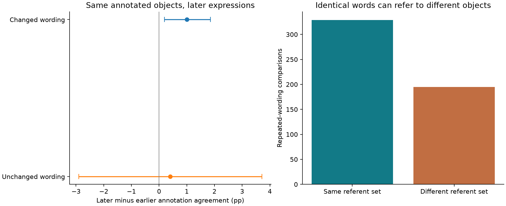
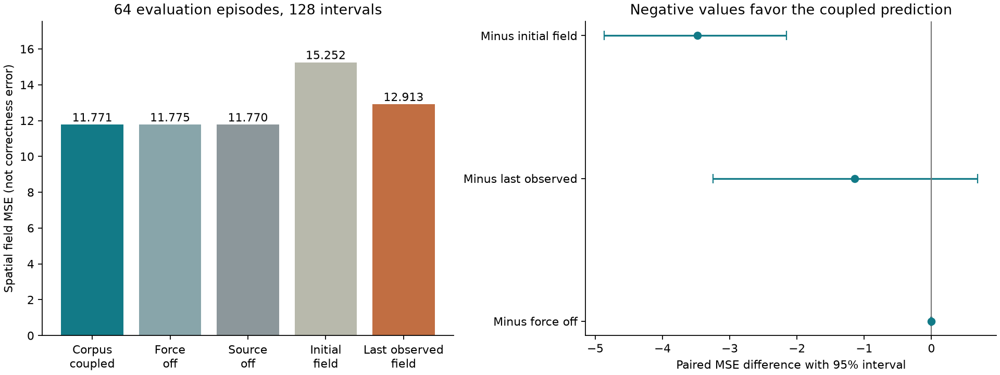
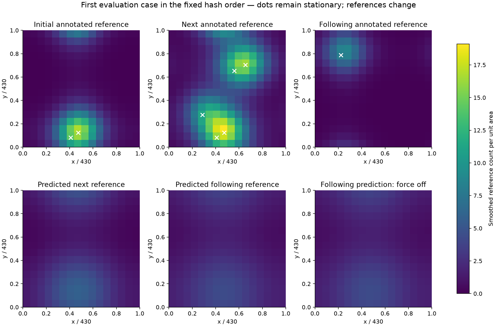

# Real reference, expression and interaction over time

**Completed 22 October 2026 for Streams and Rocks.** We acquired OneCommon, a new public source with human reference interpretations, actual expressions, message timestamps and object coordinates. We ran the coupled corpus equations against observed spatial reference fields under an explicit measurement hypothesis. The model improves over keeping the initial field fixed, but its advantage over the last observed field is uncertain, and switching off its added force gives almost the same performance.

[Illustrated report](report.html) · [Frozen protocol](PROTOCOL.md) · [Sources, equation traceability and limitations](SOURCES.md) · [Field results](results/field_results.json) · [All episode predictions](results/predictions.csv)

## What changed from the earlier correctness test

The previous comparison used correct/incorrect task answers as an assumed field observable. Here the reference labels are made by multiple human annotators, linked to actual visible objects and dialogue times. This measures **a specific part of meaning: what an expression refers to**. It does not measure all intended meaning, the speaker's private utility or every social implication.

The source is [Udagawa and Aizawa's OneCommon reference-resolution corpus](https://doi.org/10.1609/aaai.v34i05.6442), pinned to [repository commit 19125f2](https://github.com/Alab-NII/onecommon/tree/19125f2edc38c20341bfbb1756154aacdaa4f149). We searched CoDraw and Minecraft dialogue resources as alternatives; the [source comparison](SOURCES.md) explains the selection. Original dialogue text and worker identities are not republished.

**The earlier 0.140 versus 0.104 result meant the proposed correctness mapping added complexity without improving prediction.** The new errors below have different units—spatial reference-field error—and must not be compared numerically with those correctness errors.

## Meaning, wording and interaction: actual observations

The downloaded source contains **6,760 dialogues**, with reference annotations for 5,191. The original project annotated successful dialogues only. After excluding 129 dialogues with administrative adjudication, this analysis uses **5,062 dialogues**. It retains **32,795 expressions** with concrete, non-ambiguous aggregate referents and at least three worker judgements. It excludes 3,259 expressions lacking concrete/confident reference under this rule and 4,330 lacking the required worker votes. These are counts from the pinned repository version, not an asserted reproduction of every earlier paper total.

All 5,191 annotated dialogues matched original message counts and speaker order during schema inspection; original message times were strictly increasing. The expression text has the authors' spelling/grammar normalization. Annotators had access to full conversations, so their current-reference labels may reflect later context. This is a retrospective annotation test, not a live language-understanding evaluation.

There are **5,358 within-speaker pairs** referring to the same annotated object set in different utterances: **5,045 use changed wording** and 313 use unchanged wording. Among changed-wording pairs, later interpretation agreement is **1.00 percentage points higher**, with a whole-dialogue bootstrap interval of **[0.19, 1.85] points**. The unchanged-wording change is 0.41 points, with interval [-2.90, 3.72]. These are separate within-group changes, not a randomized changed-versus-unchanged effect.

**Same referent is narrower than same meaning.** An abbreviated reference can identify the same dot while dropping descriptive content and relying more on context. Later context also changes. The result does not establish that changing wording caused better understanding, nor does annotation agreement directly measure the other participant's understanding.

Conversely, **195 of 524 repeated-wording comparisons refer to different object sets**. Identical words do not guarantee identical reference. Across **12,188 consecutive cross-speaker eligible transitions**, mean within-dialogue referent-set Jaccard overlap is 0.511 [0.503, 0.518]. This records shared/different reference through interaction; it does not establish copying, rivalry or a causal memory effect.



## Your governing equations remain the specification

```text
u_t + (u·grad)u = -grad(p) + nu Lap(u) - (sigma/rho) a(q)e
div(u)=0; q=|grad(S)|-Gamma
S_t + u·grad(S) = D Lap(S) + K_h kappa A
A_t=gamma(U-Ubaseline); A(0)=0
T=mu0 (grad(u)+grad(u)^T)
```

These are the coupled momentum, incompressibility, field transport, accumulated input and stress relations from P229–230, P517–519 and P545–550 of your [exact corpus excerpts](../community-mimesis/corpus_extract.json). Sharp, original signed tanh and smooth exact-off responses remain separate laws. We retain the signed tanh tail, the fixed force direction and the velocity zero mode. There is no added decay, logistic decision score, clipping of S or substitution of drag for the corpus force. The batched implementation is tested against the unchanged [single-case solver](../community-full-field/field.py).

**H_ref is the added measurement hypothesis:** each utterance's distinct annotated referents become a smooth spatial S field, with one unit integral per object. U is the mean agreement of human interpreters for that utterance, used as an explicit recoverability-utility proxy. The model receives annotated states and agreement values; it does not infer these from raw language. Personal utility and Sens are not thereby measured.

Positions come from each speaker's own view, scaled by 430 coordinate units. Actual elapsed time is measured in minutes. Objects stay stationary; the location of reference changes. The unit-square periodic topology, kernel width .12, initial u=0, initial A=0 and fixed source at the initial referent centroid are explicit assumptions. The source does not measure those latent flows or supply physical periodic social boundaries. These choices are detailed in the protocol.

## Training-only selection and reserved evaluation

There are **1,657 eligible speaker episodes**, each containing the first three retained referential utterances with positive intervals no longer than 120 seconds. A fixed hash rule assigned entire visual scenarios to training or evaluation. The numerical pilot selects **64 independent scenario episodes in each split** in hash order, with no error-based selection. The 128 numerical episodes are a tractable subset; descriptive analyses above use all retained records.

On the 64 training episodes, the integrated mass identity fits Ubaseline=0.851562, gamma=1 and **kappa=0.134074**. Nine coupled candidates and three force-off controls were evaluated on training fields only. The selected coupled candidate has **sigma=0.0001, D=0.01**, nu=.02 and Gamma=1. This is the smallest tested positive force and largest tested diffusion; it is not a unique measured human constant or a demonstrated global optimum. The [selection lock](results/fit_lock.json) was written before evaluation.

The coupled system evolves across both measured intervals without a middle-state reset. Its next source input uses only the previous observed annotation agreement. The last-observed-field control receives the actual middle spatial field for its second prediction, an information advantage; the initial-field control uses the same initial spatial observation as the model. Both are shown.

| Evaluation method | Spatial MSE | Spatial MSE after removing field-mean error |
|---|---:|---:|
| Coupled corpus field | 11.771281 | 7.629453 |
| Force off, training-selected diffusion | 11.774654 | 7.632825 |
| Accumulated source off | 11.770454 | 7.629829 |
| Keep initial reference field | 15.252075 | 11.111450 |
| Keep last observed reference field | 12.912574 | 9.240699 |

Each episode contributes the mean of two interval errors, each averaged over the observation grid. There are **128 evaluation intervals**. The coupled-minus-control paired MSE differences, with 2,000-resample scenario bootstrap intervals, are:

* Initial-field control: **-3.4808 [-4.8666, -2.1531]**.
* Last-observed-field control: **-1.1413 [-3.2468, 0.6899]**.
* Force-off control: **-0.00337 [-0.00957, 0.00255]**.

Negative values favor the coupled prediction. **The pilot supports improvement over a frozen initial field, but does not establish an advantage over the last observed field or over force-off diffusion.** Removing the accumulated source barely changes the score. Most of the improvement is also available without the proposed field-dependent force. The alternative tanh and smooth-off scores are 11.771282 and 11.771299; they are sensitivities at fixed parameters, not independently tuned winners. Kappa is positive here, so the nonnegative-kappa control is identical.



## What was actually simulated and checked

The run completed **768 training episode simulations** (12 candidates × 64), **384 evaluation episode simulations** (six settings × 64), and **eight refinement simulations**. The two persistence controls are computed directly from observations. Every numerical episode solves the coupled PDE system; this study does not assess only its total-field identity.

The selected model's maximum mass-identity error is 2.91e-14, divergence RMS is at most 9.50e-20, and instantaneous energy work/dissipation residual is at most 1.69e-21. The latter checks accounting of forcing and viscous loss, not energy conservation in a driven dissipative model. Pressure and symmetric stress diagnostics are saved; neither was measured in the conversations.

For the first four evaluation cases, final combined field/velocity differences between 16² and 32² grids range from 2.07e-06 to 6.44e-06. Halving the 16² time step changes final component-RMS values by at most 5.06e-12. On those **same four cases**, coarse-grid MSE is 5.623003 and finer-grid MSE is 5.623008; these subset scores are not the all-64 score. Grid differences are not exact-solution error estimates, and only four cases were refined.



**12 unit tests and 2,851 saved-result checks pass.** They cover source/selection provenance, batch-versus-single-case dynamics, analytical accumulated mass, pixelwise errors, bootstrap intervals, incompressibility and energy accounting. All candidate scores and all failures/limits are retained.

## What the new evidence supports

The same annotated object set can persist while expression changes, and the same words can point to different objects. That is a concrete, observable connection between reference, expression and context over time. It is compatible with **preserves Sens while adjusting Sin**, but it tests only the referential component of that distinction.

The field model can now be compared against spatially grounded reference trajectories. This is a stronger test than the earlier correctness mapping, yet **the distinctive force and accumulated source have not earned a demonstrated predictive advantage here**. Diffusion-like smoothing accounts for much of the apparent gain. Numerical precision cannot resolve missing empirical definitions of social velocity, pressure, utility or decision coupling.

This source has no matched moderation decisions, penalty histories or unsuccessful annotated dialogues suitable for testing rivalry outcomes. Water, Fog, Smoke and Clay remain situational descriptions; we do not assign those types from reference agreement. A successful reference task is not proof of a helpful double, and a shifted referent is not proof of a rival.

## Reproduce

```bash
python -m pip install -r requirements.txt
python -m unittest -q
python verify_saved.py
python download_data.py --raw /your/local/onecommon
python extract.py --raw /your/local/onecommon
python analyze.py
python verify_saved.py
python build_report.py
```

Run inside this study in the repository; it imports the pinned community-full-field solver. [Source and units](SOURCES.md), [protocol](PROTOCOL.md), [verification receipt](results/verification.json), [numeric episodes](results/episodes.json), [field arrays](results/scalar_predictions.npz), and [compressed wording-pair records](results/wording_pairs.json.gz) make the calculation inspectable. The gzip files contain JSON and are losslessly readable with Python's standard gzip module. Source texts and worker IDs remain outside the published package.
