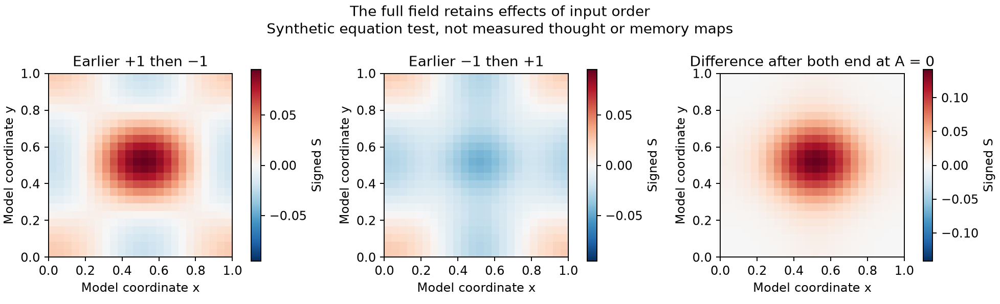
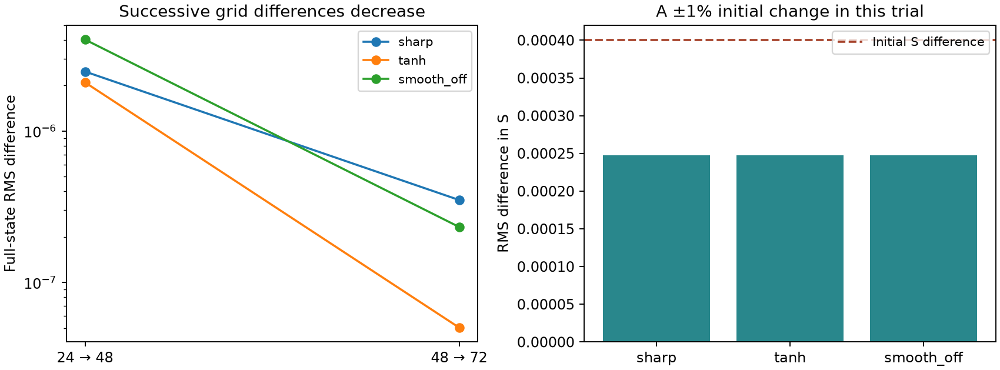

# History and form tests for the two in one

Streams and Rocks · 23 October 2026

**The full empirical two-in-one model is not finished or validated.** This study adds a runner that keeps each person’s state and input history separate, 36 coupled equation trials, and a new audit of 840 real thought probes from 24 people. The trials expose both retained history and missing role distinctions. No simpler predictor or movement-only score is presented as the requested full-model test.

Smoke is inward putting-forward and Clay is inward receiving within one person. Wind, Fog, Mist and Water are forms of the moving idea. Water is perceived balance. The author now gives D₂O a distinct role: a small compositional change can have a large consequence, potentially changing something life-saving into something life-threatening. Testing that claim requires specified changes and observed consequences; the mathematical threshold is not automatically a harm boundary.

| Completed | Result | Meaning |
| --- | --- | --- |
| Exact corpus dynamics | 36 synthetic coupled trials and one analytic check | No change to the audited solver |
| Person-specific runner | State, input order, role attribution and event references preserved | Missing initial state or utility and cross-person/gap-filled histories are rejected |
| New real records | 24 people; 47 sessions; 140 runs; 840 probes; 10,920 item rows | Measurement coverage, not 10,920 independent people |
| Verification | 14 unit tests; 89 saved checks | Numerical and source-accounting checks |
| Full empirical fit | Not performed | Required observation functions and joint measurements are absent |

## What the exact equations say about history

Reversing two earlier input intervals leaves both final accumulators at A≈0 and the current input at zero. Nevertheless, the full fields differ. Under the declared periodic boundaries, final mean S is +0.012 for the +1 then −1 history, and −0.012 for the reverse. The sharp-law S difference is RMS 0.039880 and the velocity-component difference RMS 0.003339. History therefore can matter beyond the present accumulator. These units and histories are synthetic, not psychological measurements.



Changing only the Smoke/Clay attribution of an otherwise identical input sequence produces exactly the same computed state in all three response laws. This is expected because those labels do not enter the supplied equations. The runner preserves that provenance, but does not invent a force or a separate history equation from it. This identifies a missing coupling or observation rule; it does not establish that the inward functions are equivalent in people.

## Why a freely fitted interpretation would be ambiguous

Doubling S, its initial amplitude, the threshold, the smoothing parameter and κ, while halving σ, leaves the complete velocity and pressure fields unchanged and doubles S. All three response laws obey this scaling, and all paired numerical differences after undoing the S rescaling are exactly zero. A measured movement signal alone therefore cannot choose the scale of the context field and these parameters. A calibrated observation of S, a fixed scale, or another justified constraint is needed.

Changing unknown observation-start A from −0.1 to +0.1, conditional on the same starting field, changes the later S field by RMS 0.022713 in the sharp-law trial. Those are sensitivity conditions, not recovered biographies. The runner accepts explicitly supplied nonzero observation-start A while preserving the original integral’s origin. It never interprets unobserved history as zero.

## Small changes and the D2O question

The initial S amplitude was varied by ±1%, giving an initial pairwise S RMS difference of 0.000400. The final difference is about 0.000247 for each response law: this particular perturbation contracts in S. A large consequence is therefore not demonstrated by this trial. Other settings may behave differently. The tests contain no measured benefit/harm outcomes and no chemistry or toxicity calculation.



| Law | Grid 24 versus 48 | Grid 48 versus 72 | Half-step difference |
| --- | --- | --- | --- |
| sharp | 2.48e-06 | 3.51e-07 | 3.46e-12 |
| tanh | 2.1e-06 | 5.03e-08 | 2e-14 |
| smooth_off | 4.03e-06 | 2.33e-07 | 3.3e-14 |

Maximum mass-accounting error is 6.07e-17; divergence RMS 1.74e-17; Taylor–Green analytic velocity error 1.91e-14. Finite checks do not prove a general Navier–Stokes theorem.

## What the real records can establish

The [NEMAR experience-sampling source](https://doi.org/10.82901/nemar.on007216) provides repeated reports of thought movement, verbalness, visualness, affect, arousal, attention, intentionality, disengagement, temporal focus, self/other focus and confidence. All 280 selected files passed their upstream hashes. The audit found the expected 13 item rows in each of 840 probes. The 19 nonnumeric/nonfinite development responses are retained as missing, including a fully blank probe; no values are imputed.

Eight participants remain reserved from response analysis and model selection. Their file structure, item presence and timestamps were audited, but their response values were not summarized or fitted. This is a source suitability assessment. There is no held-out prediction claim. Sequential question timings are not continuous measurements of thought.

| Required construct | Closest source item | Why it does not establish the construct |
| --- | --- | --- |
| Inward speaking and receiving | Verbalness | Does not distinguish putting-forward from what was understood or refused |
| Meaning and idea content | No content transcript | A rating does not identify the idea’s claim or implications |
| Personal and role-specific memory history | Earlier reports and past-focus ratings | No event contents or separate role references; unrecorded gaps remain unknown |
| Water / perceived balance | Affect and arousal | Pleasantness or activation is not perceived balance |
| Fog / memory clarity | Confidence in answering the probe | Does not directly measure a recalled memory’s vividness or accuracy |
| Wind / experienced time | Past and future orientation | Temporal focus is not felt distance or distortion |
| Mist / unspoken agreement | No direct item | Silence, calm and endorsement cannot be interchanged |
| D2O / small change with large consequence | No paired compositional change/outcome | Cannot infer help or harm from the movement scale |
| U and continuum states | No calibrated utility or spatial field observation | Renaming a rating would add an unsupported measurement assumption |

## What is needed to finish the requested application

The remaining work is substantive: define and calibrate observations linking the inward functions, meaning, history and forms to the existing fields, and obtain records that can distinguish those links. The [measurement record](MEASUREMENT_RECORD.md) specifies what must be observed. The [current form definitions](form_definitions.json) retain the author’s meanings. The [readiness finding](READINESS.md) explains why a movement-only fit would be another incomplete substitute.

The same mathematical core may support several observable outputs without a separate dynamical equation for every form. However, those output functions are not supplied by the corpus and cannot be established by a column name. Any new coupling or measurement rule must be identified as an addition and tested. The W consistency condition, exact-margin utility optimization and reciprocal scalar rescaling remain separate corpus relations; they have not been silently renamed as inward role dynamics.

## Reproduce and inspect

```text
python -m pip install -r requirements.txt
python fetch_data.py
python audit_records.py
python run_exact_tests.py
python -m unittest discover -p "test_*.py" -v
python verify_saved.py
python build_report.py
```

Run inside this study directory. Downloads are limited to public behavioral records and dictionaries; raw files stay outside the publication directory. The [frozen protocol](PROTOCOL.md), [numerical plan](NUMERICAL_PLAN.md), [source manifest](source_manifest.json), [source review](SOURCES.md), [data audit](results/data_audit.json), [equation results](results/equation_results.json) and [verification](results/verification.json) distinguish planned, computed and unmeasured quantities.

[Current two-in-one model](../community-two-in-one/MODEL.md) · [Inverse translation](../community-two-in-one-field/INVERSE_TRANSLATION.md) · [Streams and Rocks community model](../community-power/README.md)
