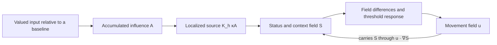

# Recovering the ideas behind the field equations

**One person puts an idea forward inwardly, receives and reconsiders it, and changes how it moves through their own history.** Smoke names the speaking function; Clay names the listening function. Wind, Fog, Mist, Water and the other forms describe the moving idea. Water is perceived balance, which can coexist with movement or unresolved disturbance.

The author explains that these ideas came first and were translated into a format made to fit Navier–Stokes. The equations retain a movement–context feedback loop and accumulated input. They do not retain every distinction in the original account. This reconstruction works backward from the supplied mathematics and the author's clarifications.

Three kinds of statement are distinguished below: **author definition**, **corpus mathematics**, and **reconstructed connection**. A reconstructed connection is an interpretation to evaluate against experience, not an already measured psychological mechanism. The original step-by-step translation is not available, so its unique original wording cannot be recovered from the equations alone.

## The inward process

Smoke puts something forward. Clay receives, holds, challenges, reshapes or refuses it. The idea can return differently, retain its meaning, become less clear, or move peacefully. Both functions belong to the same person and can draw on different parts of that person's history. The process need not consist of literal inner speech, and the material forms are not permanent types of people.

The closest connection already present in the mathematics is this loop:

The arrows show dependencies in the corpus equations, not a measured sequence of human causes. **Smoke and Clay are proposed functions operating through this loop, not names for two arbitrarily selected coordinates.** Introducing or reformulating what is considered is a possible Smoke-related operation. Receiving it in a remembered context and altering what happens next is a possible Clay-related operation. The source alone does not constitute Smoke, and the threshold force alone does not constitute Clay: neither term records what was said inwardly, understood or refused.

## Reading the exact equations backward

The notation abbreviates the corpus's D_diff as D, Γcrit as Γ, and fixed unit direction e_k as e. It changes no equation. Paragraph numbers refer to the [source trace](corpus_trace.json).

| Corpus term | Mathematical meaning retained | Reconstructed connection |
| --- | --- | --- |
| S(x,t), paragraphs 516–517, 524 | Signed status/context field on a specified continuous domain | The changing context in which the person encounters the idea. It is not automatically the idea's whole meaning, Smoke or Clay. |
| u(x,t), paragraphs 229, 526 | Velocity field transporting S | How movement through the declared idea/context space is organized. Its coordinates and units need an experiential interpretation. |
| u · ∇S, paragraph 517 | Advection of S | Movement carries context forward. It does not by itself certify preservation of intended meaning. |
| K_h κA, paragraphs 517–519 | Localized signed source, with kernel integral one | Accumulated influence can keep introducing or reintroducing input. Linking a source to an inward utterance requires observing that utterance. |
| A_t = γ(U − Ubaseline), A(0)=0, paragraphs 518, 532 | Integral of excess utility since the model's origin | Accumulated influence from what matters relative to a reference. It is not a list of memories or an automatic emotion score. |
| q = abs(∇S) − Γ, paragraphs 230, 548 | Local variation of S and its excess above a threshold | Differences in context can produce a response under the chosen law. A gradient is not automatically disagreement between the inward positions. |
| −(σ/ρ)a(q)e, paragraphs 230, 549–550 | Threshold-dependent force in a fixed direction | A possible redirection of movement. Calling it refusal, resistance or disturbance requires evidence for that interpretation; the force can also add energy. |
| u_t + (u · ∇)u, paragraph 229 | Local and convective acceleration | Movement depends on the existing flow and its variation, as well as forcing. This is not yet a demonstrated psychological inertia law. |
| νΔu and DΔS, paragraphs 229, 517 | Smoothing of velocity differences and diffusion of S | Nearby parts of the declared domain influence one another. These terms do not define forgetting, reconciliation or peace. |
| −∇p and div u = 0, paragraph 229 | Pressure enforces incompressibility under the chosen boundaries | Inherited fluid constraints. Neither felt pressure nor perceived balance follows from them. |
| T = μ0[∇u + (∇u)ᵀ], paragraphs 545–546 | Symmetric Newtonian viscous stress | Deformation within the analogy, not a measurement of distress or treatment without an observation link. |

The inverse reading is: **accumulated influence changes the context in which an idea moves; movement carries that context; context differences can redirect movement; inward putting-forward and receiving are functions to locate in that process.** The feedback terms are present. Separate states for the two inward functions are not present in the supplied field system.

## What the translation left unspecified

| Author's distinction | What the model retains | What remains unspecified |
| --- | --- | --- |
| Smoke and Clay within one person | Coupled movement and context, sources and responses | Separate reports or states identifying inward putting-forward and receiving |
| Moving idea and Sens | Transport and a distinction between intended meaning and encoded expression | A relation between a field state and the idea's claim, target, force and implications |
| Each person's own history | Person-specific initial fields and inputs; accumulated A | Which memory belongs to which function, what it contains, and how it is retrieved now |
| Water as perceived balance | Changing or steady flows can occur | Perceived balance observed separately from calm, agreement and unresolved tension |
| Fog and variable memory clarity | Field variation and diffusion | Vividness, certainty and accuracy; no equation requires old memories to fade |
| Wind and experienced time | Evolution in model time t | The relation between clock time, event age and felt temporal distance |
| Mist: author-named form; narrower agreement interpretation provisional | A context field can organize a proposed interpretation, but does not define this form | Establish the experiential distinction first; agreement/endorsement observations would test only the narrower proposal |
| Heavy water D₂O | Subsequent author clarification: a small compositional change can have a large consequence | The specific change, its size, context, observed consequences and benefit/harm criteria; molecular mass alone does not supply them |

The Navier–Stokes format adds a continuous geometry, local derivatives, incompressibility, smoothing terms and Newtonian stress. The supplied coupling adds a single accumulated scalar, localized source, threshold and fixed force direction. Constant coefficients, periodic boundaries and a unit-square domain in the numerical trials are additional declared computational choices. These are inspectable assumptions, not consequences of the material names.

The threshold alternatives also differ. Sharp and smooth exact-off responses give zero added force below threshold. The supplied tanh choice has a negative tail there and can reverse the added force. Removing that tail would change the law. A fixed-direction force is not automatically opposed to motion. A slowing or outward spiral cannot alone establish listening, refusal or peace.

## Recovering history

A(t) preserves cumulative net input in the selected units. If equal positive and negative contributions cancel, A alone does not reveal their order or contents. The spatial fields may preserve further effects of intervening evolution, but those effects are not labeled as particular autobiographical memories. Separate histories of putting-forward and receiving cannot be recovered by renaming the single accumulator twice.

The origin in A(0)=0 is the integral's origin, not necessarily the start of a recording. Earlier inputs may already have produced nonzero A and structured u and S when an observed episode begins. Specifying earlier inputs or an uncertain observation-start state consistent with prior evolution can preserve the equation. Missing biography is unknown, not zero. No forgetting term is added.

The completed numerical checks establish a further limit: multiplying γ by four and dividing κ by four changes A's scale while leaving κA and all calculated u, S and p values unchanged in the paired trials. Field observations alone cannot choose those scales independently. This identifies a calibration that the translation cannot recover by itself; it does not invalidate the original ideas. See [the numerical findings](README.md).

## The other corpus equations

Sens and Sin distinguish intended meaning from expression shaped by a setting (paragraph 22). This helps ask what survives inward reformulation, but supplies no measurement of meaning. The scalar S must not silently be treated as an abbreviation for Sens.

W equality compares treatment across actors within a declared context (104). Exact-margin utility optimization describes selection among available permitted actions (105–107). They can inform questions about internalized rules, but have no specified dynamical coupling to inward Smoke and Clay.

The reciprocal transformation [S,R] → [λS,R/λ] preserves SR (497–506). Its entries are scalar variables, distinct from spatial coordinates. Two entries alone do not make it the two-in-one: the transformation supplies neither two histories nor time evolution. These expressions remain in the corpus; their coupling to this application remains unresolved.

## Testing the reconstruction

Update on 23 October: the author's D₂O clarification is now included above. The [new history and form tests](../community-two-in-one-application/README.md) test input order, role relabeling, state scaling and a small perturbation in the unchanged equations, and audit a new public repeated-report source. These findings do not complete the missing empirical observation functions.

The reconstruction specifies a conceptual correspondence: **putting forward, receiving and returning occur within one evolving person-specific process.** It does not fix how many units of S correspond to a report, where a thought lies in the continuous domain, or which observation identifies a source or threshold response. Those are operational choices to evaluate, not ideas the author must invent again from scratch.

Preserve an episode's wording and distinguish what the person reports putting forward, receiving, changing and retaining. Allow nonverbal episodes, unknown histories and cases where the two functions cannot be distinguished. Record intended meaning separately from an analyst's embedding; perceived balance separately from unresolved disturbance; remembered content separately from clarity and felt age. A candidate mapping must say what would contradict it, including peaceful movement and vivid old memories.

The audited public source has 118 people, 12,104 timed expression records and 6,434 annotated thoughts. It supports analysis of expressed thought trajectories. It does not independently label the full inward exchange, utility or the author's idea forms. Assigning those labels from embeddings would turn an interpretation into a supposed measurement. These records remain development material for evaluating an observation map, not evidence that this reconstruction is already true.

After calibration, an observation map can connect partial records to the **full coupled corpus equations** for reserved-data or prospective predictions. Disabling the source or threshold force can test whether those mechanisms improve predictions while retaining the full model as the object of study. An added state for distinct histories would be a declared extension. No simpler predictor or new empirical result is introduced here.

## Provenance and status

Author definitions: the clarifications in this conversation, including that the ideas preceded their Navier–Stokes translation. Mathematical source: *Plain Language Corpus Math and Logic Corrected*, SHA256 `01f9ab0942f9c88982863e2ffc1e3c495786b5e6b67a26ae77d18235e7058acf`; [exact selected paragraphs](corpus_trace.json). [Current definitions](../community-two-in-one/MODEL.md) · [Completed field audit](README.md) · [Measurement contract](MEASUREMENT_CONTRACT.md).

This revision changes the interpretation and testing specification. The exact solver, saved numerical results and frozen protocol are preserved. The interpretation is not a diagnosis or a validated fluid law of inward experience.

## Source-chain correction: the roles have an architectural anchor

The full corrected corpus already assigns transmit/I to a=(2,3,1), receive/Self to b=(2,3,2), sink/buffer to c=(1,3,2), and perimeter to d=(3,3,1), in paragraphs 72–91. Smoke can be read in relation to transmit and Clay in relation to receive. Earlier statements suggesting no mathematical anchor at all were too broad.

These are source-assigned roles and static coordinates, not measured locations in a person. The original receive description includes external or auxiliary input; the author's later within-person two-in-one is a further interpretive specification. No evolution law for these four nodes, mapping from them to the PDE domain, or measured role-specific history follows from the coordinates alone. Retaining that distinction preserves the source instead of replacing the user's theory.

Mist as specifically internalized or unspoken agreement is an operational interpretation previously introduced in the reports. The author supplied Mist as a form of the moving idea, but did not uniquely assign that narrower meaning. Keep it provisional. Water's perceived balance and D2O's small-change/consequence distinction remain the author's explicit clarifications. Strong language remains when warranted by the observed and attributed account.

See the [complete chain audit](https://github.com/NousVolition/Nous-Volition/tree/main/studies/community-chain-audit), including exact source passages and unresolved measurement requirements.
