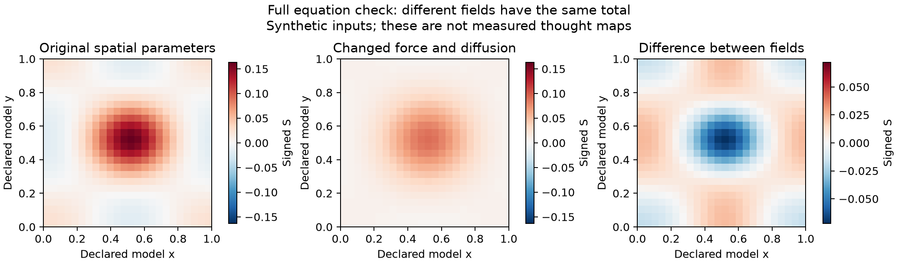
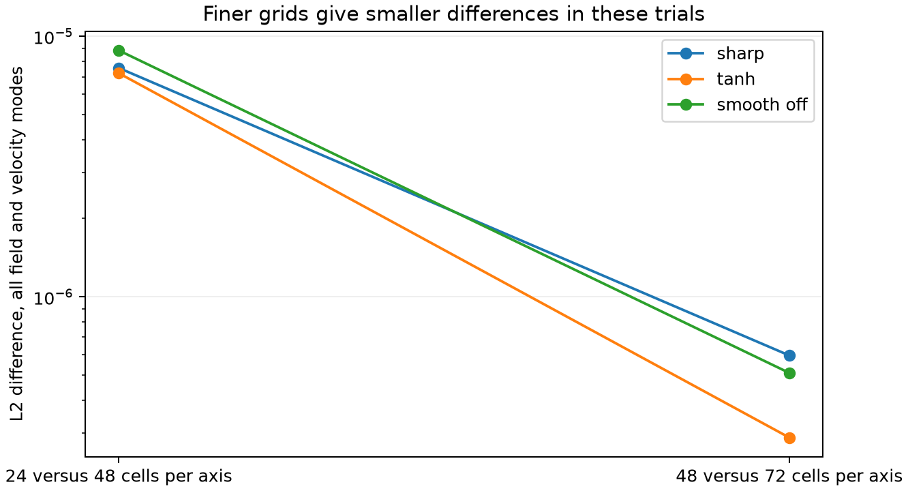

# Exact corpus equations and the two in one data audit

<!-- chain-audit:start -->
Audit update, 23 October 2026. The corpus contains transmit/I and receive/Self roles at P72–91. Those are genuine conceptual anchors, although they do not determine their dynamic coupling to S and u. The full PDE runs below are numerical fixtures. A(0)=0 refers to the declared integral origin, not every observation session. Use the audited runner for explicit observation-start state and separate stress coefficient. [Corrections, source coverage and remaining tests](https://github.com/NousVolition/Nous-Volition/tree/main/studies/community-chain-audit).
<!-- chain-audit:end -->

Streams and Rocks · 22 October 2026

**The coupled corpus equations were run and checked. A full empirical two-in-one fit remains unresolved.** The new public source contains 6,434 annotated thoughts from 118 people, but does not separately measure the inward speaker, inward listener, perceived balance or utility. The corpus supplies the field dynamics; it does not yet specify the observation link from those dynamics to these inward roles. No simpler predictor was fitted or substituted in this study.

Within one person, Smoke is inward speaking and Clay is inward listening. Wind, Fog, Water and Mist describe the moving idea itself. Water is perceived balance. The author has subsequently clarified D₂O as a small compositional change with potentially large consequences. The [new history and form tests](../community-two-in-one-application/README.md) incorporate that definition and further exact-equation checks. Each person has their own history; the measurements do not erase unrecorded history.

| Completed work | Result | What it establishes |
| --- | --- | --- |
| Full coupled equations | 18 runs and 2 analytic special cases | Numerical behavior under declared dimensionless inputs |
| Real published records | 118 people; 12,104 timed records; 6,434 thoughts | Availability and alignment of within-person expression sequences |
| Software and saved results | 12 unit tests; 272 saved-result checks | Implementation and reproducibility checks |
| Full empirical two-in-one prediction | Not performed | No invented role, geometry, utility or meaning mapping |

## The equations used

The author has clarified that the ideas came first and were translated into the Navier–Stokes format. The [inverse translation](INVERSE_TRANSLATION.md) now works backward from that mathematics to the inward process, distinguishing author definitions, reconstructed connections and assumptions added by the translation.

```text
u_t + (u · ∇)u = −∇p + νΔu − (σ/ρ)a(q)e;  ∇·u = 0
q = |∇S| − Γ
S_t + u·∇S = DΔS + K_h κ A
A_t = γ(U − Ubaseline);  A(0) = 0
T = μ0(∇u + ∇uᵀ)
```

These come from corpus paragraphs 229–230, 517–519 and 545–550. The [exact source trace](corpus_trace.json) and [equation-to-code table](equation_trace.csv) identify the terms. The solver is byte-identical to the audited earlier full-field implementation. Sharp, signed tanh and smooth exact-off responses remain separate; S remains signed and A has no automatic forgetting. The full system uses a numerical spatial and time discretization, whose errors are checked below.

The corpus also retains the W consistency condition, exact-margin utility optimization and static reciprocal rescaling of S and R. Those formulas are included in the source trace. They have no specified coupling to inward Smoke and Clay in the supplied document, so they have not been silently relabeled or inserted as new dynamics. Running the complete coupled field system is consequently not the same as completing the entire proposed two-in-one application.

## A specific limitation found in the full equations

Multiplying γ by four and dividing κ by four multiplied A by four but left every computed S and velocity value, and pressure, unchanged in all three response laws. The numerical difference was exactly zero in these paired calculations. Analytically this follows because only the product κA enters the source: A changes scale while κA does not. Even perfect observations of S and u would not distinguish these two rates separately without an additional scale constraint or an observation of A. Fixing one calibrated rate is a way to resolve this ambiguity without altering the equations.

A second check changed the force strength and diffusion coefficient. The spatial S fields differed by RMS 0.018199 in experiment units and the velocities by RMS 0.004523, while their mean S values were equal. Under these periodic boundaries, the exact total-field identity is M′=κA and M″=κγ(U−Ubaseline). A single total or questionnaire score therefore cannot identify all spatial mechanisms. This identity is derived from the full PDE, not fitted as a replacement predictor.



## Numerical accuracy

| Response law | 24 versus 48 grid L2 | 48 versus 72 grid L2 | Time step versus half step L2 |
| --- | --- | --- | --- |
| sharp | 7.57e-06 | 5.96e-07 | 3.03e-11 |
| tanh | 7.23e-06 | 2.88e-07 | 3.61e-14 |
| smooth_off | 8.84e-06 | 5.11e-07 | 7.53e-14 |

All three trials had smaller successive grid differences. Maximum scalar-total error was 5.6e-16; divergence RMS 1.7e-17; and the energy-balance residual 2e-18. Analytic Taylor–Green velocity error was 1.9e-14, and advected/diffusing scalar error 2.2e-15. These finite numerical checks establish neither a general existence theorem nor empirical support for an inner experience model.



## What the real records contain

The [Su and colleagues think-aloud study](https://doi.org/10.1038/s41467-025-61807-w) provides continuous verbalized thought in a scanner. All 239 selected upstream files were downloaded and hash-checked. Grouping the original timed records by the authors’ thought IDs yields 6,434 thoughts and exactly 6,434 aligned 768-dimensional embedding rows. The audit found no reversed start times, nonpositive durations, overlapping neighboring intervals or missing named transcript fields. Median first-to-last recorded span is 597.735 seconds. These are observations of expressed thought, with an experimental setting that may affect what people say and think.

Three files differ from the usual header layout. Two include eight populated text fragments in extra unnamed columns. Those fragments have not been silently assigned timestamps or merged into thoughts. The [per-file coverage table](results/record_coverage.csv) retains these issues. Before a semantic-content fit, those fragments need reconciliation with the source. The matching row counts alone do not establish that an embedding faithfully preserves a person’s meaning.

| Quantity | Evidence status | Available record | Limit |
| --- | --- | --- | --- |
| Person and within-session order | Observed | 118 people; separate recorded streams | Do not concatenate different people into one history |
| Expression and elapsed time | Observed | 12,104 timed sentence/clause records | Verbalizing thought can change it; clock time is not felt time |
| Thought topics and categories | Observer annotation | 6,434 groups with aligned numeric embeddings | Classification of expressed content is not a direct measure of personal intent |
| Smoke and Clay functions | Unmeasured in this release | No separate role columns | A spoken sentence does not reveal what was inwardly received or refused |
| Sens and utility U | Unmeasured as model inputs | No participant-rated intended-meaning trajectory or utility scale | Do not replace these with emotion or semantic similarity |
| Spatial S and u | Mapping unresolved | 768-dimensional language-model vectors are available | A declared continuous domain, metric and observation equation are required |
| Personal pre-session history | Unobserved | Short current session, not lifetime input | Missing history is not zero |
| Water Fog Mist Wind forms | Unmeasured as author-defined forms | No reports of the stated distinctions | Perceived balance, agreement, tension and felt time remain separate |

The [2026 data extension](https://doi.org/10.1038/s41597-026-08414-6) adds finer timestamps, externally generated content ratings and questionnaires from the same cohort. Its archive metadata were checked; its ratings were not used as utility. [Descriptive Experience Sampling](https://hurlburt.faculty.unlv.edu/codebook.html) offers more precise reports of inward speaking and hearing, but such labels cannot automatically be equated with Smoke and Clay. The [source review](SOURCES.md) records what was inspected or downloaded.

## What would permit the requested full test

The [inverse translation](INVERSE_TRANSLATION.md) reconstructs Smoke and Clay as putting-forward and receiving functions within one movement–context feedback loop. Accumulated influence changes context; movement carries context; context differences can redirect movement. These functional connections recover part of the idea behind the equations without assigning an arbitrary velocity component to Smoke or a scalar to Clay.

The remaining step is operational: specify how observations arise from the mathematical states. The [measurement contract](MEASUREMENT_CONTRACT.md) identifies the needed coordinates, units, utility input, history and observation rules. The current integral does not separately preserve the contents of memories, their felt age or each inward function’s history. Mathematical pressure does not automatically measure felt pressure, and incompressibility does not measure Water as perceived balance.

After calibrating that observation mapping, reserve people and later episodes before selecting parameters, estimate states from their past only, and propagate the full PDE to predict reserved observations. Compare its force and accumulated-source mechanisms with explicit ablations. The present 118 records are development data because they have now been inspected. A successful numerical run or a good match to a chosen text representation would not by itself establish that the representation measures the inward two-in-one.

This study therefore supplies completed equation tests and a real-data suitability audit. It does not report an invented empirical prediction score. The prior 0.2134 questionnaire-history result remains a separately labeled statistical comparator in the earlier study.

## Reproduce and inspect

```text
python -m pip install -r requirements.txt
python fetch_data.py
python audit_data.py
python run_equations.py
python -m unittest discover -p "test_*.py" -v
python verify_saved.py
python build_report.py
```

Run inside this study directory. Source retrieval needs internet access; raw data go to a sibling work directory outside the publication package. Unit tests and saved-result verification need no network. The [frozen protocol](PROTOCOL.md), [source manifest](source_manifest.json), [equation results](results/equation_results.json), [data audit](results/data_audit.json) and [verification record](results/verification.json) support reproduction. The original corpus SHA256 and solver SHA256 are recorded in the source review and numerical results. The package does not contain participant narratives or demographics.

[Current two-in-one definitions](https://github.com/NousVolition/Nous-Volition/blob/main/studies/community-two-in-one/MODEL.md) · [Streams and Rocks community model](https://github.com/NousVolition/Nous-Volition/blob/main/studies/community-power/README.md)
