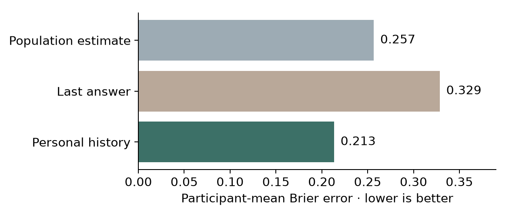

# One person and a moving idea

Streams and Rocks • 22 October 2026 • a corrected interpretation, two public-data probes and an editable testing document

**Smoke, Clay and the moving idea are within one person's two-in-one.** Smoke is inward speaking; Clay is inward listening; the middle is the idea moving and changing between them. Every person has their own history. This replaces the earlier interpretation of these roles as separate people. It does not turn material properties into psychological laws.

[Download the editable testing document](Two_in_one_testing_protocol.docx) · [Read the same document in HTML](report.html) · [Current model and exact corpus equations](MODEL.md) · [Frozen pilot analysis protocol](PROTOCOL.md)

The document includes working definitions, completed numerical findings, a proposed diary design, an episode recording sheet, a personal-history record, comparison models, meaning checks and evidence gates. It was researched with SciSpace and checked against original sources. The proposed new human study has not been recruited or run.

## Completed real-data findings

| Test | Numerical result | What it supports and what it leaves open |
| --- | --- | --- |
| Earlier reports predicting later dialogic inner speech | Replication evaluation: 632 predictions in 142 people. Participant-mean Brier error is 0.2134 using personal history, 0.2567 using the original population estimate, and 0.3287 using the last answer. | Earlier records improve this prediction. Stable personal tendencies could account for it; no causal accumulation or full inner field is established. |
| History minus population error | −0.0433; 95% participant bootstrap interval −0.0703 to −0.0149 | Conditional on the predictor selected using original-experiment data. The published study was consulted, so this is not an untouched model-selection holdout. |
| Stricter dialogic endorsement | “Agree only”: history 0.1450, population 0.1782, last 0.2087 | The predictive advantage persists under this declared alternative coding. |
| Recalled content from different life periods | 1,052 people with both remote and recent scored memories. Recent minus remote mean content: +7.02 elements [5.63, 8.65]. | There is an average difference in counted content among these recalled memories; this does not track the same memory fading. |
| Exceptions to a simple age ordering | Older memories have more counted content in 31.25% [29.57, 32.90] of within-person older/newer pairs on average. | A model should allow older memories to be more detailed. Counted content is not measured vividness, truth or felt temporal distance. |



The inner-experience source is [Nedergaard, Skewes and Wallentin's study](https://doi.org/10.1037/xhp0001112), with [public OSF records](https://osf.io/jgx7m/). The memory source is [CRAM version 4](https://doi.org/10.6084/m9.figshare.10246958.v4), with [measurement methods](https://doi.org/10.1371/journal.pone.0044809) and [dataset description](https://doi.org/10.5334/joc.105). The datasets contain different people and were not joined.

## What is still untested

The public sources do not separately measure internal speaking and listening, idea transitions, Mist as internalized agreement, perceived balance concealing disturbance, or Wind as experienced temporal spacing. No new full-field simulation or fit is claimed here. The corpus and prior solver are unchanged; the statistical history predictor is an explicitly added measurement probe.

The author’s material vocabulary remains available without fixing identities. Calm, agreement, tension, vividness, accuracy and felt temporal distance need separate measurements. Peroxide’s specific metaphorical role remains undefined. Strong language remains intact, attributed and open to comparison.

## Reproduce

Use Python with the versions/ranges in requirements.txt. From this study folder:

```sh
python -m pip install -r requirements.txt
python analyze.py
python -m unittest -q
python verify_saved.py
python build_document.py
```

For a source-level reproduction, download to a private folder with `python fetch_sources.py PRIVATE_FOLDER`, then run `python analyze.py --raw-dir PRIVATE_FOLDER`. Downloaded files include original source identifiers and free-text columns; do not publish that folder. The study publishes only selected numeric derivatives with dataset-local IDs. These are pseudonymous derivatives, not a guarantee against linkage to the public source.

Twelve unit tests and 23,604 saved-result checks passed. Source hashes, exclusions, participant-level scores, predictions, bootstrap settings and the pre-calculation protocol hash are included. Reproduction uses a fixed seed and 2,000 participant resamples. The protocol is not a registered preregistration. An initial parser failed to normalize spaces in response labels and returned no eligible reports; it was corrected before valid results were produced and is covered by a unit test.

The original corpus SHA256 and the unchanged prior field solver SHA256 are recorded in MODEL.md. See [sources and screening](sources.json), [numeric results](results/summary.json), [sample exclusions](data/sample_audit.json) and [verification](results/verification.json).
