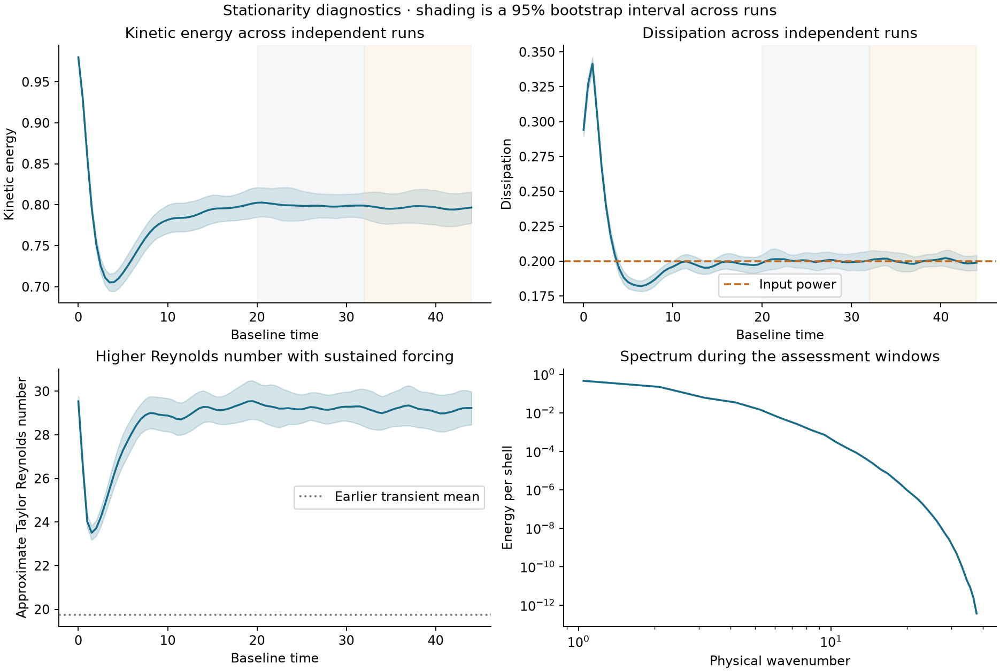
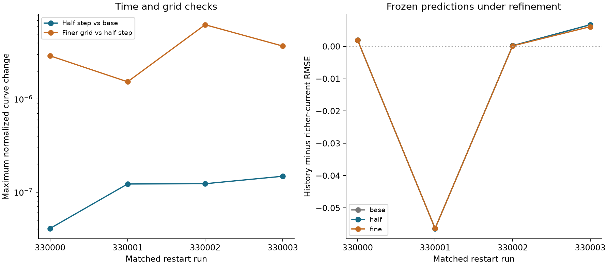
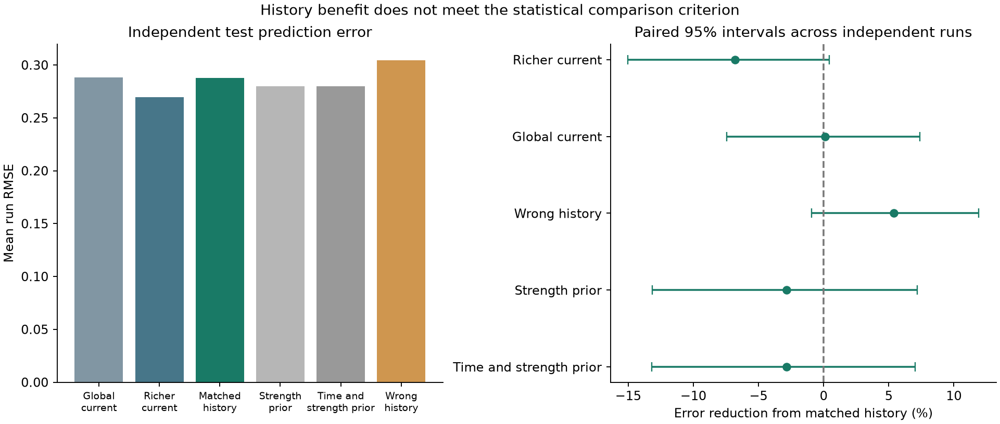
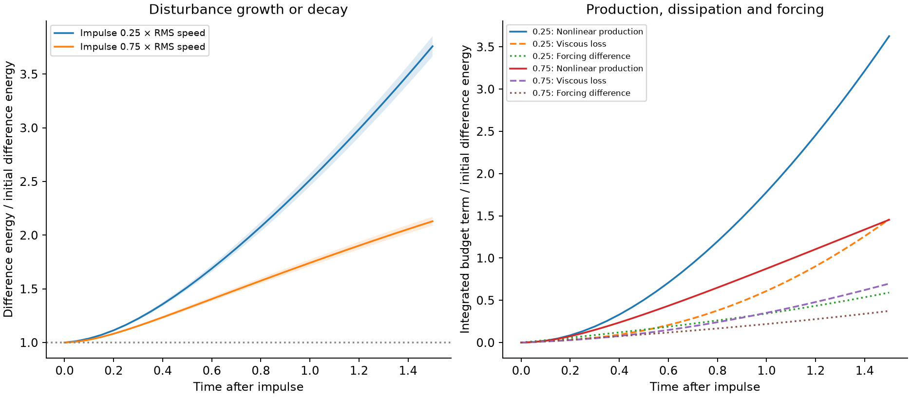

# History prediction in sustained three dimensional turbulence

**Completed result: This experiment did not establish a useful prediction advantage from matched history beyond all the declared controls.** There are 32 independent test runs, separate from 24 training and 8 validation runs. Each flow supplies four intervention times and two impulse strengths, giving 256 test targets while retaining only 32 independent sampling units. Matched-history mean run error is **0.287995**. Against the richer current-state predictor, the error reduction is **-6.79%**, with a paired 95% interval **[-15.02%, +0.42%]**. Positive reductions favor history; the full control comparison appears below.

The measured approximate Taylor Reynolds number is **29.20 [95% interval 28.84, 29.58]**, compared with about 19.75 in the [earlier transient study](../stress-history/README.md). This is a higher Reynolds number, sustained-flow experiment at a still modest Reynolds number. It does not establish a broad inertial range or high-Reynolds asymptotic behavior. Forcing, initialization and measurements also changed, so differences between studies cannot be attributed to Reynolds number alone.

[Runnable code, tests and restorable recordings](https://github.com/NousVolition/My-Sources-Project-ALL/tree/main/reports/fluid-organization-pilot/extensions/stationary-history) · [Streams and Rocks report](https://github.com/NousVolition/Nous-Volition/tree/main/studies/fluid-organization/extensions/stationary-history)

## Completed experiment and parameters

| Item | Executed setting |
| --- | --- |
| Fluid equations | Three dimensional, incompressible, constant density Navier–Stokes |
| Domain and boundaries | Periodic cube of side 6, dimensionless model units |
| Main resolution | 64 cubed, strict two thirds Fourier cutoff, double precision |
| Viscosity and power input | Viscosity 0.025; power per unit mass 0.2 |
| Forcing | Constant-power negative damping in modes 0 less than mode length at most 2 |
| Integration | RK4; baseline step 0.02, response step 0.01 |
| Independent initial conditions | 64 fresh fields from Gaussian random draws, projected to be solenoidal and restricted to low modes; normalized RMS speed 1.4 |
| Interventions | Copies at times 32, 36, 40 and 44; localized divergence-free impulses of 0.25 and 0.75 baseline RMS speed |
| Response horizon | 1.5 model-time units per intervention |
| Histories | Current observations and differences at lags 0.5, 1 and 2 |
| Refinement controls | Four predeclared test runs; half steps and an 80 cubed grid at the same smaller steps |

The disturbance is a fixed Fourier polynomial derived from the curl of a smooth periodic vector potential. Its strength is a global RMS velocity ratio, not a percentage increase in total kinetic energy. Every intervention starts from identical copies of the same baseline field. Both copies use the same power-control law evaluated on their respective states, so their forcing fields can differ.

Large-scale constant-power forcing follows an established [stationary-turbulence DNS approach](https://arxiv.org/abs/1406.6317). Constant energy alone is insufficient evidence for turbulence: [low-Reynolds flows under negative damping can self-organize](https://doi.org/10.1088/1751-8113/48/25/25FT01). Here the stationarity assessment also checks the energy spectrum, mean dissipation, turnover times and sustained nonlinear transfer to higher modes. This is an idealized forced fluid; material properties of water, air, fog, smoke or ice are not calibrated by this experiment.

Acquisition used 16 local and 16 hosted calibration fields, and 32 hosted plus 0 local test fields. The [execution record](results/execution.json) identifies platforms, seed groups and workflow commits. Cached files are counted only once. Original recording bytes and source hashes are retained. The 20 solver/design tests passed locally and on the Linux runner; both receipts are retained.

## Stationarity and numerical validation

The calibration stationarity check **passed** before model freezing. The independent test check **passed**. The first intervention follows at least **13.85** accumulated integral turnover times. Means in windows 20 to 32 and 32 to 44 are compared across whole independent runs; time samples are not treated as independent replicates.

| Quantity | Earlier window | Later window | Relative change and paired 95% interval |
| --- | --- | --- | --- |
| Energy | 0.79945 | 0.79653 | -0.37% [-3.04, +2.16] |
| Dissipation | 0.20026 | 0.20022 | -0.02% [-1.74, +1.74] |
| Integral length | 1.69374 | 1.68748 | -0.37% [-1.81, +1.03] |

The declared equivalence bound for these three relative changes is ±15%. The mean dissipation/input mismatch is +0.12%, with its 95% interval required to lie within ±10%. The total variation between normalized mean spectra is 0.48%, with a 95% upper bound of 2.11% against a 10% limit. Mean forward flux through mode length 4 is 0.06478; its 95% interval is [0.06419, 0.06538], with the lower limit required to exceed 5% of input power. These finite-window criteria support approximate statistical stationarity; they cannot prove stationarity of every higher-order statistic for unlimited time.

Component mean-square velocities relative to their isotropic mean are 1.013, 0.985, 1.002. The reported Taylor Reynolds number uses the isotropic approximation `sqrt(15) times (2 E / 3) / sqrt(viscosity times dissipation)`. The integral Reynolds number in the data tables is `sqrt(2 E) times integral length / viscosity`; its speed is the full vector RMS speed. Exact isotropy of every finite realization is not assumed.



All declared numerical checks **passed**. Minimum sampled cutoff times Kolmogorov length is 1.7434, against a 1.5 requirement. The cutoff is `(ceil(N/3) - 1) times 2 pi / 6`, using the inscribed axis cutoff rather than the larger corner wavenumber; the Kolmogorov length is `(viscosity cubed / dissipation) to the one-quarter power`. The largest saved normalized difference-energy balance residual is 1.9e-07. Resolution and spectral-tail diagnostics are sampled every 0.5 baseline time units and 0.05 response time units; CFL is tracked at every RK stage. Tests cover an exact decaying solution, a forced equilibrium without a cascade, incompressibility, nonlinear energy conservation, constant power input, identical clones, the full difference-energy budget, matched grids, stationarity rejection controls, and protection against prediction leakage.

The largest relative change in a normalized response curve is 0.00001% for the half-step comparison and 0.00063% for finer grid versus half-step at the same time step. Each control restarts from the same base-grid field two time units before an intervention, then recomputes history and response. These are dependent numerical controls, not additional independent evidence. They test short-time resolution of the prediction calculation; long-run screening comparisons address statistical grid behavior separately. They do not constitute continuum extrapolation of the entire ensemble.



Separate long screening integrations compare the same initial Fourier field across grids. The table gives changes in time-window means from 20 to 45 for one seed per pair. These descriptive differences have no independent ensemble confidence interval. Changes in step and grid are combined where both settings differ; chaotic trajectories need not remain pointwise close over these long intervals.

| Viscosity | Grids | Time steps | Energy change | Dissipation change | Forward-flux change |
| --- | --- | --- | --- | --- | --- |
| 0.030 | 56 to 64 | 0.025 to 0.025 | -0.184% | +0.230% | +0.818% |
| 0.025 | 64 to 80 | 0.025 to 0.0125 | +0.456% | +0.669% | +0.102% |
| 0.020 | 64 to 80 | 0.025 to 0.0125 | -3.314% | +2.051% | +4.075% |

The [screening table](results/screening_regimes.csv) retains every attempted case. The completed 48-cubed pilot fell below the later resolution threshold and was excluded from confirmation. An 80-cubed, viscosity-0.02 pilot at step 0.025 was rejected by its initial-step CFL guard; this is a numerical rejection, not evidence of physical instability. The [source provenance](results/screening_provenance.json) also documents the first driver's source-hash and filename bookkeeping errors. Screening cases do not count toward the independent prediction sample.


## Independent prediction comparison

The target is the integral of `E_delta(t) / E_delta(0)` from time 0 to 1.5 after the impulse, evaluated by trapezoidal quadrature on saved samples spaced 0.05 time units apart. It measures disturbance persistence and amplification in model-time units. The error score first takes RMSE over all eight targets within one run, then averages those 32 run errors. The recording cadence is held fixed in the integration-step and grid comparisons.

The global-current predictor receives eight global measurements, impulse strength and intervention time. The richer-current predictor adds local velocity, all nine velocity-gradient components, local strain and vortex stretching, the local instantaneous velocity derivative, and the initial normalized production, dissipation and forcing-difference rates: 30 inputs in total. The history predictor adds 75 causal lag differences, for 105 inputs. These are Eulerian measurements, not a test of passive-marker history. Full feature names are recorded in the source.

All input families use the same candidate linear/RBF ridge models and validation grid. Scaling uses training data only, and validation selects models by mean run RMSE. All times and strengths from a run remain together in a split. The model freeze is recorded at **2026-10-12T02:03:34.238505+00:00**. The [frozen source and models](https://github.com/NousVolition/My-Sources-Project-ALL/tree/ac2ab54b70dbac40cd9ebc16dd8de1af09e3e3f2/reports/fluid-organization-pilot/extensions/stationary-history) were published before the held-out integrations. No test targets are used for tuning. The protocol was developed during screening and calibration; the final source/model freeze is prospective with respect to the independent test, not the calibration observations. The earlier design registration is retained separately.

| Comparator | Comparator mean run RMSE | Error reduction with matched history and 95% interval |
| --- | --- | --- |
| Richer current state | 0.269695 | -6.79% [-15.02, +0.42] |
| Global current state | 0.288322 | +0.11% [-7.43, +7.39] |
| Wrong-run histories | 0.304345 | +5.37% [-0.94, +11.91] |
| Training mean by strength | 0.279990 | -2.86% [-13.16, +7.19] |
| Training mean by time and strength | 0.280085 | -2.82% [-13.20, +7.04] |

Wrong-history controls use three models trained with complete run histories permuted between independent runs. Their test error averages every different run as a history donor, keeping times and strengths together. The uncertainty calculation resamples run identities in both recipient and donor roles and excludes the same original run even if bootstrap sampling duplicates it. Donor pairs are not independent observations.

Support requires a benefit against every declared comparator and passing numerical and stationarity checks. This joint criterion prevents a weak current-state model, extra model inputs, gradual settling, or an unusually favorable history permutation from establishing the claim by itself. Individual 95% comparison intervals are not simultaneous confidence intervals. Uncertainty is conditional on this calibration ensemble, feature set and model-selection procedure; retraining on new calibration ensembles remains a separate validation question.



The strength-specific comparison below is descriptive. Its intervals do not replace the combined, predeclared control criterion and are not corrected for exploratory subgroup comparisons.

| Impulse ratio | Richer current RMSE | History RMSE | History error reduction and 95% interval |
| --- | --- | --- | --- |
| 0.25 | 0.323250 | 0.361751 | -11.91% [-22.51, -3.51] |
| 0.75 | 0.190277 | 0.177522 | +6.70% [-3.48, +15.37] |

Across the four refinement runs, the largest change in the history-minus-current error contrast is 4.66393e-07 for time step and 0.000608199 for grid spacing. The complete comparisons are in [the refinement table](results/refinement_predictions.csv).

## Physical response and mechanisms

The resolved difference-energy equation is `dE_delta/dt = P - D + Q`, where `P = -mean(delta_u_i delta_u_j d_j u_base_i)` is production by baseline strain, `D = viscosity times mean(abs(grad delta_u)^2)` is viscous loss, and `Q = mean(delta_u dot (f_disturbed - f_base))` is forcing-difference work. The code integrates all three terms with the same RK stages as the velocity field. In this experiment forcing feedback does not cancel.

| Impulse RMS ratio | Final energy ratio and 95% interval | Integrated production / initial energy | Integrated loss / initial energy | Integrated forcing difference / initial energy |
| --- | --- | --- | --- | --- |
| 0.25 | 3.7595 [3.6649, 3.8539] | 3.6273 | 1.4598 | 0.5919 |
| 0.75 | 2.1298 [2.0886, 2.1717] | 1.4536 | 0.6978 | 0.3741 |



Nonlinear advection and strain, viscous damping, and the specified forcing feedback account for the recorded response within the checked numerical residuals. A positive difference-energy production term transfers energy from the background flow; it does not create energy without a source. A larger normalized separation of trajectories is not by itself an energy or causal measurement. This study does not identify weakening molecular interactions, and a change in prediction accuracy is not a causal intervention on organization.

The full current fluid field with this forcing law determines its subsequent evolution. Any benefit from a short history of partial measurements would be useful evidence about missing current information, not proof of an additional memory force in Navier–Stokes. Conversely, failure of these declared history features does not exclude benefits from other observations, targets, horizons or independently tested model families.

## Reproduce the completed results

Use the [code repository](https://github.com/NousVolition/My-Sources-Project-ALL/tree/main/reports/fluid-organization-pilot/extensions/stationary-history) with Python 3.12. Restore the archived observations and audit the original bytes before regenerating files:

```text
python restore_recordings.py
python -m pip install -r requirements.txt
python -m pytest test_solver.py test_design.py -q
python audit.py
```

In a separate working copy, `forecast.py evaluate`, `analyze.py`, `report.py`, `manifest.py` and `audit.py` rebuild the statistical results and figures from recordings. Fresh DNS runs are more costly. Preserve the delivered directory, and use another copy with the prior `data/runs`, `data/cloud`, `data/logs`, `data/predictions.npz` and entire `results` directory archived outside that copy. Keep the protocol and `data/screen` historical screening records. This removes stale models, public-registration receipts and execution records from the fresh copy. Run:

```text
python pipeline.py calibration --workers 8
python pipeline.py confirmation --workers 8
```

The calibration phase refuses to freeze models unless its numerical and stationarity checks pass. The confirmation phase verifies frozen source/model hashes before test runs and does not refit them. Run `environment.py` to record a reproduction environment. Full fields are regenerable from seeds; selected full restart fields, time series, observed targets, predictions, source hashes, failed screening records and exact archive checksums are retained. Regenerated floating-point bytes can differ across platforms; a new manifest describes that reproduction rather than the original snapshot.

## Remaining experiments and unanswered questions

- Repeat the whole training, validation and test procedure with new independent ensembles to measure model-selection variability, and refine every test run to extend the present four-run numerical check.
- Test substantially larger Reynolds numbers with a wider resolved cascade and longer observation windows. The present Reynolds number remains modest.
- Compare multiple stationary Reynolds-number regimes with the same forcing, observations and intervention design to isolate Reynolds-number effects.
- Test richer spatial current measurements, passive-marker geometry histories, noisy observations, different source positions and other response horizons, using new frozen models and independent runs.
- Vary the forcing law or replay identical external forcing across copies to isolate the contribution of forcing feedback from fluid dynamics.
- Calibrate a physical fluid or laboratory dataset. Fog evaporation and heat exchange, smoke particle effects, walls and free surfaces need their own models and checks; ice requires separate solid mechanics and thermal physics.

These are proposed follow-ups. They are not completed outcomes of the numerical experiment above.
