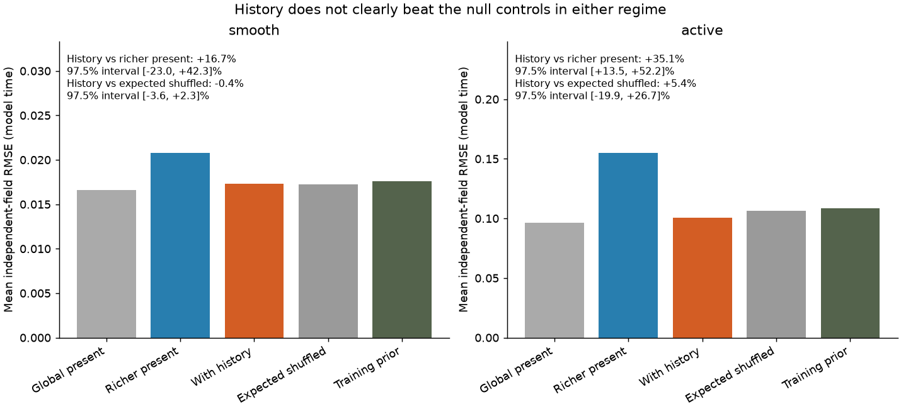
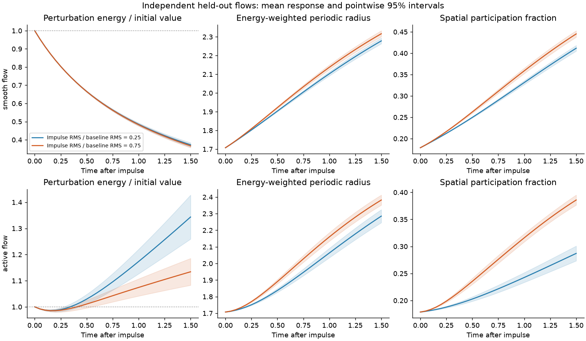
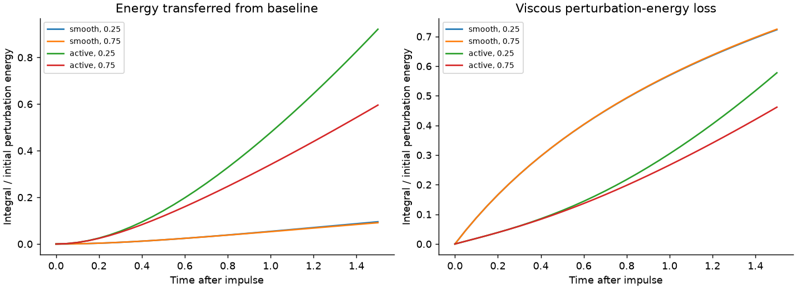
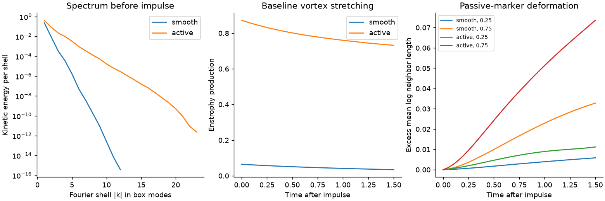

# Stronger fluid disturbances and independent history forecasts

Completed numerical study — 11 October 2026. Both numerical screens passed.

**The prespecified test for a useful history advantage beyond all controls was not met in either regime.** In active flows, history improves on the richer present-input model, but does not clearly beat expected shuffled histories or the training-only average. The simple global-current model has lower mean test error than the history model (0.096598 versus 0.100727); the richer present model generalizes poorly in this sample. The 35.1% improvement over that richer model therefore does not establish that the relevant past carries additional useful information. No predictors were refitted after these results.

**smooth: No resolved improvement beyond the richer present measurements.** History changes mean error by -16.69%; the paired 97.5% interval for error reduction is [-23.03%, +42.29%]. Positive reductions favor history. The raw RMSE difference is -0.003472, interval [-0.010948583010844785, 0.003617841385310612]. **active: Improvement over the richer present model; useful relevant history remains unestablished against the null controls.** History changes mean error by -35.07%; the paired 97.5% interval for error reduction is [+13.46%, +52.16%]. Positive reductions favor history. The raw RMSE difference is -0.054415, interval [-0.09378380250099692, -0.017515773499333937].

| Flow regime | Richer present RMSE | With history RMSE | Error reduction | Paired 97.5% interval |
|---|---:|---:|---:|---:|
| smooth | 0.020804 | 0.017332 | +16.69% | [-23.03%, +42.29%] |
| active | 0.155142 | 0.100727 | +35.07% | [+13.46%, +52.16%] |

**[Runnable code, tests, frozen models and exact recordings → My-Sources-Project-ALL](https://github.com/NousVolition/My-Sources-Project-ALL/tree/main/reports/fluid-organization-pilot/extensions/stress-history)** · **[Streams and Rocks report](https://github.com/NousVolition/Nous-Volition/tree/main/studies/fluid-organization/extensions/stress-history)** · [Illustrated report](report.html)



## Completed experiments

64 new independent initial-condition seeds: 24 training, 8 validation and 32 held-out seeds. Each seed is run at both viscosities, with one unchanged copy and impulses at 0.25 and 0.75 times the baseline velocity RMS. This gives 128 simulated regime/seed triplets and 384 fluid trajectories. The two regimes share initial seeds for matching; they are not independent replicates of each other. Within each regime, uncertainty resamples its 32 independent test fields, keeping both strengths together. Four prechosen test fields per regime have half-step and finer-grid reruns, counted as dependent controls. Separate screening seeds never enter prediction training or testing.

The active regime uses five-fold lower viscosity than the smooth comparison, higher speeds than the prior smooth recovery study, and measured nonlinear energy transfer and vortex stretching. It is a **transient, modest-Reynolds-number 3D flow**, not demonstrated fully developed high-Reynolds turbulence or an extended inertial range. This new impulse-energy target differs from the earlier 120-field forcing-change target; its scores are not directly comparable.

## What the models know

All inputs stop at the impulse time. The conventional model sees eight global current summaries and the known strength. The stronger present model sees 33 current global, spectral, source-local and marker-geometry measurements, including the complete three-component velocity and nine-component velocity-gradient tensor at the disturbance center, the known strength, and the initial production and dissipation rates divided by initial perturbation energy: 36 inputs. The history model appends 33 causal changes at each of three lags (0.25, 0.5 and 1 time unit): 135 inputs. Three controls attach complete histories from a different run while preserving both strength rows within each field. The same kernel-ridge model family and validation grid are used throughout; scaling uses training data only. Test labels never choose features, hyperparameters, windows or settings. Even this stronger present measurement remains an incomplete observation of the spatial fluid state.

The primary target is the integral over 0–1.5 of perturbation energy divided by its impulse-time value. Error is the RMSE across the two strengths for each field, then averaged across independent fields; its units are model time. A 20,000-replicate paired field bootstrap gives 97.5% intervals for each regime, with Bonferroni protection for the two primary history-versus-present comparisons. A history claim also requires improvement over a training-only mean outcome for each known strength and over the expected shuffled-history control: all nonidentity whole-field donors averaged over the three frozen control models. The shuffle comparison uses a field-node bootstrap resampling current and donor roles jointly, excluding the same original field even if duplicated. The three fixed-permutation scores are descriptive checks; the main figure shows the expected shuffled-history error. All prediction intervals are conditional on the frozen calibration sample and fitted models, and do not include variability from retraining. Descriptive flow/response intervals are 95% and do not supply extra confirmatory hypotheses.

The [protocol and source were publicly recorded before held-out runs](https://github.com/NousVolition/My-Sources-Project-ALL/commit/bf1c120644c547e9718fcfda14660c178f8dd004); calibration was already underway at that publication. The model freeze was recorded at 2026-10-11T21:46:28.577432+00:00, SHA-256 `6d12fbd904e452370965209a1402158918d54126fd2a0de3f7cf4bd08a660edb`. No test simulations existed at model freeze. All new runs have separate deterministic random seeds and source/configuration/data hashes. The complete deterministic present fluid state already determines later evolution in this numerical model; history can help partial measurements reveal omitted state or change the approximation error of a finite predictor. This is not evidence for an additional physical memory force or history-dependent modification of Navier–Stokes.

## Physical and numerical checks

Periodic side-6 constant-density incompressible Navier–Stokes, strict two-thirds Fourier dealiasing and shared fixed solenoidal ABC forcing; RK4 evolves fluid and one-way passive markers together. The impulse is the curl of a smooth periodic localized vector potential with fixed modes through five per coordinate. It injects a globally defined RMS velocity and changes total energy by its squared norm plus its cross term with the initial field; it is not a point force. Density, compressibility, phase changes, walls and particle feedback are absent.

The exact Galerkin perturbation-energy balance is `dEδ/dt = P − D`, with `P = −<δu_i δu_j ∂_j u_base,i>` and `D = ν<|curl δu|²>`. Shared forcing cancels. Positive production transfers energy from the evolving background into the velocity difference; dissipation removes it. Energy-weighted radius and spatial participation describe spreading, not literal signal speed. Marker stretching does not establish energy amplification or causation. Current tetrad volume and shape are statistics of finite neighborhoods transported by cubic B-spline interpolation; they are not continuum tangent-map determinants or proof of exact volume preservation. Taylor-scale Reynolds numbers use an isotropic approximation, `u′ = U_RMS/√3`, `λ² = 15νu′²/ε`, `Reλ = u′λ/ν`; isotropy is not demonstrated here. The integral Reynolds diagnostic uses full-vector velocity RMS and the isotropic-spectrum length convention. Lower viscosity changes both diffusion and dissipation; it is not a direct measurement of a single interaction-strength variable.

Seventeen analytic, physical-budget and leakage tests pass. Run-level checks include finite states/CFL, viscous step limit, divergence, total and perturbation energy balances at every saved time, high-band tails, and cutoff times Kolmogorov length. These screens and matched finer-grid reruns support the declared finite calculation; four refinement seeds do not prove ensemble-wide continuum convergence. The cutoff criterion is a screening convention, not a guarantee. The original rejected step and exact original screening outputs are retained in [screen events](screen_events.json). The original trilinear active-flow marker comparison failed (0.030318 against 0.03), while its energy response agreed. Cubic tracking was revalidated on that same seed at both viscosities using finer grids and half steps; the fluid-energy arrays remain bit-identical under this one-way-marker revision. The failed screen remains in the report package and was not used for fitting. A tested diagnostic optimization bins spectral energy once per observation and reuses a curl array; it leaves the screened fluid and marker updates unchanged.

smooth: mean history-minus-present RMSE on the four refinement fields is -0.003627 at baseline settings, -0.003627 at half step and -0.003631 on the finer grid. The largest paired grid change in that contrast is 1.4904e-05; it is below the magnitude of the full test-sample mean contrast. The mean contrast sign does not change in this four-field subset. active: mean history-minus-present RMSE on the four refinement fields is -0.021279 at baseline settings, -0.021279 at half step and -0.021287 on the finer grid. The largest paired grid change in that contrast is 0.000501603; it is below the magnitude of the full test-sample mean contrast. The mean contrast sign does not change in this four-field subset. These checks are dependent numerical comparisons, not additional independent test fields. They do not quantify continuum uncertainty across the entire ensemble.

## Results and data

The following prespecified control contrasts use mean independent-field RMSE; a negative difference favors history. They supplement the primary present-versus-history comparison above.

| Regime | Control comparison | RMSE difference | Paired 97.5% interval |
|---|---|---:|---:|
| smooth | History minus expected shuffled history | +0.000071 | [-0.000379, +0.000594] |
| smooth | History minus training-only prior | -0.000271 | [-0.000880, +0.000348] |
| active | History minus expected shuffled history | -0.005721 | [-0.029887, +0.019557] |
| active | History minus training-only prior | -0.007681 | [-0.042935, +0.026123] |

smooth: the stronger present measurements change error by +25.04% relative to the eight-global-summary model; the paired 97.5% interval for error reduction is [-79.79%, +15.72%]. active: the stronger present measurements change error by +60.61% relative to the eight-global-summary model; the paired 97.5% interval for error reduction is [-114.12%, -21.76%]. This is a secondary comparison, and does not isolate marker geometry from the other additional present measurements.

### Descriptive breakdown by disturbance strength

These per-strength scores use pooled RMSE across the 32 fields, rather than the primary mean field RMSE across both strengths. Their paired 95% intervals are unadjusted, conditional on the frozen models, and descriptive. They cannot replace a failed primary test or establish additional confirmatory claims.

| Regime | Relative impulse RMS | Richer present RMSE | With history RMSE | Error reduction | Descriptive 95% interval |
|---|---:|---:|---:|---:|---:|
| smooth | 0.25 | 0.029028 | 0.023407 | +19.37% | [-16.70%, +44.57%] |
| smooth | 0.75 | 0.027118 | 0.021338 | +21.31% | [-14.85%, +44.32%] |
| active | 0.25 | 0.202449 | 0.135607 | +33.02% | [+16.56%, +47.35%] |
| active | 0.75 | 0.159322 | 0.101842 | +36.08% | [+11.80%, +51.57%] |

- [Quantitative parameter regimes](results/parameter_regimes.csv), [disturbance responses](results/response_regimes.csv), [flow statistics and uncertainty](results/flow_summary.json)
- [Prediction breakdown by strength](results/prediction_by_strength.csv), [its distinct descriptive scope](results/strength_prediction_scope.json)
- [Every held-out prediction](results/predictions.csv), [primary scores and uncertainty](results/prediction_summary.json), [frozen model file](results/frozen_models.json)
- [Numerical verification](results/numerical_verification.json), [screening verification](results/screen_verification.json), [prediction changes under refinement](results/prediction_refinements.csv), [test record](results/tests.xml)
- [Prediction refinement summary](results/refinement_forecast_summary.json), [runtime/library versions](results/environment.json)
- [Frozen protocol](protocol.json), [exact-file manifest](manifest.json), [source provenance](UPSTREAM.txt)





## Which mechanisms explain the response?

**smooth mechanisms.** At the impulse time, the mean approximate Taylor Reynolds number is 3.75 (descriptive 95% interval 3.52–3.99); the nonlinear-to-viscous acceleration RMS ratio is 0.881. Mean forward spectral flux across box-mode radius four is 5.308e-05, with interval [4.034e-05, 6.689e-05].
At relative impulse 0.25, mean integrated production is 0.09524 and viscous loss is 0.7228, both divided by initial difference energy. Their net balance explains the mean final energy ratio 0.3724. 0/32 fields exceed 1.01 times initial difference energy at a saved observation. These counts describe sampled transient amplification; they do not establish a long-time instability.
At relative impulse 0.75, mean integrated production is 0.09116 and viscous loss is 0.7246, both divided by initial difference energy. Their net balance explains the mean final energy ratio 0.3665. 0/32 fields exceed 1.01 times initial difference energy at a saved observation. These counts describe sampled transient amplification; they do not establish a long-time instability.
**active mechanisms.** At the impulse time, the mean approximate Taylor Reynolds number is 19.8 (descriptive 95% interval 18.6–20.9); the nonlinear-to-viscous acceleration RMS ratio is 3.1. Mean forward spectral flux across box-mode radius four is 0.01602, with interval [0.01375, 0.01822].
At relative impulse 0.25, mean integrated production is 0.921 and viscous loss is 0.5775, both divided by initial difference energy. Their net balance explains the mean final energy ratio 1.344. 29/32 fields exceed 1.01 times initial difference energy at a saved observation. These counts describe sampled transient amplification; they do not establish a long-time instability.
At relative impulse 0.75, mean integrated production is 0.5957 and viscous loss is 0.4616, both divided by initial difference energy. Their net balance explains the mean final energy ratio 1.134. 28/32 fields exceed 1.01 times initial difference energy at a saved observation. These counts describe sampled transient amplification; they do not establish a long-time instability.

Advection and strain redistribute the velocity difference; background strain supplies or removes difference energy, and viscosity dissipates it. Vortex stretching and spectral transfer characterize the active flow, while the directly checked production-minus-dissipation balance explains its energy response. A history forecast comparison cannot distinguish all of these mechanisms causally, and does not test whether molecular interactions weaken. The combined history features also cannot isolate the contribution of marker organization from the contribution of velocity and spectral history.

## Reproduce in the linked code repository

Use Python 3.12 or later and run inside the linked extension folder. Restoration requires only Python's standard library. Exact recordings retain saved observables, marker positions, diagnostic time series and state hashes; complete 3D fields are regenerable from seeds and source, and are not archived for every new run.

```text
python restore_recordings.py
python -m pip install -r requirements.txt
python -m pytest test_study.py -q
python audit.py
```

Audit the original restored bytes before regenerating output files. To repeat the calculations, use a separate working copy and run:

```text
python verify.py
python forecast.py evaluate
python analyze.py
python report.py
python manifest.py
python audit.py
```

For a fresh simulation reproduction, start from a separate copy and archive `data/runs`, `data/forecast`, `results/frozen_models.json` and `results/freeze_receipt.json` outside that extension folder. Keep the original directory as an unchanged reference. Preserve `data/screen`, the historical screening results, and the public protocol receipt. Run `pipeline.py`, then `report.py`, `manifest.py` and `audit.py`. The pipeline completes calibration, freezes new models before any new test simulation, runs tests and numerical controls, verifies them, and evaluates forecasts. The numerical tests can be repeated with `python -m pytest test_study.py -q`; `environment.py` records the current library versions. Retain the locked protocol. Regenerated output bytes can differ across library versions or platforms; the newly generated manifest describes that reproduction rather than the original snapshot. The code refuses stale simulation caches or refitting an existing frozen model. `batch.py screen` reproduces screening with current source; historical source hashes are audited separately. Original failed/earlier screening files are preserved rather than silently replaced.

## Unanswered questions — proposed, not completed

- Do the results replicate with more independent fields, other random-field families, source positions and impulse shapes, or other observation horizons?
- Does a causal history benefit survive richer current spatial measurements, different model families, noisy/sparse observations and strict ensemble-wide spatial refinement?
- What happens at statistically stationary, substantially higher Reynolds numbers with a wider cascade? This requires longer burn-in, larger grids and a new frozen study.
- Do marker histories specifically help, rather than histories of global/spectral flow summaries? The combined-history comparison does not isolate this.
- Are any history gains causal consequences of organization? Matched state reconstruction, intervention designs and separate identifiability arguments are needed.
- Do wall boundaries, evaporation/heat exchange, dilute inertial droplets or smoke particles change these results? Ice requires a separate solid/thermal model. Laboratory validation remains future work.

## Primary physics references

The resolution diagnostic follows common DNS practice illustrated in [Momenifar, Dhariwal & Bragg (2019)](https://link.aps.org/accepted/10.1103/PhysRevFluids.4.054301), whose parameters include cutoff-times-Kolmogorov lengths near 1.5. Their inertial-particle findings are not results of this passive-marker experiment. [Johns Hopkins 8192³ isotropic-turbulence documentation](https://turbulence.pha.jhu.edu/docs/README-isotropic8192.pdf) provides a high-resolution reference; this pilot does not reproduce that flow or claim comparable Reynolds numbers.
