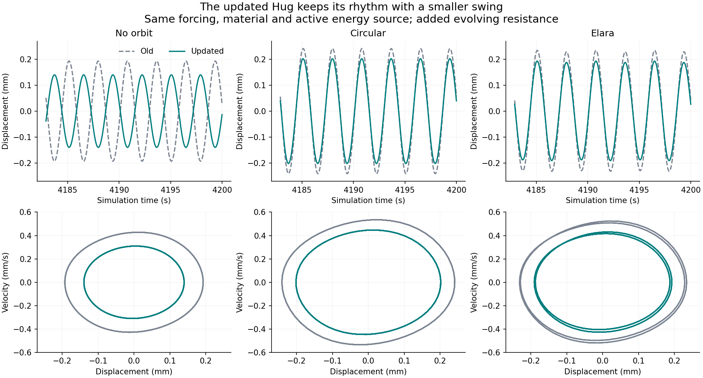

# Hug with evolving guards: old and updated equations

The updated synthetic Hug retains a locally attracting autonomous rhythm and full-state orbital repetition for circular and all six eccentric inputs. Its no-orbit displacement half-range is 27.6% smaller. This is a declared reduced mechanical coupling of the updated participant/guard equations, not a unique derivation or full Navier-Stokes model.

[Illustrated report](report.html) · [Offline animation](player.html) · [Equations, controls and reproduction](METHODS.md) · [Results](results.json)

| Input | Old half-range (mm) | Updated half-range (mm) | Change |
| --- | ---: | ---: | ---: |
| No orbit | 0.192928 | 0.139735 | -27.6% |
| Circular | 0.240895 | 0.201772 | -16.2% |
| Pasiphae | 0.211387 | 0.164457 | -22.2% |
| Elara | 0.232928 | 0.191748 | -17.7% |
| Himalia | 0.236559 | 0.196443 | -17.0% |
| Europa | 0.240973 | 0.201852 | -16.2% |
| Callisto | 0.240959 | 0.201838 | -16.2% |
| Thebe | 0.241013 | 0.201884 | -16.2% |

No-orbit periods are 2.839324 s (old) and 2.836413 s (updated). These are simulation seconds, not measured clay or real orbital times.

The frozen control shows that adding resistance already reduces amplitude; evolving guards reduce it further. Shared and directional guards with equal weights yield the same mechanics here by an exact closed-subsystem identity. This is not evidence that asymmetry itself caused the amplitude reduction. Turning off active gain and saturation removes the autonomous rhythm while allowing an externally forced response.

**Verification:** 128 trajectories at two accuracy settings, 52 independent Radau segments and six cycle stability checks. All saved numerical gates pass, with identical classifications. No old scientific results were replaced. The earlier stiffness-switch recovery delays are not recalculated in this experiment.

**Scope:** one-mode clay mechanics plus abstract internal participants and evolving guards. The added resistance, guard coefficients and time mapping are declared synthetic assumptions. No physical measurements, moving-boundary test, rupture law or orbital backreaction is included. The drawing shear preserves outline closure by construction.

Keep this folder beside `dynamics-fractals-sims`; it imports that study's unchanged forcing and outline. See [methods](METHODS.md) for reproduction. Large raw caches are local; compact diagnostics, both-resolution summaries, animation samples and sources are published.
