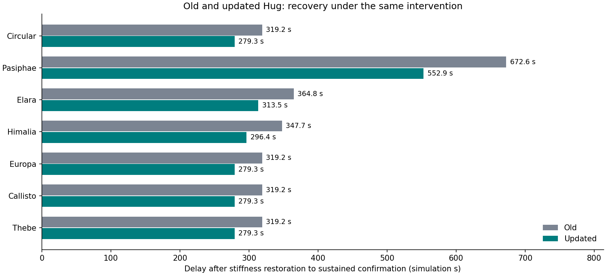

# Updated Hug: losing and regaining synchronization

The updated Hug recovers sooner in every tested orbit.

[Illustrated report](report.html) · [Offline animation](player.html) · [Methods and reproduction](METHODS.md) · [Results](results.json)

| Input | Old delay (s) | Updated delay (s) | Updated − old (s) |
| --- | ---: | ---: | ---: |
| Circular | 319.2 | 279.3 | -39.9 |
| Pasiphae | 672.6 | 552.9 | -119.7 |
| Elara | 364.8 | 313.5 | -51.3 |
| Himalia | 347.7 | 296.4 | -51.3 |
| Europa | 319.2 | 279.3 | -39.9 |
| Callisto | 319.2 | 279.3 | -39.9 |
| Thebe | 319.2 | 279.3 | -39.9 |

The same stiffness changes occur at 171 and 741 simulation seconds, with continuous states and orbital phase. Delays include a 20-comparison confirmation window, have 5.7-second resolution and are checked through 4161 seconds. Old diagnostics use four states; updated diagnostics use eight. A mechanical-only projection is retained for comparison.

84 live trajectories at two accuracy settings and 42 independent Radau segments support the numerical audit. The old historical delays are reproduced. Unchanged-stiffness and leave-high controls are included, along with both settled histories.

These are synthetic coefficients and prescribed orbit-shaped loads. Added damping and adaptation are not separated by this experiment. The animation magnifies shear ×150 and preserves outline joins through its drawing map; it does not test tearing. Keep this folder beside the two parent studies named in the methods. No website deployment or physical measurement upload is involved.
