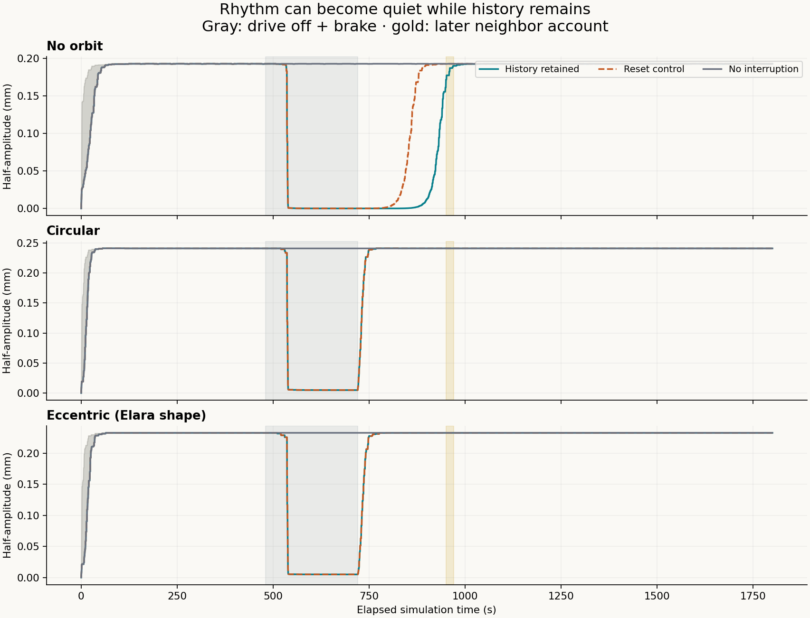
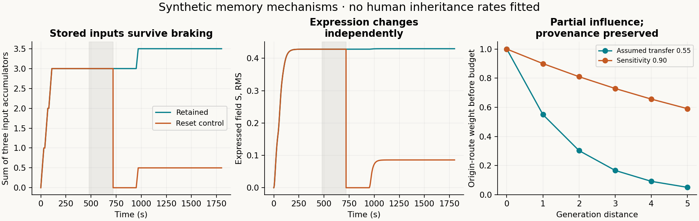

# Hug: persistent history with bounded expression

[Plots and report](report.html) · [Interactive animation](player.html) · [Short GIF](hug-memory.gif) · [Equations and reproduction](METHODS.md) · [Adoption references](REFERENCE.md)

The supplied corpus's accumulation and gradient-response laws are connected to a spatial memory field and a documented clay-mode projection. The requested finite limit is implemented through **explicit new saturation, expression-relaxation and bounded-exchange terms**. Retained inputs and provenance are not reset when the drive stops. A deliberate reset control measures the consequences of deletion.

Nine synthetic scenarios × three orbit conditions × two starts = 54 main paths. The three conditions are no orbit, circular and eccentric e=.212 with the previous signed waveform, common 5.7-second orbital clock and matched 6-micronewton force RMS. These are not actual lunar forces.

| Condition, first start | Braked amplitude / baseline | Amplitude confirmation delay | Mechanical repeat confirmation delay |
|---|---:|---|---|
| No orbit | 0.000943% | 224.5 s | Not applicable |
| Circular | 1.99% | 57.0 s | 129.3 s |
| Eccentric (Elara shape) | 2.1% | 57.0 s | 157.8 s |

Drive off plus brake: 480–720 s. A later reminder at 950–970 s is separate. Amplitude confirmations use 57 s windows and remain valid through 949.5 s. Mechanical repetition uses exact orbit checkpoints, ten comparisons and tolerance .01. No-orbit motion has no orbital synchronization label. [All starts and scenarios](summary.csv), including non-confirmations, remain available. The older four-lag full-state recovery criterion is different and its times are not directly compared.

The forced primary amplitude confirmations equal the minimum 57 s waiting window. Deleting S in the reset control changes the applied force and disturbs the mechanical equilibrium, which accelerates its unforced return here. This is not evidence that forgetting helps people. One changed-caregiving start does not meet the amplitude criterion before the later reminder.

Maximum retained-input error: 8.66e-15. Main energy residual: 1.86e-06. Maximum |S| 1.1160 is below the discrete bound 2.5146. All main states are finite. [Refinement details](results.json) report measured errors; the model is a material-coordinate field plus a mechanical shear mode, not a full moving-boundary Navier-Stokes solution.

The 64-cell run shifts one unforced reset-control confirmation from 150.5 to 149.0 s; other tested confirmations agree at the diagnostic resolution. The 128-cell subset checks nine retained-history paths. [Saved-data verification](verify_saved.py) and [player logic checks](check_player.cjs) are reproducible offline; the latter is not a browser layout test.

Adoption is reference material for distinguishing biological ancestry, caregiving and communicated family history. It is not an anomaly label or a trauma calibration. Specific autobiographical memory inheritance is not assumed. The biological channel is uncalibrated and disabled; unknown ancestry remains unknown. The HCCH intercountry totals in [the source table](adoption_reference.csv) are not a complete worldwide adoption count.

Sources: corrected corpus hash and Miro links are in [METHODS.md](METHODS.md). All parameters and event histories are synthetic. No physical clay or human measurements were collected. Publication updates repository files; it does not deploy a website.
