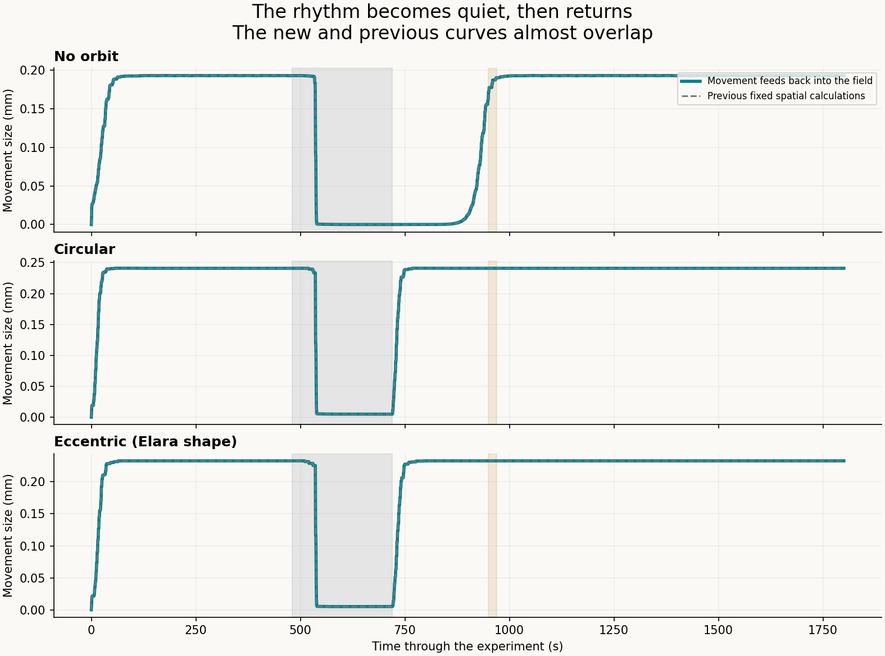
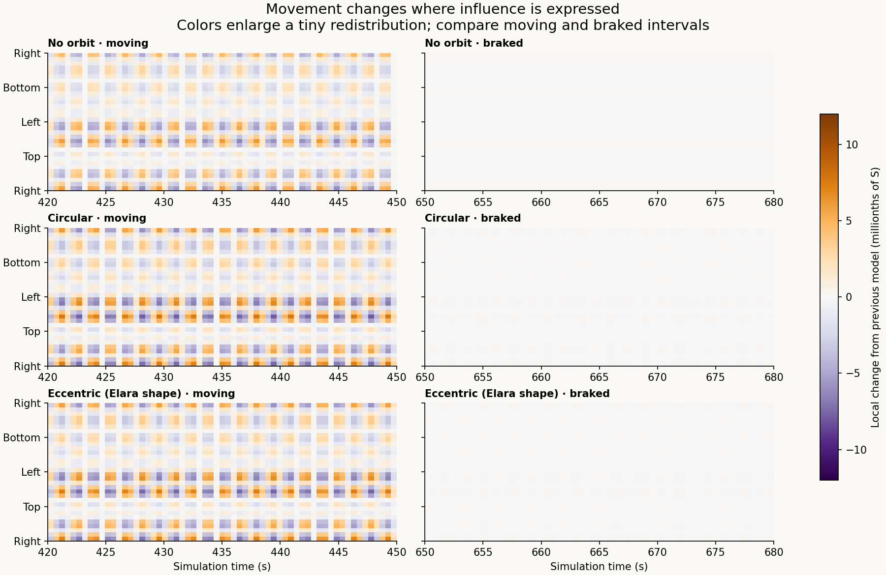

# Hug: movement restructures expressed history

The clay now changes the spatial expression of history, while the accumulated record stays intact. In these tests the change is very small, and the rhythm recovers at the same measured times as before.

[Plain-language report and plots](report.html) · [Interactive animation](player.html) · [Animated GIF](hug-feedback.gif) · [Equations and reproduction](METHODS.md)

The supplied `partial_t S + u·grad(S)` is evaluated in material coordinates. Diffusion and source-force gradients now follow the actual clay shear through its deformation tensor. Stored A and event provenance are never reset. The existing bounded-expression extensions remain explicit. This is an angular-field and single-mode mechanical reduction, not a full fluid/contact solver or human-memory measurement.

Five scenarios × three conditions × two starts = 30 main paths, with 72 refinement paths. Conditions are no orbit, circular, and synthetic eccentric forcing e=.212. There is no new tuned restructuring gain. Physical shear remains below 0.242%; its field effect is small.

| Condition | Amplitude return: previous / new | Orbital repeat: previous / new | Late relative pattern change |
|---|---|---|---|
| No orbit | 224.5 s / 224.5 s | Not applicable / Not applicable | 4.93 ppm |
| Circular | 57.0 s / 57.0 s | 129.3 s / 129.3 s | 5.97 ppm |
| Eccentric (Elara shape) | 57.0 s / 57.0 s | 157.8 s / 157.8 s | 5.73 ppm |

Delays include confirmation windows. Forced amplitude return at 57 s is the first eligible confirmation, not an exact regrowth time. All tested timing results agree on refinement. The 64-to-128-cell discrepancy in the paired field effect is 6.1e-08; full differences and controls are in [results.json](results.json). No new recovery-time ordering or large physical effect is claimed.

The diffusion-only control changes the spatial pattern; the force-gradient-only control leaves S unchanged. Mean S agrees between matched cases because redistribution is conservative, even though existing sources and relaxation still change that mean over time. Retention of A follows the specified accumulation law and is checked, not discovered as a human fact.

Colors enlarge differences of a few millionths; shape deformation in the animation is magnified ×150. Neither display scale enters the equations. The [saved-data checker](verify_saved.py), 25 equation tests, [offline player checks](check_player.cjs), [protocol](protocol.json), [immutable event catalog](history_ledger.json) and [source/run hashes](run_provenance.json) are included. Full trajectories can be regenerated using the documented commands.

The [previous fixed-spatial model](../hug-memory-continuity/README.md) is preserved. Biological ancestry and adoption statistics do not set model coefficients. No physical clay or human measurements were added. This update publishes repository files and does not deploy a website.
