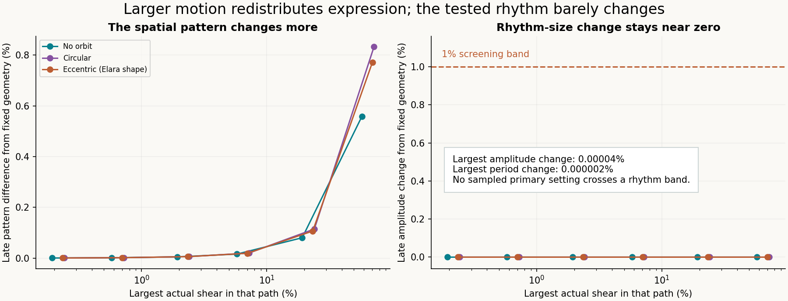

# Hug: larger movement and a testing structure

Larger simulated movement restructures the expressed field more strongly, but no tested paired case crosses the predeclared rhythm-change bands. Stored A and event provenance remain intact. This is a synthetic stress test of reduced equations, not measured clay behavior.

[Plain-language report](report.html) · [Interactive animation](player.html) · [Animated GIF](hug-movement.gif) · [SciSpace-assisted testing structure](TESTING_STRUCTURE.md) · [Methods and reproduction](METHODS.md)

Six primary movement settings (1, 3, 10, 30, 100, 300), three orbital conditions, two mechanical starts, and moving/fixed spatial operators give 72 main paths. Two larger settings with fixed orbital force add 24 controls. 204 finer calculations accompany the 96 main paths. Actual shear reaches 72.35% in the reduced model. The largest primary amplitude effect is 0.00004%, far below the operational 1% band; this is not a claim of physical measurement precision.

The field can change without changing the rhythm substantially. When the orbit's force is held fixed while self-motion grows, orbital repetition can change in both paired models. That is not a memory-feedback effect. All outcomes, including unconfirmed recovery windows, remain in [results.json](results.json), [summary.csv](summary.csv), and the report.

The [testing structure](TESTING_STRUCTURE.md) separates equation fidelity, numerical reliability, causal controls, rhythm outcomes and future material measurements. SciSpace discovery was checked against linked primary sources; the numerical thresholds are explicit study choices. The original source laws and the declared reductions/extensions remain pinned and unchanged.

Twenty unit tests cover source fidelity, scaling symmetry, conservative transport, exact lower-half exclusion and diagnostics. [Saved checks](verify_saved.py) recompute mechanics and retained inputs; [player checks](check_player.cjs) exercise offline controls and finite coordinates, not browser layout. Full double-precision trajectories are reproducible; compact primary data and refinement audits are published. See [run provenance](run_provenance.json), [protocol](protocol.json), and [hash manifest](manifest_sha256.json).

Animation shape uses actual shear, gain ×1. Colors show a magnified difference from fixed geometry, on a common scale; no history is erased. The animation's closure is a drawing property. Linear Burgers coefficients are uncalibrated and do not establish finite-strain clay validity, hydration or fracture. No human/adoption data set coefficients. This updates repository files, not a website deployment. The [previous smaller-motion study](../hug-memory-feedback/README.md) is preserved.
