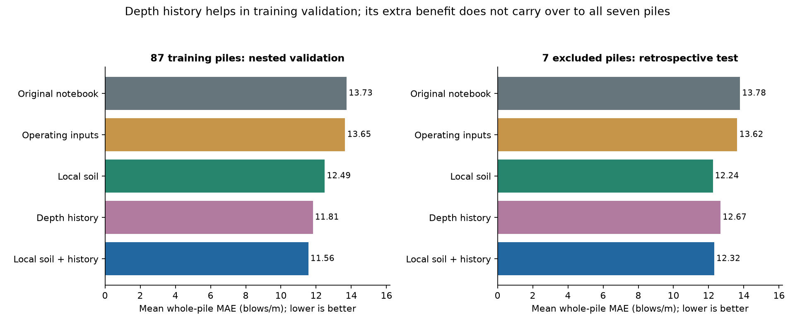
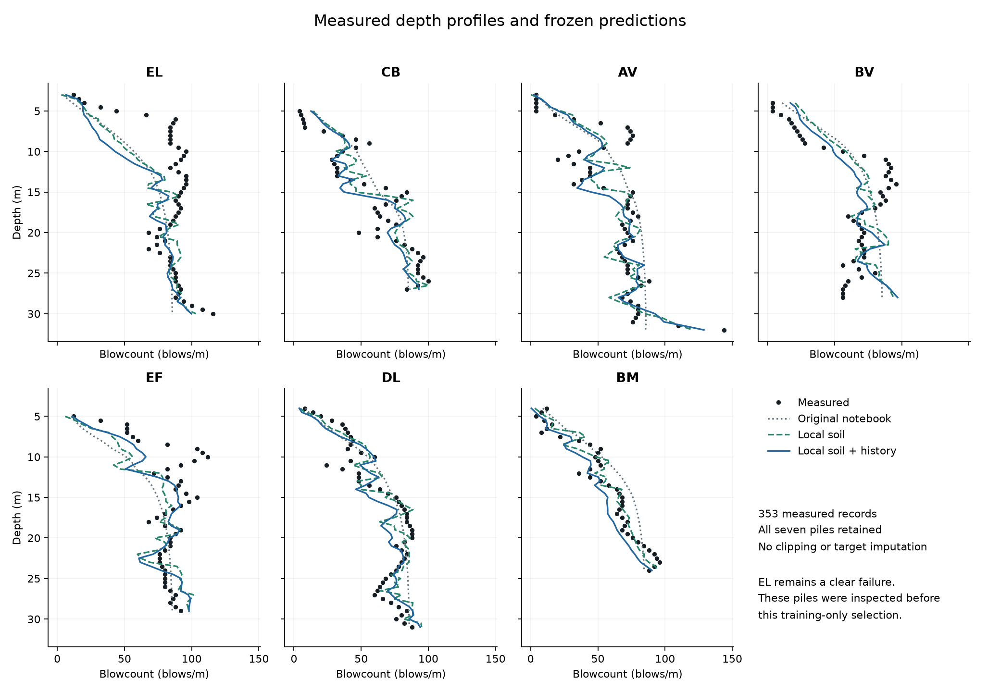

# Local soil and depth-history tests on measured piles

**Completed:** 33 candidates selected on 87 piles only; nested whole-pile validation; locked evaluation of all seven excluded piles. [Open the report](report.html). [Read the frozen protocol](PROTOCOL.md).

The training-only winner combines local qc, fs and u2 with shallower-layer summaries, operating inputs and an additive piecewise-linear ridge fit. Its 5-fold selection MAE was 11.597 blows/m per pile. The second fixed split seed selected the same candidate.

The nested procedure reduced mean pile MAE from 13.73 to 11.56. All five outer folds chose the combined family; three chose alpha 0.001 and two chose 0.01. This estimates the fixed selection procedure, with each validation pile excluded from the inner selection and fitting.

On all seven excluded piles (353 measurements), pooled MAE fell from 13.91 to 12.42 (10.7% lower), and pooled RMSE from 18.10 to 17.05. Equal-pile MAE fell from 13.78 to 12.32.

Adding history did not beat the local-soil-only family on these seven piles: pooled MAE 12.42 versus 12.33, and RMSE 17.05 versus 16.65. The chosen model remains the training-only winner; test scores did not switch the choice.

By MAE the selected model improves five piles and worsens EL and DL. By RMSE it improves five and worsens EL and BV. EF improves to R² 0.024, only just above its within-pile mean benchmark. EL worsens to R² -0.815; its systematic underprediction is unresolved.

The selected model underpredicts overall by 4.56 blows/m. It has zero negative predictions on the seven piles, but the nested training-validation procedure produces 19 negatives, which were retained. No physical nonnegativity constraint was imposed.

Descriptive paired whole-pile 95% bootstrap intervals cross zero: selected minus original mean-pile MAE [-3.15, 0.12], and combined minus local-only [-1.43, 1.35] blows/m. Seven selected, potentially spatially dependent piles cannot establish a population-wide advantage.

## Every excluded pile

Selected using only 87 piles: local_history_hinge_a0.001. All errors in blows/m.

| Pile | n | Original MAE | Selected MAE | Original RMSE | Selected RMSE | Selected bias | Selected R² |
| --- | --- | --- | --- | --- | --- | --- | --- |
| EL | 55 | 17.69 | 19.49 | 23.09 | 27.24 | -17.28 | -0.815 |
| CB | 45 | 12.23 | 10.66 | 14.09 | 13.74 | -0.84 | 0.772 |
| AV | 59 | 14.91 | 9.53 | 19.12 | 12.84 | -0.92 | 0.769 |
| BV | 49 | 16.17 | 15.25 | 17.68 | 18.50 | +2.14 | 0.521 |
| EF | 49 | 16.44 | 12.84 | 23.53 | 17.74 | -7.00 | 0.024 |
| DL | 55 | 9.20 | 9.78 | 12.03 | 11.45 | -0.93 | 0.714 |
| BM | 41 | 9.82 | 8.69 | 11.55 | 10.11 | -6.79 | 0.854 |





## What this tests

The local-soil family uses current cone resistance qc, sleeve friction fs and pore pressure u2, plus depth, supplied normalized energy and geometry. Depth history uses only strictly shallower CPT samples: prefix means and exponential summaries with lengths 1 m and 5 m. No future-depth data, cumulative blow counts, prior targets, pile-ID features or final penetration predictors. Original notebook features already include cumulative qc, so that baseline is not a no-history control. The Operating family supplies that control. All new families share equal-pile-weighted ridge fitting; the reproduced original retains unweighted OLS.

The combined family has 16 raw predictors, expanded to 64 additive linear/hinge columns, with an intercept. Scales and hinge knots are fitted inside each fitting fold. There are no interactions or physical constitutive equations. The smallest tested penalty wins; the fixed grid was not extended after seeing outcomes.

## What the results support and leave open

Measured current soil inputs improve prediction relative to operating inputs in nested validation and these seven-pile aggregate results. Strict-prefix soil history adds predictive information in the nested comparison, but its added advantage over local soil does not carry over to the seven-pile aggregate. This is evidence about these empirical predictors and this dataset, not proof of a physical soil-memory mechanism.

No elapsed times, pauses or recovery measurements are supplied. Spatially neighboring piles can remain correlated despite whole-pile splits. The seven were already inspected in the notebook and earlier work; the question itself was informed by those failures. Nested validation cannot erase that history or guarantee independence at a new site. Energy normalization is inherited from the source, with its upstream fitting provenance unresolved. Measured operating energy also limits preinstallation use. The remaining independent test needs new piles or a genuinely separate site with the same variables and observed targets.

The community model can retain the question of context and history. These soil measurements do not measure human meaning, moderation, penalties or social memory. Miro's memory and measurement-limit ideas motivated candidate tests; they are not empirical calibration of the pile model.

## Reproduce

Python 3.12.14; package versions in [requirements.txt](requirements.txt). Obtain the original CSV through authorized [Kaggle access](https://www.kaggle.com/competitions/isfog2020-pile-driving-predictions/data). Raw competition data and row-level predictions are not included. Use a new output directory; the selection command refuses to overwrite a saved model lock.

```text
python -m pip install -r requirements.txt
python -m unittest -v test_model
python run_analysis.py select --data /path/to/training_data.csv --out /path/to/new_run
python run_analysis.py evaluate --data /path/to/training_data.csv --out /path/to/new_run --private-out /path/to/private_predictions
python audit_results.py --out /path/to/new_run
python make_report.py --out /path/to/new_run --private-out /path/to/private_predictions
```

Validation completed: **19 scientific unit tests; 76 saved-result/rerun checks**. An independent rerun reproduces candidate scores, folds, nested outcomes, final metrics and fitted models exactly (run timestamps excluded). See [audit](results/audit.json), [test log](results/unit_tests.txt), [model lock](results/model_lock.json), [evaluation receipt](results/evaluation_receipt.json), [all training candidates](results/training_cv_candidates.csv), [all seven-pile scores](results/seven_pile_metrics.csv), and [paired intervals](results/paired_intervals.json).

The model lock is a local, hashed record written before this iteration's seven-pile evaluation, not an external preregistration. The protocol and scientific-code hashes are verified before evaluation. Numerical reproducibility does not establish physical validity.

## Sources and provenance

- [ISFOG2020 competition data](https://www.kaggle.com/competitions/isfog2020-pile-driving-predictions/data): measured outcomes supplied at 0.5 m resolution. CSV SHA256 `565f5cdd872ec98d2ec9dd73bf7493a5ecf2e2dc1e6751295c05af2de361ff17`.
- [Earlier notebook reproduction and provenance](https://github.com/NousVolition/Nous-Volition/tree/main/studies/isfog-pile-tests): preserves the original formula and explains its historical data exposure and integrated-cone proxy units (MPa m², not the notebook's kN label).
- [Grouped cross-validation documentation](https://scikit-learn.org/stable/modules/cross_validation.html#cross-validation-iterators-for-grouped-data): rationale for keeping related observations in whole groups. This implementation uses NumPy, not scikit-learn.
- [Nested cross-validation documentation](https://scikit-learn.org/stable/auto_examples/model_selection/plot_nested_cross_validation_iris.html): separate model selection from outer evaluation.
- [Miro research board](https://miro.com/app/board/uXjVEXBJz3k=/): conceptual prompts about hidden state, history and measurement limitations; not a source of pile observations.
