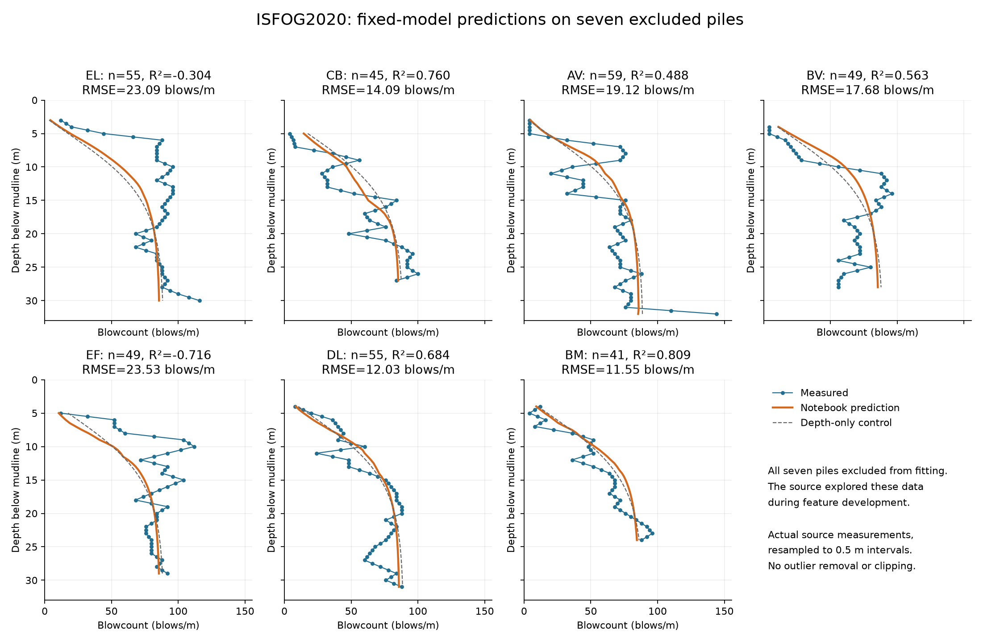
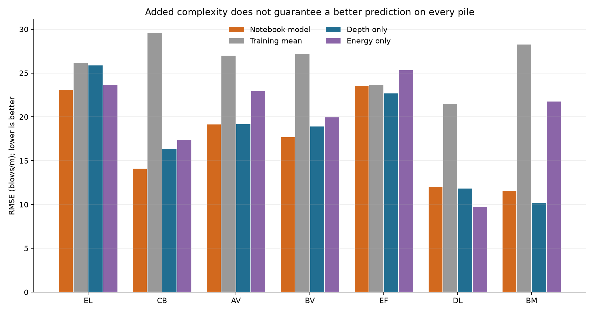

# Actual pile-driving measurements: all seven excluded piles

Completed 2026-10-21. The unchanged three-feature notebook model was fitted on 87 piles (4,257 eligible depth records) and tested on EL, CB, AV, BV, EF, DL and BM (353 eligible records). These are field measurements supplied by the ISFOG2020 competition, resampled by the source to 0.5 m, rather than generated scenarios.

Across the seven piles, **RMSE is 18.10 blows/m, MAE is 13.91 blows/m, and R² is 0.521**. Mean prediction bias is +0.03 blows/m. The notebook model has lower RMSE than the depth-only control on 4 of 7 piles. Every pile is shown below; no unsuccessful cases were discarded.

| Pile | Scored rows | RMSE (blows/m) | MAE (blows/m) | Bias (blows/m) | R² |
|---|---:|---:|---:|---:|---:|
| EL | 55 | 23.09 | 17.69 | -15.34 | -0.304 |
| CB | 45 | 14.09 | 12.23 | +4.87 | 0.760 |
| AV | 59 | 19.12 | 14.91 | +5.95 | 0.488 |
| BV | 49 | 17.68 | 16.17 | +8.12 | 0.563 |
| EF | 49 | 23.53 | 16.44 | -13.32 | -0.716 |
| DL | 55 | 12.03 | 9.20 | +4.59 | 0.684 |
| BM | 41 | 11.55 | 9.82 | +6.96 | 0.809 |

Positive bias means overprediction. Negative R², if present, means worse squared error than predicting that test pile's observed mean; that diagnostic reference is not a deployable fitted baseline. RMSE gives greater weight to large errors. Individual depth samples within a pile are correlated.



## What the comparison establishes

This independently reruns the notebook and extends its one displayed test pile (CB) to all seven fitting exclusions. All four saved training R² values and the saved CB R² reproduce within 1e-8. The code passed 14 scientific unit tests and 26 of 26 saved-data checks. Full-precision coefficients, per-pile metrics, row coverage, hashes and checks are in [results](results/summary.json).

**EL and EF expose important failures.** Their negative R² values mean the model misses their depth-profile variation badly enough to lose to each pile's own observed mean. It underpredicts EL by 15.34 and EF by 13.32 blows/m on average. Opposite errors in other piles make the pooled bias look almost zero. A small pooled bias does not establish reliable predictions for every pile.

**These are fitting exclusions, not untouched model-selection holdouts.** The source notebook inspected the whole dataset before splitting and used it during feature exploration. CB's result was already visible. Running the fixed model on these seven piles is useful retrospective evidence, but it does not restore blindness or demonstrate transfer to a new offshore site. A future model revision needs separate, previously unused site/pile outcomes and a frozen evaluation plan.

## Controls and uncertainty

All controls use the same primary fitting and evaluation rows, with coefficients fitted only on the other 87 piles. The mean control predicts the fitting-set mean. Depth and energy controls use the notebook's fixed tanh transformations. No replacement model was selected or tuned from these test outcomes.

| Model | Pooled RMSE | Pooled MAE | Pooled R² | Mean pile RMSE |
|---|---:|---:|---:|---:|
| Notebook model | 18.10 | 13.91 | 0.521 | 17.30 |
| Training mean | 26.17 | 21.24 | -0.001 | 26.19 |
| Depth only | 18.83 | 14.35 | 0.481 | 17.86 |
| Energy only | 20.67 | 15.86 | 0.376 | 20.09 |

Error units are blows/m. Pooled metrics weight every eligible depth record equally; mean pile RMSE weights each of the seven piles equally and is not the square root of mean pile MSE. Pooled R² uses the overall test mean and can differ substantially from within-pile R².



The fixed-model, whole-pile bootstrap (10,000 resamples, seed 20261021) gives a descriptive 95% percentile interval of 14.51–21.04 blows/m for pooled RMSE and 11.50–16.03 for MAE. Only seven deliberately selected piles are available, spatial independence is unverified, and fitting uncertainty is excluded. These intervals are not a population validation guarantee or a prediction interval for a future pile.

## Inputs, missing records and physical meaning

The CSV contains 7,374 depth rows from 94 piles, with 4,610 recorded blowcounts. Shallow self-weight penetration and depths below the final installed pile can lack driving observations. Missing targets were never converted to zero. The main evaluation reproduces the notebook's all-column complete-case rule after feature construction. [Coverage](results/coverage.csv) accounts for observed but unscored rows. There are 0 negative predictions in the seven-pile primary results; predictions were not clipped.

The predeclared required-fields-only sensitivity adds 0 fitting rows and 0 test rows. Its pooled RMSE is 18.10 blows/m. [Full sensitivity](results/missingness_sensitivity.json).

The initial intake check incorrectly required diameter at every CPT depth. It flagged 2,052 missing diameters in rows without target measurements. Investigation found zero missing cone-resistance values and zero missing diameters anywhere in the integration prefixes used for scored records. All 4,610 observed targets are scored. The broad failed assumption and its resolution are preserved in [the intake audit](results/intake_audit.json). No measurement was filled in and the model predictions did not change.

The predictors are normalized transmitted hammer energy E, depth z in metres, and an integrated cone-resistance proxy S. At each pile, S is the cumulative sum of pi × diameter × depth increment × cone resistance. The source's first increment remains missing. The three transformations are tanh(5E − 0.5), tanh(0.001S − 1) and tanh(0.1z − 0.5), with an OLS intercept. The original numerical feature scale is preserved.

**Unit correction:** cone resistance in MPa times diameter and depth in metres gives MPa m², equivalent to MN. The notebook labels its raw proxy kN without a factor of 1,000 or a specified shaft-friction factor. This report calls it a proxy, not a measured shaft force. Multiplying by 1,000 while keeping the transformation coefficient unchanged would alter the model. No shaft-force law is validated here.

The energy input was recorded during driving. These predictions are conditional on supplied operating data; they are not complete preinstallation predictions or proof that increasing hammer energy causes a particular change in blowcount. Cumulative number of blows is never a predictor. The competition's other 20 piles have no supplied target in validation_data.csv and are outside this seven-pile test.

## Reproduce and inspect

Download `training_data.csv` through the [official competition data page](https://www.kaggle.com/competitions/isfog2020-pile-driving-predictions/data) after signing in and accepting its rules. Exact SHA-256 hashes and environment versions are recorded in [provenance](results/provenance.json). The competition CSV and source notebook are not republished here. The supplied notebook is the reference for the features and saved scores; its contents are not executed, and it is not required to rerun the analysis.

```sh
python -m pip install -r requirements.txt
python -m unittest discover -s . -p test_analysis.py -v
python analyze.py --data /path/to/training_data.csv
```

Run from this study directory. Add `--notebook /path/to/isfog-2020-linear-model-demo.ipynb` to record the hash of a local reference copy, as in the published run. Without it, that provenance field is null; numerical results are identical. The analysis uses centered NumPy least squares, checked independently against an augmented intercept-column solution, to reproduce the source's dense scikit-learn LinearRegression. Outputs overwrite only this study's results, figures and generated report. An optional `--out /path/to/new-output` writes a separate rerun. No authentication, uploads or network calls occur in the analysis script.

- [Fixed protocol](PROTOCOL.md)
- [Per-pile metrics for all four models](results/per_pile_metrics.csv)
- [Notebook score reproduction](results/notebook_reproduction.csv)
- [Unit-test output](results/unit_tests.txt) and [saved-data checks](results/checks.json)
- [Illustrated offline report](report.html)

## Connection to Streams and Rocks

This adds a real physical-data prediction test to the project. It shows how to freeze a rule, compare it with observed outcomes, retain failures and distinguish parameter fitting from model selection. Pile-driving records do not test whether equivalent wording receives unequal moderation or whether past penalties change later treatment. Those community questions still require their own matched human encounter data.

Sources: Bruno Stuyts's [ISFOG2020 competition](https://www.kaggle.com/competitions/isfog2020-pile-driving-predictions/data), its [rules](https://www.kaggle.com/competitions/isfog2020-pile-driving-predictions/rules), and the supplied notebook (code cells 24, 28, 53, 57, 67–85, with whole-data depth exploration in cell 65). The official description supplies dataset provenance and field definitions; the equations and saved score checks come from the notebook. The aggregate statistics and plots are newly computed here.
