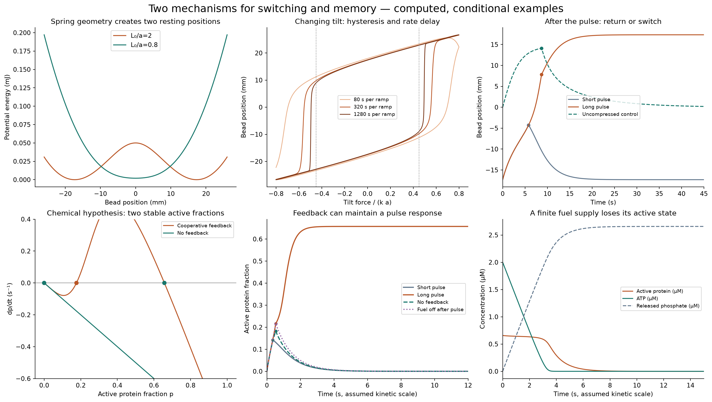
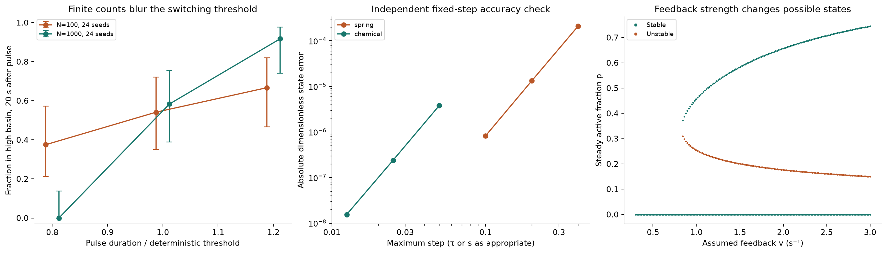

# Mechanisms, switching and memory

Completed numerical study in **Streams and Rocks**. The ideal spring follows the supplied bead-and-spring geometry; the biochemical model is an explicitly **uncalibrated hypothesis**. Neither assigns new reactions to CO, CO₂, water, fog, smoke, VOCs or H₂O₂.

**18 verification tests passed. 168 seeded finite-count simulations completed.**

## What was found

| Model | Completed result | What it means |
| --- | --- | --- |
| Compressed ideal spring | Resting positions at ±17.3205 mm; a selected tilt pulse switches sides above 7.25624 s | Geometry supplies the elastic force; this is one bead moving, not molecular repulsion. |
| Cooperative activation hypothesis | A 0.5 s⁻¹ stimulus crosses the basin boundary above 0.439032 s; sufficient stimulation leaves 65.7153% active with replenished fuel | A feedback rule can maintain activity after a pulse, under the assumed rates. |
| Controls | Removing feedback or stopping activation erases the response; an uncompressed spring returns to its central position | The proposed mechanisms are necessary for the corresponding effects in these selected models. |
| Finite chemical fuel | With 2 µM initial ATP and no replenishment, the initially high activity decays to near zero | Sustained activity needs a maintained reaction cycle in this model. |
| Count noise | The longer pulse leaves 16/24 runs high with 100 proteins and 22/24 with 1,000; no-feedback control: 0/24 | Random event counts blur the threshold. These are outcomes 20 s after the pulse, not lifetime estimates. |



## Read and reproduce

- [Illustrated HTML report](report.html): download and open in a browser; GitHub's file viewer displays HTML source.
- [Numerical results, parameters and every seed](results.json).
- [Saved deterministic trajectories](trajectories.npz).
- [Equations and simulation methods](models.py), [verification tests](test_models.py), and [actual test log](test_log.txt).
- [Full reproduction instructions](README.txt), [pinned dependencies](requirements.txt), and [sources](references.json).
- [Publication provenance](publication.json) and [file hashes](manifest.json).

Use Python 3.12 in a fresh environment, from this directory:

```text
python -m pip install -r requirements.txt
python -m unittest -v test_models.py
python run_study.py
```

The full runner repeats verification, deterministic cases, sensitivity calculations and all 168 seeded simulations, then rebuilds figures and the report. No network is used after dependency installation. The optional generated ZIP is ignored in Git because the individual files are already included.

## What was checked

The spring force matches the negative potential gradient. Analytic equilibria, fold locations and independent pulse-time quadrature agree with integration. Its energy accounting includes drag losses and work from changing the tilt. Independent fixed-step refinement reduces transient errors by approximately sixteen per step halving.

The chemical model keeps total protein fixed, respects nonnegative concentrations, agrees with an exact no-feedback solution, and balances activation/deactivation counts. A finite-fuel comparison also conserves adenylate and phosphate inventories. Random runs preserve integer protein counts and record their seeds; 95% Wilson intervals quantify finite-trial sampling, not uncertainty in the assumed kinetic constants.



## Assumptions and limits

Spring: a=10 mm, L₀=20 mm, k=1 N/m, mass=10 g and drag=2 N·s/m. Overdamped motion is modeled; inertia, dry friction, contact, spring buckling and thermal forcing are omitted.

Chemical hypothesis: total protein=1 µM; v=2 s⁻¹, d=1 s⁻¹, K=0.3 and Hill exponent n=4. These are selected effective rates, not measured enzyme constants or a validated elementary reaction mechanism. Protein and selected fuel inventories are checked; complete chemical free-energy, heat, atom and charge closure is not claimed. The rates do not establish a property of any original substance pair.

The supplied refuge/outbreak drawing is interpreted as a comparison of stability geometry; its missing equation was not reconstructed. The spring and chemical examples share analysis methods but are not physically coupled. This study does not propose a new Navier–Stokes law or resolve the existence and smoothness problem.

[Return to Streams and Rocks](../../README.md)
