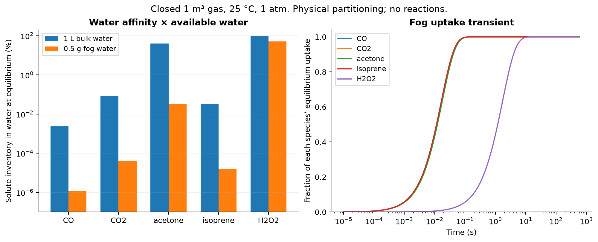
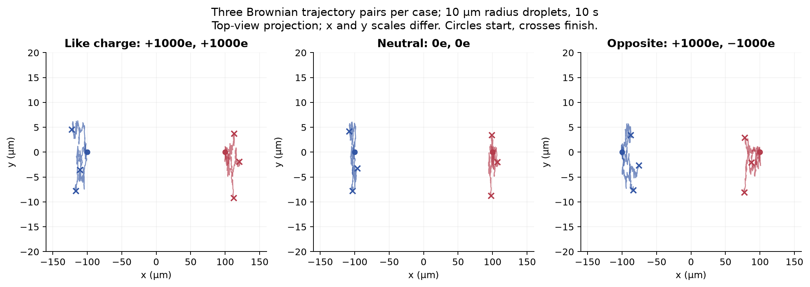

# Substance interactions and equation tests

Earlier completed work from the same research chat, now published in **Streams and Rocks**. This collection preserves the numerical data, figures, tests, conditions, references and explicit limitations. It complements [the switching and memory study](../mechanisms-switching-memory/README.md).

## Start reading

| Study | Completed checks | Open |
| --- | --- | --- |
| Substance interactions | 27 unit tests; 114 matrix rows with separate evidence statuses | [Illustrated report](research_report.html), [interaction matrix](interaction_matrix.csv), [reproduction guide](README.txt) |
| Five equations and gas/fog transport | 20 equation tests + 8 transport tests; 12 saved transport runs | [Equation study](equation_tests/README.md) |
| Stability, energy, forces and water-figure audit | 19 unit tests + 8 separate saved-data consistency checks | [Stability study](stability_tests/README.md) |

**74 unit tests and 8 data-consistency checks** belong to these earlier packages. The separately published switching study has its own 18 tests and 168 seeded runs. Numerical verification is not environmental or experimental validation.

GitHub renders this README and the figures below. Download the repository to open the HTML reports in a browser; the GitHub file viewer shows HTML source.

## What the substance study actually ran

The 114-row matrix covers CO, CO₂, liquid water, vapor, fog, mist, ice, smoke, air, nitrogen, oxygen, acetone, isoprene and hydrogen peroxide. Fog/mist are droplets in air, and smoke is a heterogeneous aerosol plus gases. The labels overlap; they are not fourteen independent thermodynamic phases.

The completed calculations include 21 gas/liquid partition cases; two carbonate equilibrium solves; a reduced CO + OH kinetic benchmark; conservative 2-D prescribed-flow transport and refinement; 7,680 Brownian charged/neutral particle-pair trajectories; 28 vapor/interface cases; nine acetone/ice adsorption cases; and analytic scavenging, agglomeration, freezing and melting comparisons. **Not every matrix row was simulated**: evidence statuses identify numerical runs, analytic results, literature assessments and unavailable surface rates.



At 25 °C and 1 atm in the specified closed 1 m³ gas/fog scenario containing 0.5 g liquid water, the calculated aqueous CO inventory at equilibrium is about 0.00000120% of total CO. This is weak physical dissolution, not conversion to CO₂. The separate unbuffered CO₂/bulk-water calculation gives pH 5.59465 under its stated inventory and alkalinity assumptions. These are scenario results, not drinking-water or exposure predictions.



Like-charge Coulomb motion is distinguished from neutral Brownian spreading and drag/transport. Opposite-charge cases stop before excluded near-contact physics becomes important. The chemical benchmark requires an explicit OH inventory and evaluated rate. No CO/water reaction is inferred from mixing. H₂O₂ catalytic decomposition remains a literature assessment, not a newly calibrated catalytic-rate simulation.

## Equations are supporting models with defined quantities

[Five equations](equation_tests/README.md) tests a limit cycle, Josephson/pendulum dynamics, clock alignment, saddle-node scaling and the harmonic oscillator. A constructed one-way coupling uses their signals to prescribe a divergence-free carrier flow. That transport benchmark preserves molecular identity and inventories; its chosen gains and timescales are not measured chemical or hardware connections.

[Stability and energy](stability_tests/README.md) adds nonlinear spirals, the corrected forward-time return map, population equilibria, conservative/damped dynamics, time reversal and direct gas-transfer/Coulomb checks. The water figures are reanalyses of bundled existing outputs; they are not new quantum chemistry or molecular-dynamics runs.

## Reproduce and inspect

Each package has its own pinned requirements and README.txt. Use Python 3.12 in a fresh environment. For the substance study, from this directory:

```text
python -m pip install -r requirements.txt
python -m unittest -v test_models.py
python run_study.py
python build_report.py
```

Use the separate instructions inside `equation_tests` and `stability_tests` for those supplements. Run them from their own directories so their local modules and logs resolve correctly. No network is required after dependency installation.

- [Saved numerical summary](results/summary.json), [configuration](config.json), [reference constants](references.json).
- [Publication verification](publication_verification.json), [publication record](publication.json), [original file hashes](source_hashes.json), [published file hashes](publication_manifest.json).
- Original test logs and numerical run logs are retained. Fresh publication-check logs are in `verification`.

All files are published individually. Duplicate ZIP bundles, installed environments and caches are omitted. The source manifest for the older water snapshot identifies its prior project; that is provenance, not this publication's destination.

## Limits

The carrier velocity is prescribed; these models do not solve a new Navier–Stokes law. Assumed geometry, diffusivities, transfer coefficients, sticking and surface laws remain explicit. Smoke is a surrogate where modeled. No complete atmospheric mechanism, collective charged cloud, turbulence, calibrated near-contact coalescence or general liquid-water quantum prediction is claimed. Calculations used no physical CO/smoke generation, vapor exposure or smell tests.

[Streams and Rocks](../../README.md) · [Switching and memory](../mechanisms-switching-memory/README.md)
