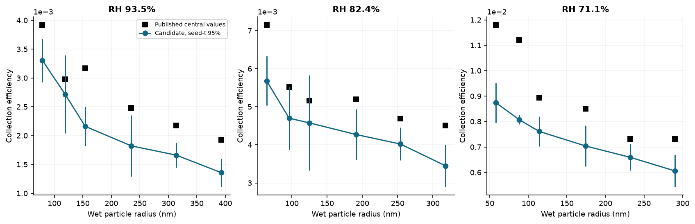
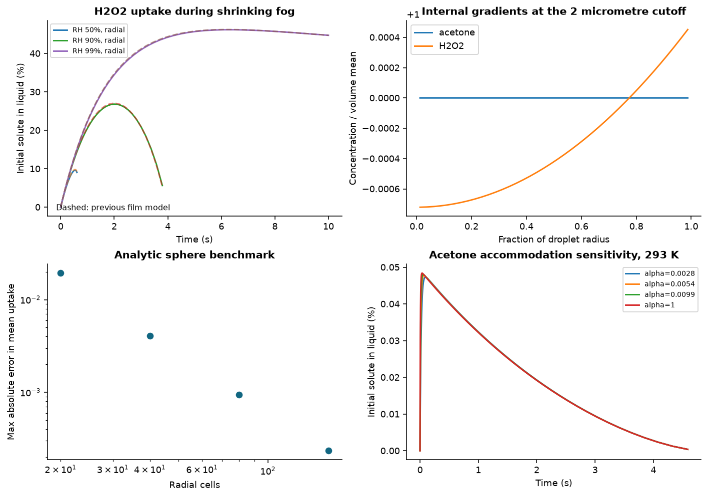
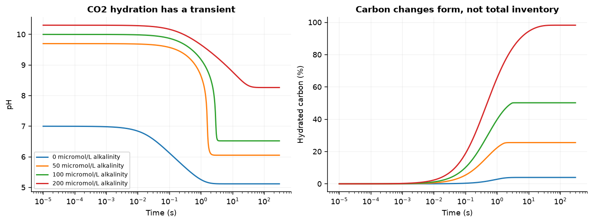
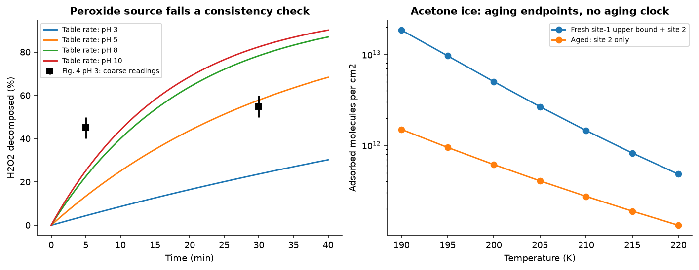
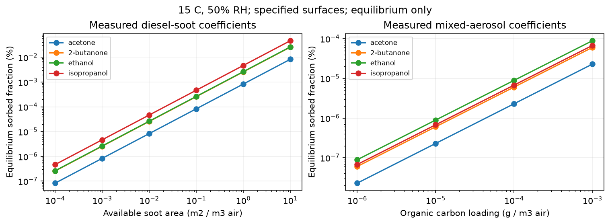
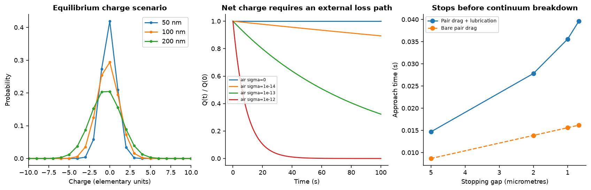

# Substance study: transport, kinetics and evidence audit

Completed computational batch • 13 October 2026 • Streams and Rocks / Nous Volition

**The falling-droplet candidate is substantially closer to the published collection data, and the new liquid-diffusion and carbonate solvers pass their numerical checks. Experimental validation remains incomplete.** This report separates completed calculations, measured input data and unresolved evidence across the six requested extensions.

Read the [methods and assumptions](METHODS.md), [source provenance](references.json), [six-item evidence register](evidence_gaps.csv), [saved-result verification](verification.json), or [previous study](https://github.com/NousVolition/Nous-Volition/tree/main/studies/substance-interactions). The original interaction matrix and equation appendix remain in the parent study.

## What ran

| Module | Completed calculations | Status |
| --- | --- | --- |
| Falling-droplet collection | 18 measured settings × 4 seeds × 4,096 paths; 12 controls × 4 seeds; separate 4,096-path low-Re pilot | Improved candidate; not validated for smoke |
| Evolving fog | 12 species/RH cases, 8 grid/analytic cases, 7 sensitivity cases | Conservative resolved diffusion; matched uptake/evaporation measurements still needed |
| CO₂ / carbonate | 4 alkalinities, 7 controls/sensitivities, 3 step checks | Published reversible rates; no independent transient-data comparison |
| H₂O₂ / MnO₂ | 4 specified-condition rate curves and 2 source-figure checks | Source consistency failed; conditional audit only |
| VOC surfaces and ice | 9 transcribed surface coefficients; 46 loading cases; 21 ice endpoint cases | Condition-specific equilibrium and ice endpoint models |
| Charge / near contact | 3 theoretical charge distributions, 7 relaxation scenarios, 4 positive-gap approach cases | No measured smoke charge distribution or collision/coalescence prediction |

**34 new unit tests passed** (28 transport/kinetics tests and 6 surface tests). Saved-result audits are reported separately. The substance-study collection now contains 137 unit tests across its three batches, plus 8 historical water-data checks; the older 103 unit tests and 8 water checks were not rerun in this batch. The 495,616 particle paths are model samples, not experimental observations.

## 1. Falling droplets: a large improvement with remaining model error

Against 18 sodium-fluorescein collection measurements at 71.1%, 82.4% and 93.5% RH, the candidate predicts 0.682–0.912 times the measured central values: approximately 8.8–31.8% low. Median multiplicative error is **1.213**, compared with 141.4 for the earlier diffusion-only closure. These observations were not fitted, but they already informed the decision to change the model; they are not untouched model-selection holdouts.

The model uses flow around a falling sphere, thermal/vapor-gradient forces, Brownian diffusion and finite-particle interception. The comparison uses the published droplet sizes and temperatures, assumed speed 0.25 m/s and pressure 101,325 Pa. Full measured settings are in [measured_collection.json](measured_collection.json); model constants are in [METHODS.md](METHODS.md).



Published central values and candidate estimates. Error bars cover four-seed sampling uncertainty only; measurement uncertainty is not included.

At the control setting, removing phoresis changes collection efficiency from 0.00540 to 0.00182. Halving the step changes the mean to 0.00499; the stochastic refinement is noise-limited. Overlapping intervals do not prove convergence. Wider injection and farther boundary controls are also saved in [capture_control_summary.csv](results/capture_control_summary.csv).

**Smoke validation remains open.** Reynolds numbers are about 1.8–1.9, outside the strict creeping-flow regime used here. Finite-Re flow, flow-distorted vapor/temperature fields, first-passage errors, aerosol material properties and sticking must be resolved. Crossing the absorbing interception boundary counts as capture by assumption, not demonstrated coalescence. [Source: Dépée et al., Part I](https://doi.org/10.5194/acp-21-6945-2021).

## 2. Liquid diffusion: resolved transport changes the fog prediction

At 298.15 K, initial radius 10 μm, liquid water content 0.5 g/m³, 1 atm and 90% RH, the droplet reaches the 2 μm cutoff at **3.797 s**. The resolved model leaves **5.638%** of the initial H₂O₂ inventory in liquid, versus **5.281%** in the old film approximation. Peak liquid uptake is 26.82%. This module models partition and diffusion, with no H₂O₂ reaction.

CO remains weakly dissolved: 9.77e-09% of its initial inventory remains in liquid at that cutoff. Maximum gas-plus-liquid inventory residual over the 12 main cases is 4.5e-13. Water thermal balance is quasisteady and externally maintained gas temperature is assumed; this is not a fully closed energy calculation.



Moving-shell uptake, small internal gradients at 90% RH, analytic sphere refinement and an acetone accommodation sensitivity. The +1 axis offset denotes concentrations close to a uniform mean.

The fixed-sphere benchmark approaches second-order grid convergence. For the moving H₂O₂ case, 40 versus 160 cells changes the final inventory fraction by about 7.1×10⁻⁸. Independent measurement validation is still absent: the recovered acetone uptake conditions use 10 kPa helium and suppressed evaporation, unlike these air/fog cases. A related water-profile repository contains simulations, not experimental traces. [Acetone uptake source](https://doi.org/10.1039/B313474A); [candidate evaporation measurements](https://doi.org/10.1021/acs.jpcb.2c08909).

## 3. CO₂ chemistry: alkalinity changes both the endpoint and the transient

A closed liquid starts with 0.2 mmol/L dissolved CO₂ at 25 °C. Reversible hydration/dehydration and hydroxide routes use published forward/reverse rates. Proton-transfer equilibria are resolved at each kinetic step at fixed alkalinity. There is no gas-transfer process in this separate module. CO and CO₂ are different chemical species.

| Alkalinity (mmol/L) | Initial pH | Final pH | Time to 95% of final hydrated pool (s) |
| --- | --- | --- | --- |
| 0.00 | 7.000 | 5.118 | 2.023 |
| 0.05 | 9.699 | 6.053 | 1.353 |
| 0.10 | 10.000 | 6.522 | 2.055 |
| 0.20 | 10.301 | 8.264 | 8.235 |



Published-rate CO₂ transients with specified alkalinity; hydrated carbon includes H₂CO₃, bicarbonate and carbonate, excluding CO₂(aq).

Carbon conservation residual is at most 2e-15. Detailed balance, an analytic fixed-pH limit, no-reaction controls and step refinement pass. Published rate inputs do not independently validate these calculated pH transients. Matching stopped-flow data, buffers/indicators and activities remain needed. [Wang et al. (2010)](https://doi.org/10.1021/jp909019u).

## 4. Specified peroxide catalyst: a failed source audit

The selected source specifies water/NaOH-washed Merck MnO₂, BET area 6.5 m²/g, loading 0.333 g/L, temperature 303.15 K, initial H₂O₂ 0.020 mol/L, dark stirred water and HCl/NH₄OH-adjusted pH. Four unambiguous aqueous Table 1 rates were tested at pH 3, 5, 8 and 10. Hydrogen/oxygen atom accounting and the analytic exponential agree numerically.

**The source does not pass its own table-versus-figure comparison.** At pH 3, the tabulated 0.009 min⁻¹ predicts 4.4% decomposition after 5 minutes, while a coarse Figure 4 reading is roughly 45% (±5 percentage points reading tolerance, not measurement uncertainty). The 30-minute comparison also disagrees. These curves are retained as an auditable rejected candidate, not an accepted decomposition prediction. Generic water and smoke still have no assigned catalytic rate. [Akhtar et al. (2012)](https://jcsp.org.pk/ArticleUpload/4144-20045-1-CE.pdf).



Left: conditional tabulated-rate curves fail the peroxide source check. Right: acetone on ice compares aging endpoints, not a calibrated aging timeline.

## 5. VOCs: material-specific data, with explicit temperature and aging limits

Nine measured partition-coefficient rows were recovered from [Roth et al. supporting Tables S2/S3](https://acs.figshare.com/articles/journal_contribution/3270178). At 15 °C and 50% RH, acetone K is **8.32e-06 m³/m²** on diesel soot and **0.000229 m³/g organic carbon** on mixed road-tunnel aerosol. The units represent different normalizations and cannot be compared as identical coefficients. Forty-six closed-inventory equilibrium scenarios were run; source log-error bounds are included in the CSV.



Equilibrium loading scenarios use measured coefficients on specified samples. Mixed road-tunnel aerosol is not treated as pure organic material.

The measured ethanol-soot coefficient at 70% RH is 0.759 times its 50% RH value. No extrapolation to other temperatures or arbitrary humidities is allowed by the code. Isopropanol is included as an additional measured species; it is not isoprene. Isoprene sorption rates and soot-aging laws remain unparameterized.

For acetone on vapor-deposited ice, the 190–220 K model compares a fresh-site upper bound with an aged endpoint retaining only the second site type. At 200 K and gas density 10¹⁰ molecules/cm³, the fresh upper-bound coverage is 8.18 times the aged coverage. There is no calibrated aging clock, no extrapolation to room temperature and no claim for all ice surfaces. [Behr et al. (2006)](https://doi.org/10.1021/jp0563742).

## 6. Charge and near contact: distinguish charge redistribution, loss and collision

The calculated bipolar charge distributions are theoretical scenarios for 50, 100 and 200 nm radii. They are not measured smoke histograms. Internal electrical relaxation redistributes charge within a droplet; it cannot by itself remove an isolated droplet’s net charge. Charge loss is calculated separately only when an external conducting ambient is specified.



Charge scenarios and a separate positive-gap hydrodynamic diagnostic. No actual contact or coalescence is simulated.

For two 10 μm immobilized spheres under a constant 1 pN inward test force, adding leading lubrication resistance increases the time to narrow a 10 μm gap to 1 μm from 0.01561 s to 0.03557 s, a factor of 2.28. The analytic quadrature agrees numerically. The additive drag interpolation is approximate; the smallest stop gap is 0.67 μm. This is neither a complete pair-mobility solution nor a near-contact electrostatic force model. Measured charges, ion attachment, polarization, rarefied lubrication and liquid-film rupture remain necessary before predicting coalescence. Collective electrostatics, buoyancy and turbulence remain separate work.

## Reproduce and inspect

Use Python 3.12. The recorded environment used Python 3.12.14, NumPy 2.5.3, SciPy 1.18.1 and Matplotlib 3.11.2. All inputs needed for these computations are packaged; no downloads or service calls occur in the simulations. Run from this directory:

```sh
python -m pip install -r requirements.txt
python test_advanced.py
python -m unittest surface_partition -v
python run_advanced.py
python surface_partition.py
python build_report.py
python verify_package.py --refresh-manifest
```

To inspect the delivered snapshot without rerunning the particle simulations, use `python verify_package.py`. The first long run saved all numerical results before a NumPy-boolean JSON serialization error; the repaired finalizer rebuilt its summary from the saved CSVs. [Original failure log](initial_serialization_failure.txt) and [successful finalization log](finalization_log.txt) are retained with machine paths removed. Input hashes identify the repaired driver used to finalize the package.

Numerical checks, literature parameters and agreement with experimental observations answer different questions. The open items are recorded in [evidence_gaps.csv](evidence_gaps.csv). No hazardous substances were generated, no exposure tests were proposed, and no new Navier–Stokes law is claimed.
