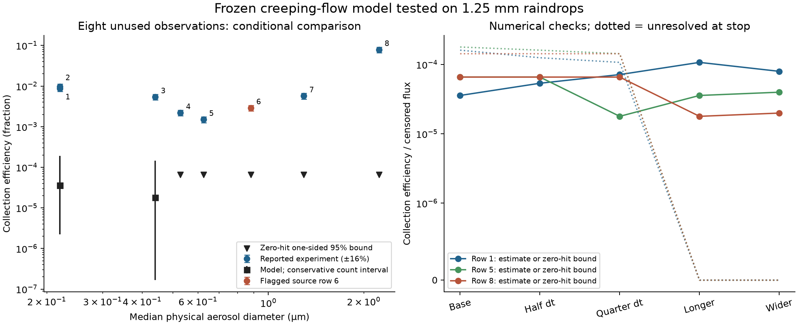
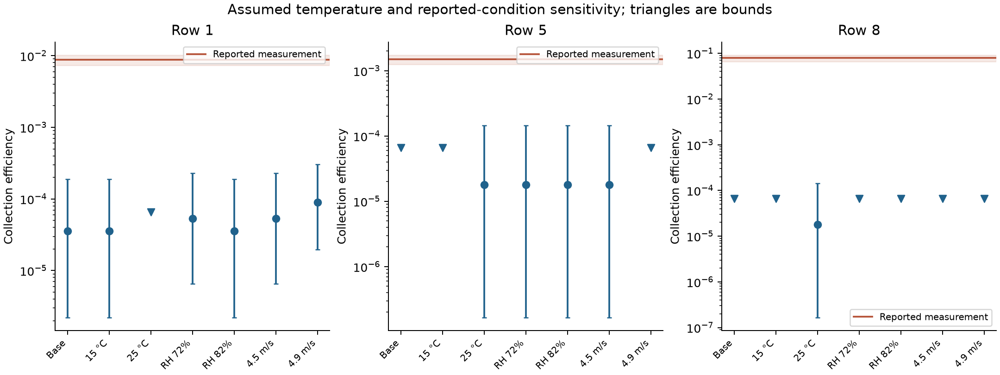

# Falling-droplet model: new measurements tested, validation remains open

15 October 2026. The unchanged model was run against **eight previously unused collection measurements** from [Lemaitre et al. (2017)](https://doi.org/10.5194/acp-17-4159-2017). These are conditional large-raindrop stress tests. No fully specified matched smoke-validation dataset was recovered.

The model was frozen before this continued literature search. None of its coefficients, forces or flow equations was changed to match these outcomes. A source and numerical decision record precedes the predictions in [continuation_protocol.json](continuation_protocol.json); the earlier [protocol.json](protocol.json) remains unchanged.

## Completed comparison

| Row | Physical diameter (µm) | Observed CE | Predicted CE | Zero-hit upper bound | Censored flux |
| --- | ---: | ---: | ---: | ---: | ---: |
| 1 | 0.22 | 0.0088 | 3.57e-05 | — | 0.000161 |
| 2 | 0.22 | 0.0097 | 3.57e-05 | — | 0.000161 |
| 3 | 0.44 | 0.0054 | 1.79e-05 | — | 0.000143 |
| 4 | 0.528 | 0.0022 | 0 | 6.58e-05 | 0.000179 |
| 5 | 0.6248 | 0.0015 | 0 | 6.58e-05 | 0.000179 |
| 6* | 0.88 | 0.0029 | 0 | 6.58e-05 | 0.000161 |
| 7 | 1.294 | 0.0057 | 0 | 6.58e-05 | 0.000197 |
| 8 | 2.235 | 0.079 | 0 | 6.58e-05 | 0.000143 |

*Row 6 has inconsistent source concentration entries; the reported efficiency agrees visually with the paper's figure. It remains visible but is excluded from the seven-row aggregate. The two smallest-size rows are replicate observations and share predictions. See [source audit](results/source_audit.csv) and [provenance](source_notes.md).

Nominal Reynolds number: **389.1**. Actual computation: **184 unique simulations, 901,120 particle paths**, across four seeds and 47 row/scenario records. Nominal unique-condition captures: **3**. Reported CE is a dimensionless fraction; multiply by 100 for percent.



The wider-domain checks also extend the stopping time from 250 to 1000 dimensionless units. At the nominal inputs, one time unit is A/U = 0.000133 s, so these stops are about 0.033 s and 0.133 s. The original dt0.025 corresponds to about 3.32 microseconds. Three representative size comparisons are:

| Row | Reported CE | Wider/longer estimate | Conservative sampling interval | Censored flux |
| --- | ---: | ---: | ---: | ---: |
| 1 | 0.0088 | 7.9662e-05 | [1.39e-05, 0.000266] | 0 |
| 5 | 0.0015 | 3.9831e-05 | [2.46e-06, 0.000189] | 0 |
| 8 | 0.079 | 1.9915e-05 | [1.85e-07, 0.000144] | 0 |

These point estimates still fall below the corresponding reported efficiencies. They are diagnostic discrepancies under the stated assumptions, not precise estimates of the true experimental error. Captures remain sparse; the model's exact rare-event rates are not demonstrated to be numerically converged.

Zero captured paths means the rare event was not resolved by that run, not that the true model rate is exactly zero. Downward triangles show one-sided 95% bounds for the sampled finite-time disk, using independent stratified paths and a conservative inlet-weight bound. They do not bound untested spatial tails or model error. Censored flux identifies trajectories still unresolved at the stopping time. Four-seed t intervals, measurement uncertainty and these bounds are different quantities.

The four seeds sometimes produce the same small capture count, making their t interval misleadingly narrow. A post-run reporting safeguard therefore adds conservative two-sided count bounds for every case in [sampling_bounds.csv](results/sampling_bounds.csv). They invert a Bernoulli exponential-moment bound, allow unequal probabilities across strata, and use bounds on inlet flux weights. These conservative intervals appear on nonzero model points in the comparison figure. The original seed intervals are retained for audit; this statistical addition does not change any trajectory or selected outcome.

The seven-row predicted/observed ratio range is 0 to 0.004062. A finite log-error score is not reported when zero point estimates make it undefined. Full values and all qualifications are in [scores.json](results/scores.json), [comparisons.csv](results/comparisons.csv), and [seed-level results](results/seeds.csv).

## What this establishes

The frozen model is being tested outside its physical approximation: 1.25 mm drops with wakes, compared with a prescribed creeping-flow sphere. It omits inertia, rear capture, deformation and electrostatics. It substitutes the measured median particle size for a distribution whose measured collection is mass-weighted. The source does not provide a numerical temperature for these rows; 20 C and 101325 Pa are explicit assumptions, and speed 4.7 m/s is read approximately from Figure 5. These mismatches preclude calling this a matched validation or attributing all disagreement to one missing mechanism.

The completed diagnostics halve and quarter the time step, extend integration time and enlarge the sampled domain at three sizes. They also switch off phoresis, Brownian motion or finite-particle interception separately. A zero-hit result repeated across time steps does not prove convergence of a rare-event rate. All results, including censored and unresolved cases, remain in the files.



The temperature scenarios (15/20/25 C) are assumptions, not measured confidence limits. RH72/77/82% and speeds4.5/4.7/4.9 m/s probe sensitivity without selecting a best-fitting setting. No tuning followed the outcomes.

The sensitivity plots show sampling intervals and the source's 16% measurement band. Differences between point estimates can reflect Monte Carlo variation; this small capture sample does not establish a temperature, humidity or speed trend.

## Search outcome and next missing evidence

The search recovered the 2017 numerical table and the 2020 full paper. The latter has nonzero drop charge in every collection-table row and lacks a numerical temperature tied to those rows; its separate PIV conditions must not be substituted. The 2014 paper reports many measurements graphically without a complete event table. Earlier cloud-drop datasets either influenced model development or use different materials/charges. Details and source hashes are in [source_notes.md](source_notes.md).

A definitive fresh validation still needs unused measurements with temperature, speed, humidity, particle-size distribution and charge specified, in the model's applicable regime. Extending the physical model to finite-Re flow and inertia would create a new version. These eight outcomes would then be development evidence, requiring another reserved dataset for that new version. This completed comparison does not establish universal smoke collection or a new fluid law.

## Reproduce

Use Python with the packages in [requirements.txt](requirements.txt), keeping this folder beside [advanced_tests](../advanced_tests). The runner verifies SHA256 of all three frozen model files and aborts if they changed.

```sh
python test_external.py
python run_external.py
python build_report.py
python verify_results.py
```

No new experiment, exposure, message to authors, physical parameter fitting or model revision was performed. [Execution notes](execution_notes.json) record an initial output-wrapper error and its repair. The raw papers remain at publisher links.
