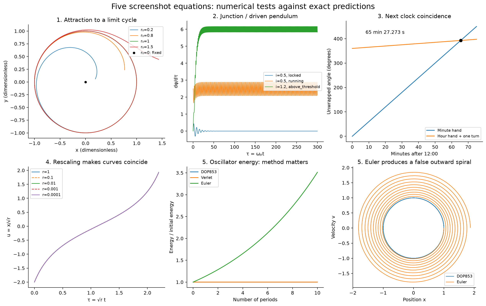
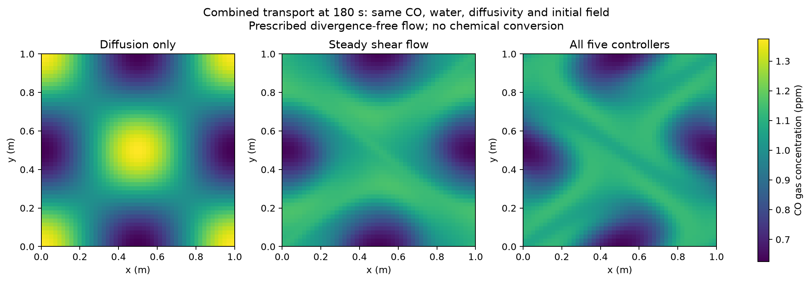

# Five equations and gas/fog transport

Completed earlier equation study: **20 equation checks, 8 coupled transport checks and 12 saved transport runs**. These belong to the substance-interaction research, separate from the later switching model.

[Open the illustrated report](report.html) · [Detailed reproduction instructions](README.txt) · [Substance study](../README.md)



The supplied examples cover the radial limit cycle, Josephson junction/damped pendulum, ideal clock alignment, saddle-node scaling and the harmonic oscillator. The oscillator comparison shows how an inaccurate method can create a false outward spiral. Explicit analytic comparisons distinguish that numerical error from actual dynamics.

The constructed combined example uses all five signals to control an imposed divergence-free flow carrying CO, acetone and H₂O₂ through fixed fog water. There is no modeled chemical conversion or electrostatic force in this supplement. Flow gains and signal timescales are chosen assumptions, not measured substance interactions.



At 180 s, the combined-flow CO variance is about 45.1% lower than the diffusion-only value in this selected setup. The flows are not energy-matched, and the 48→96-grid variance difference is about 2.75%; this is not a universal mixing benefit. Species inventory residuals are about 4.4×10⁻¹⁶ or smaller across these reported cases.

From this directory, after installing requirements:

```text
python -m unittest -v test_equations.py
python -m unittest -v combined_transport.CombinedTests
```

The full reproduction commands in README.txt also regenerate both required test logs, the transport runs and the report. [Numerical outcomes](results.json), [transport comparisons](combined_results.json), [concentration arrays](combined_fields.npz), [state trajectories](trajectories.npz), [references](references.json) and [hashes](manifest.json) are included. Optional generated ZIPs are omitted from Git.

[Stability and energy follow-up](../stability_tests/README.md) · [Switching and memory](../../mechanisms-switching-memory/README.md)
