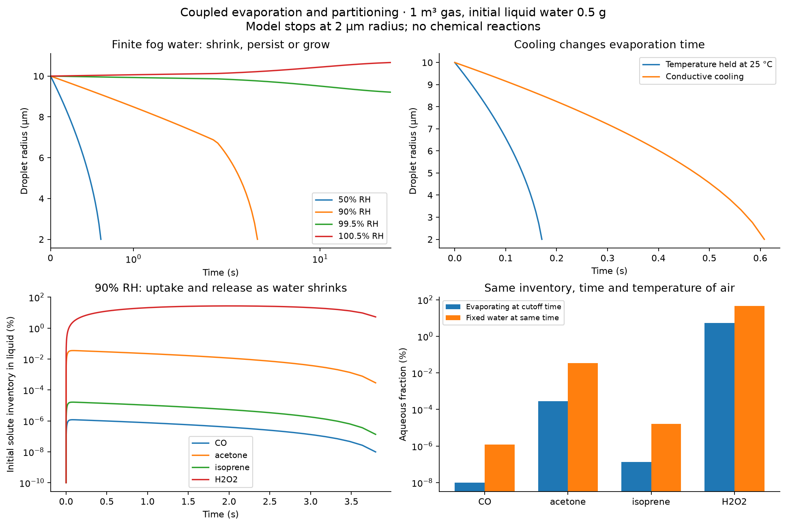
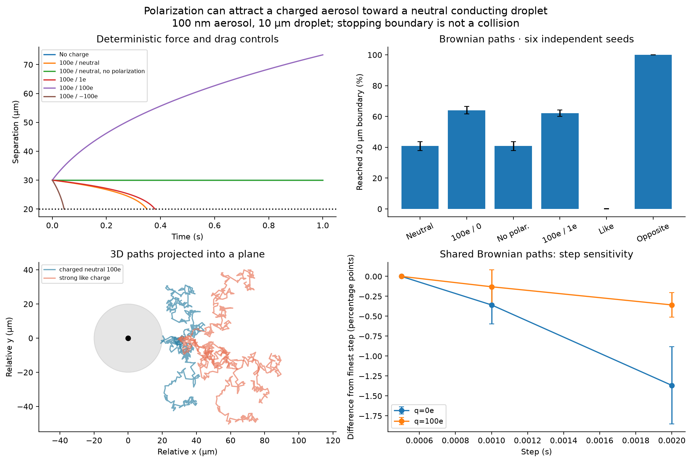
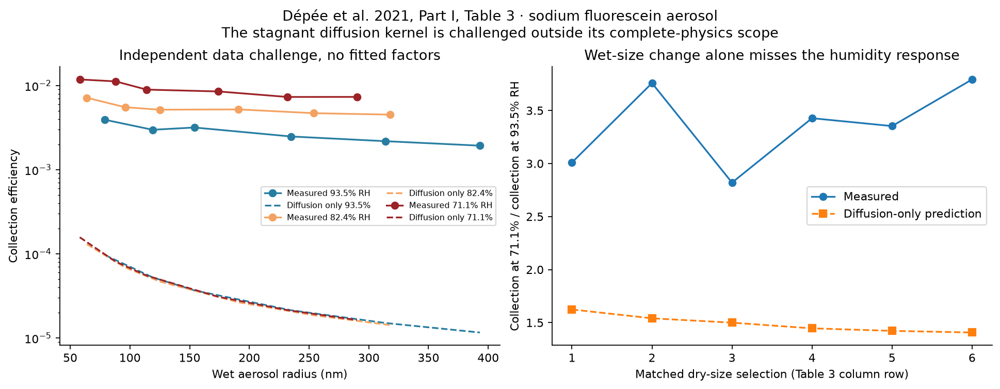

# Substance follow-up: evaporation, polarization and measured capture

Three previously open assumptions have now been tested. **29 new unit tests passed.** The batch completed 108 main fog scenarios, 28 further fog/control/refinement solves, 21,504 main Brownian paths, 18,432 paired refinement paths, 34 deterministic particle solves and a comparison with 18 published measurements. The refinement paths reuse random increments across steps; they are not independent replications of every comparison.

[Illustrated report](report.html) · [Methods and remaining gaps](METHODS.md) · [Family and community analogy](COMMUNITY.md) · [Numerical summary](results/summary.json) · [Updated interaction cases](interaction_updates.csv)

## Results that change how the original pilot should be read

**Evaporation changes gas retention.** At 25 °C, 90% initial RH, 0.5 g water in 1 m³ air and 10 µm initial radius, droplets reached the 2 µm model cutoff after 3.797 s. H₂O₂ uptake peaked at 27.03% of its initial inventory and fell to 5.28% at cutoff. Holding water volume fixed instead gave 45.87% at the same time. This is modeled absorption and release, with no chemical conversion. The remaining water is retained at cutoff; full drying is not modeled.

At 50% RH, allowing conductive cooling increased the time from 10 to 2 µm radius from 0.171 to 0.608 s. The liquid and gas share a closed water inventory; the gas temperature is externally maintained. The calculation uses a quasi-steady thermal balance and an assumed two-film solute transfer model.



**A neutral conducting droplet can attract a charged aerosol through polarization.** In the specified quiescent 25 °C scenario with a 100 nm aerosol and a 10 µm droplet, 64.10% of paths with a 100e aerosol charge reached the 20 µm separation boundary within 1 s, compared with 40.79% for neutral Brownian controls. Disabling polarization while keeping the droplet neutral exactly recovered the neutral result. These are outer encounters, not collisions or coalescence. Both objects being neutral still provides no electrostatic repulsion in this model.

The same-sign 100e/1e case was attracted at the initial separation because polarization exceeded its weak Coulomb repulsion; the 100e/100e case was repelled. Thus the sign of the net interaction depends on geometry and both terms, not just the sign of charge or a separating trajectory. The point-aerosol/conducting-sphere approximation is not a general two-droplet solution.



**The old diffusion-only capture kernel fails this published-data challenge.** The 18 sodium-fluorescein aerosol measurements exceed its predicted collection efficiency by factors 40.4–447.0 (median 141.4). All 18 remain above the tested sensitivity envelope. This directly rules out using that incomplete stagnant-kernel calculation as a quantitative description of this falling-droplet experiment. It does not invalidate diffusion itself, and the data are not universal smoke measurements.

The comparison uses [Dépée et al. (2021), Part I, Table 3](https://doi.org/10.5194/acp-21-6945-2021), including measured wet sizes and reported group conditions. No correction factor was fitted. Ventilation, phoretic effects, interception and inertia require a fuller model before a matched validation claim is justified.



## What still needs testing

- A fuller falling-droplet capture model against independent measurements, followed by composition-specific smoke tests using existing data.
- Resolved diffusion inside droplets and independent measurements of coupled evaporation and solute uptake.
- CO₂ hydration and carbonate reaction transients with stated alkalinity and validated rates.
- H₂O₂ decomposition with a specified catalyst, loading, pH and temperature.
- VOC adsorption on defined smoke/soot/organic and ice surfaces, including aging.
- Real charge distributions, charge relaxation, hydrodynamic coupling, near-contact collisions, coalescence and collective cloud behavior.

The [community guide](COMMUNITY.md) explains how Water, Fog, Mist, Gas, Smoke, Clay and Ice can represent family roles with their own contact, boundary and memory rules. That proposed family extension has not been run as part of these physical tests; the existing SIMS community studies are linked there.

## Numerical checks and reproducibility

The maximum main-sweep water-inventory residual was 2.15e-09 of initial liquid water; maximum solute inventory residual was 2e-15. Step/tolerance and Radau/BDF comparisons changed the final liquid inventory fractions by at most 1.46e-09 in the selected checks. Deterministic electrostatic potential plus drag dissipation had relative residual below 1.18e-09. Halving the Brownian step from 0.001 to 0.0005 s changed mean boundary-stop fractions by up to 0.358 percentage points in the selected paired ensembles.

Particle intervals in the tables are descriptive 95% Student-t intervals across six seed estimates. They are unbounded at rare-event extremes and can have zero width when all seed estimates coincide; they do not establish exact zero or unit population probabilities. Measurement sensitivity envelopes are assumed parameter ranges, not confidence intervals. Numerical verification and the capture-model failure are separate findings.

From this folder with Python 3.12 and the listed dependencies:

```text
python -m pip install -r requirements.txt
python -m unittest -v test_followup.py
python run_followup.py
python build_report.py
python verify_package.py --write-manifest
python verify_package.py
```

Before regeneration, `python verify_package.py` checks the delivered hashes. After an intentional rerun, `--write-manifest` records the new output hashes. The runner writes its own test log. To capture console output, run `python run_followup.py > run_log.txt 2>&1`. It overwrites this folder's generated numerical files. The completed run took 70.4 s on the recorded environment. No network is used after dependency installation. [Source references](references.json), [data transcription](measured_collection.json), [input hashes](results/input_hashes.json), [test log](test_log.txt), [all file hashes](manifest.json), [saved trajectories](results/trajectories.npz) and CSV results are included. Original substance-study results are retained separately.

[Earlier substance study](../README.md) · [Streams and Rocks](../../../README.md)
