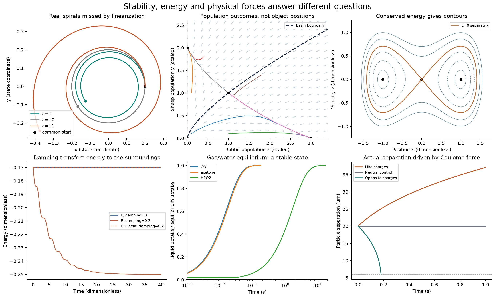
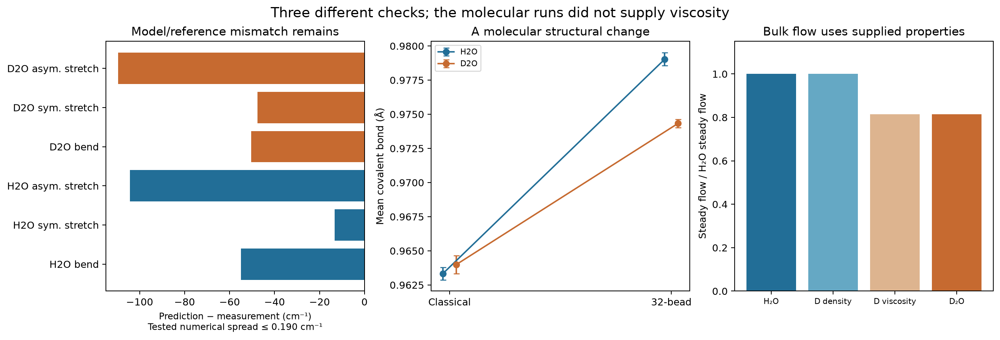

# Stability, energy, forces and the water-figure audit

Completed earlier follow-up: **19 verification tests plus 8 separate saved-data consistency checks**. [Read the illustrated report](report.html), [reproduce the calculations](README.txt), or [return to the substance study](../README.md).



The tests cover local linearization, genuine cubic spirals, the corrected forward-time return map, population equilibria, a chosen conservative potential, damping and time reversal. Direct physical audits check gas/water relaxation and Coulomb motion with drag. A spiral in state space does not by itself identify a force between substances.

The photographed return-map statement needs a domain/time-direction correction: its attracting circle attracts forward in time for positive initial radius; backward convergence is not general. The cubic example has real inward/outward spirals that its linear part cannot classify. These different examples are kept distinct.



The water section reanalyses bundled, hashed outputs from an existing H₂O/D₂O study. It checks frequency residuals, structural statistics, quality-screen counts and channel-flow identities. It does not rerun molecular or fluid trajectories. The molecular study did not validate bulk diffusion or compute viscosity; the continuum comparison uses independently supplied IAPWS material properties. Small numerical error does not repair an incorrect or incomplete physical model.

After installing requirements, run from this directory:

```text
python -m unittest -v test_stability.py
python audit_water_figures.py
```

The full README.txt explains log capture and report rebuilding. [Results](results.json), [water audit](water_figures_audit.json), [saved trajectories](trajectories.npz), [source snapshot](prior_water_data/source_manifest.json), [references](references.json) and [hashes](manifest.json) are included. Original numerical outputs remain unchanged; publication verification repeats the eight audit checks in a temporary copy.

[Five-equation tests](../equation_tests/README.md) · [Switching and memory](../../mechanisms-switching-memory/README.md)
